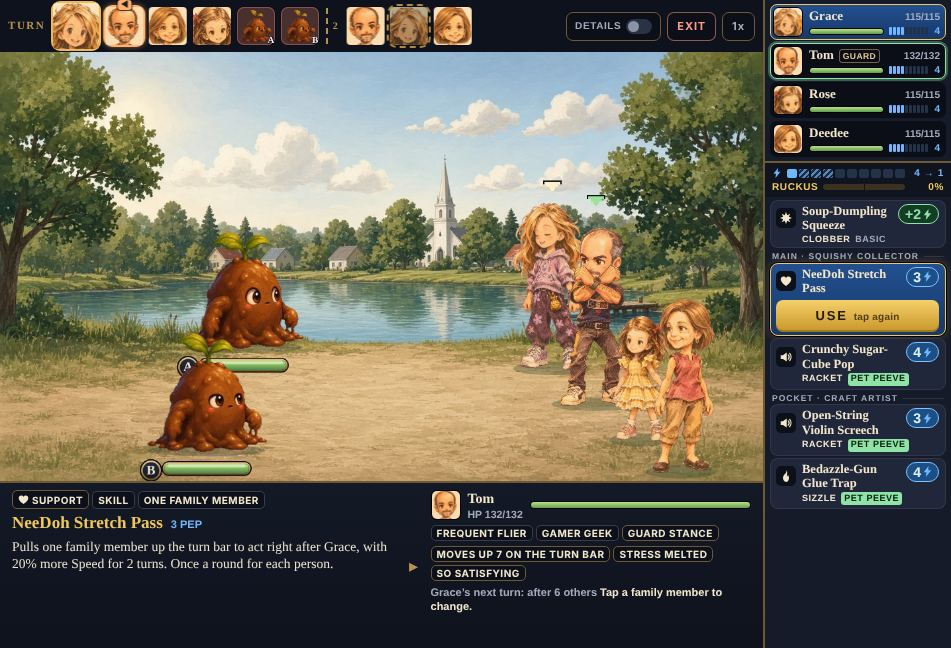
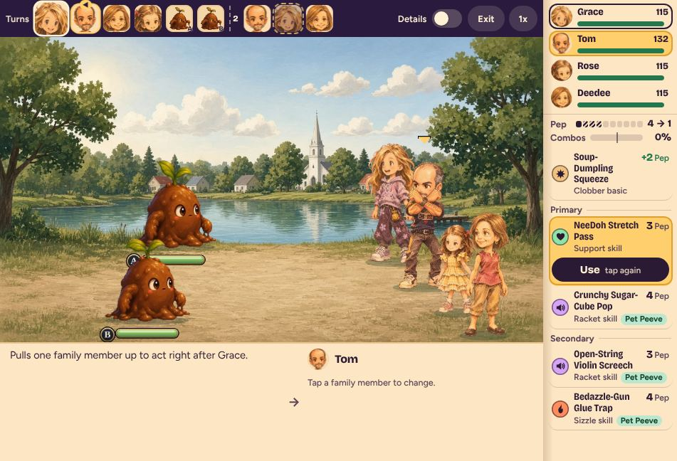
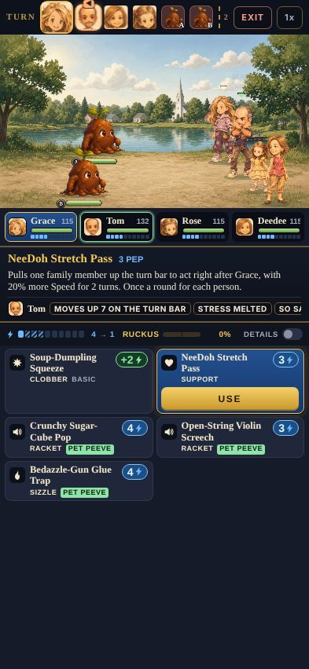
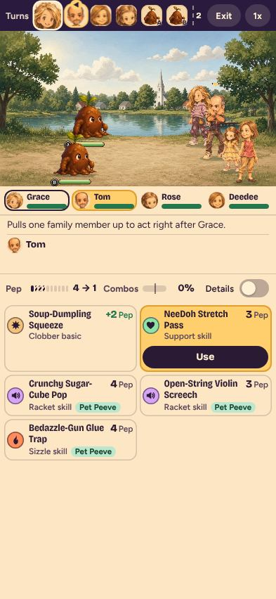

## justinbb9k (2026-11-25): Justin's Stud-Finder Beep and Knock is now a Wan 3.0 clip with one held prop (hammer), stud finder on the belt

Run bench-justinbb9-7 (WO-01H, $2.10 of $2.25, Wan 3.0 only): the new Direct-Hero start frame passed Gate 1 (head difference 0.0), 2 of 3 seeds passed the gate, seed 1 won (score 0.9439) and is baked into `pf-justin-bb-basic` (`?v=benchjustinbb97`). Strike frames checked by eye: one hammer, the stud finder stays on the belt, no floating or duplicate prop. One mid-swing frame of the raw video has faint grey whoosh streaks left of the hammer. The `justinbb9d` Mudling effects and shake are unchanged (WebKit stage test and Pass 1 review test pass). `scripts/matte_winner.py` now keeps keyed gaps between an arm and the body transparent after the clamp.

## justinbb9j (2026-11-25): WO-01H, one held prop (stud finder clipped on the belt), Justin start frame re-edited, Wan 3.0 only

Tom's order WO-01H ($2.25 hard cap): Justin holds only the claw hammer, the stud finder is clipped flat on his belt, the other hand is empty. The Hero-locked start frame is edited again with that rule (head and face stay the Hero's pixels), Gate 1 now asks the three new yes or no questions (stud finder on the belt, one hammer, other hand empty), and the Wan prompt is the one hammer swing and return. Run bench-justinbb9-7, 3 Wan 3.0 seeds, no Kling. The rule is written into CLAUDE.md. Locked thresholds untouched.

## justinbb9i (2026-11-25): WO-01G result, Wan 1 of 3 passed the gate but its winner has a floating duplicate stud finder, so it was not baked

Run bench-justinbb9-6 (Wan 3.0 only, $1.90): seed 2 passed Stage A and Stage B (15 of 18 judge votes), seeds 1 and 3 failed on a duplicate stud finder in the air. Looking at the baked frames of seed 2, a second yellow stud finder also floats ahead of the hammer in about four frames around the strike, which the judge missed, so the clip was NOT put in the game; the earlier clip stays. Also fixed in `scripts/matte_winner.py`: the birefnet video fallback paints the background black, so the "alpha" video had no transparency; `ensure_alpha` now makes the border-connected black (and big enclosed gaps) transparent. Gate thresholds and the lock file are untouched.

## justinbb9h (2026-11-25): WO-01G, separate hand zones and no drawn impact lines, Wan 3.0 only

Tom's order WO-01G ($2.00 hard cap): same Direct-Hero start frame, Wan 3.0 only. The prompt now holds the stud finder still at his side and swings the hammer once into empty air toward screen-left, with zero effects; the negative prompt bans sparks, impact lines, motion lines, starburst, flash and glow. Run bench-justinbb9-6. Locked thresholds untouched.

## justinbb9g (2026-11-25): WO-01F, one beat per move, same Direct-Hero start frame, Wan 3.0 only

Tom's order WO-01F ($2.00 hard cap): keep one clip per move, reuse the justinbb9f start frame (no picture is paid for again), and ask Wan for one physical beat (hold the stud finder steady, one hammer tap, settle). Run bench-justinbb9-5, Wan 3.0 only, 3 seeds. The Justin packet's pitch and expected action now describe the one beat; the stud finder beep stays the Battle Lab effect `vfx_red_stud_led_ping`. Locked thresholds untouched.

## justinbb9f (2026-11-25): the Hero-locked start frame now lines up with the Hero and joins at the neck

Card c-justinbb9. Run `bench-justinbb9-3` stopped at Gate 1 (spent $0.38, no video): the hand edit was kept, but it came back about 1 percent larger and shifted, so the band spliced into the Hero showed seams through the arms. Fix: `register_edit` aligns the edit to the Hero by matching the head, the edit owns everything below the chin with a feathered join at the neck (head, face and expression stay the Hero's own pixels, measured difference 0), and the magenta fringe is pulled out. Checked free on the stored edit: Gate 1 measured passes, no seam. The run's own cap now follows the trigger (it showed $5.00 before; the $2.00 was enforced only by a rule of mine). Re-run `bench-justinbb9-4`.

## justinbb9e (2026-11-25): Justin's start frame is the Hero's own pixels, and the re-run asks for the stud-finder scan and the hammer tap

Card c-justinbb9, work order WO-01E (cap $2.00, Wan 3.0 only, no Kling). Fact: the earlier start frame was redrawn by Gemini from text, so his face and proportions drifted from the Hero. Now `scripts/benchmark_run.py` cuts the Hero PNG out onto #808080 and Gemini edits only the hand band (50 to 76 percent of the figure's height); `lock_hero_pixels` keeps every other pixel from the Hero, and Gate 1 measures the head area against the Hero (mean difference at most 0.5) before any video is paid for. The Wan prompt has no style, height or proportion words and asks for both beats (stud finder glide, then one hammer tap). Justin's packet now holds the stud finder in one hand and the hammer in the other. If bria matting does not fit under the cap, the cheaper birefnet v2 video matte is used and booked at an estimate. The hit effects and Mudling shake fix from `justinbb9d` stays. Trigger `bench-justinbb9-3`.

Tests: `python3 tools/benchmark_run_test.py` (head lock, Gate 1 rejects a redrawn face, Wan-only seeds, no style words in the prompt).

## justinbb9d (2026-11-25): Justin's review clip no longer stalls on iPhone, and the hit effects land on the Mudling

Card c-justinbb9, work order WO-01D ($0.00, no paid call). Fact: the clip is a packed WebP atlas drawn as canvas frames, not a `<video>`, so no `hvc1` or `playsinline` change applies. Playwright WebKit (iPhone 14 profile) now runs here and shows the frames advancing, so the freeze was not reproduced; the fixes below remove the two costs that differ on a phone. (1) A pass-1 video frame no longer gets the outfit recolour (a `getImageData` pixel pass per frame, slow on Safari, and it could recolour hair and beard). (2) Every frame of the clip is made into a canvas before the clock starts (`bclipWarm`, `engine/clips.js`), so no picture is built mid-clip. (3) Real bug found: the effects were drawn beside Justin, not on the Mudling; they now draw on the first foe standing, 1.8x larger. (4) The hit shakes the Mudling (it only moved Justin before).

Tests: `python3 tools/justin_stages_test.py` now also checks 30+ different pictures play, and effect-coloured pixels on the Mudling at the impact (about 35 before, 5000 after); run it with `BROWSER=webkit` for the iPhone engine. Both pass in Chromium and WebKit.

## justinbb9c (2026-11-25): Justin's benchmark winner is what the review plays, with his video idle, slide, top layer and effects

Card c-justinbb9, work order WO-01C ($0.00, no paid call). Fact: the winner `wan3_s1` was already baked into `data/clips/pf-justin-bb-basic.js` by the benchmark run (`?v=benchjustinbb92`); the capture that showed the old clip was an older cached build. Fixed here: (1) Justin rests on his existing `battle_idle` video (`tools/clip-bake/bake_pass1_idle.py` makes the loop clip `pf_justin_idle` from `art-factory/staging/justin/battle_idle/raw_alpha.webm`; `bclipShowFrame` shows it for a member with a `pf_<who>_idle` clip, so no painted frame is drawn). (2) The meta lookup used the packet id with dashes while the clip key has underscores, so slide, hit-stop, shake and effects never fired; it now matches. (3) The move first slides out of the huddle for 350 ms, plays at native speed, and slides back; the sliding member is drawn on top of everyone. (4) Justin's cues include `vfx_red_stud_led_ping` with `vfx_core_clobber_impact`.

Tests: `python3 tools/justin_stages_test.py` (idle, slide, impact with effects, return, in portrait and landscape; frames in `tools/shots/justin-stage-*.png`), `python3 tools/pass1_review_test.py`.

## justinbb9b (2026-11-25): the benchmark trigger now finds its file with git, so the benchmark job starts

Card c-justinbb9. The first push of the trigger was skipped: the job condition on `head_commit.added` never matched. A `detect` job now lists the files of the push (`git diff HEAD~1 HEAD`) and the single clip and benchmark jobs wait on it. Run id is now `bench-justinbb9-2`; the skipped run spent nothing.

## justinbb9 (2026-11-25): Phase 1 benchmark started: Wan 3.0 and Kling v3 Pro, 3 seeds each, $5.00 cap

Card c-justinbb9. A push of `art-factory/benchmark-trigger.json` starts the `benchmark` job in `art-factory.yml` (`scripts/benchmark_run.py`): one Gate-1 start frame on #808080, 6 seeds, `qa_gate_v2` on every raw video, only the winner matted. Results are committed to `art-factory/benchmark/<run_id>/` (scorecard.json, alpha_checkerboard_8.png, or BLOCKER_REPORT.md).

## justinbb9a (2026-11-25): Battle animation pipeline lock, Hero-style prompts on #808080, gate v2, and the Battle Lab review extras

Card c-justinbb9. Tom replaced the green-screen plan with the Board order: Hero PNGs in `art-factory/refs/` are the only style authority, no green screen or chromakey, native 1.0x playback, three seeds per model, a $5.00 hard cap.

Lock: `CLAUDE.md` section Battle Animation Pipeline Lock, `art-factory/PIPELINE_LOCK.json`, `scripts/verify_lock.py` (Step 1 of every `art-factory.yml` job; it fails on a disallowed string, a changed lock or a weaker threshold).

Prompts: `characters.json`, `move-packets-pass1.json` and `scripts/art_director_agent.py` use the fine-ink colored-pencil style on `#808080` (`#5B6E8C` for grey or silver props). Justin's packet is the Kettlebell Rule version: prop held on frame 0, no walking, locked 3/4-left, three beats.

Gate: `scripts/qa_gate_v2.py` (Stage A measured, Stage B full-resolution vision with six booleans), `scripts/auto_trim.py` (hard cut, no crossfade), `scripts/matte_winner.py` (matte only the winner, alpha clamp, webm and hvc1 mp4, 8-frame checkerboard), `scripts/benchmark_run.py` (spend ledger under the cap).

Battle Lab: PASS-1 DRAFT REVIEW plays at 1.0x with approach and return slides, hit-stop, screen shake and code-drawn impact effects (`engine/pass1-vfx.js`, `data/pass1-meta.js` from `tools/clip-bake/pass1_meta.py`). Not done: a painted Hero or idle still in Justin's resting slot, because the no-painted-poses-in-battle rule forbids it; his idle will be a video.

Tests: `python3 tools/benchmark_run_test.py`, `python3 tools/pass1_review_test.py`, `python3 scripts/verify_lock.py`.

## justinpoc1a (2026-11-25): Justin's Stud-Finder Beep & Knock gets stricter draft rules, a two-stage QA gate and one 480p proof run

Card c-justinpoc1. Tom: fix the `battle_move_draft` prompt so the move reads at battle size, make cutout cleanliness alone never pass a clip, and run ONLY `pf-justin-bb-basic` at 480p with at most one retry (2 renders), no batch, the other 6 Pass-1 clips untouched.

Prompt: `scripts/art_director_agent.py` adds `battle_move_draft_rules` and negatives to every `battle_move_draft` prompt (planted feet and locked camera, props gripped and oversized from frame 1, ONE exaggerated leftward action, readable silhouette at about 200 px, banned: idle breathing, standing still, waist fidgeting, looking at camera, passive gestures). `justin-bb-basic` in `art-factory/move-packets-pass1.json` now has `expected_prop` (oversized yellow stud finder with flashing red LED in the off-hand, steel claw hammer in the striking hand, both from frame 1) and `expected_action` (feet planted, lean toward screen-left, one overhead-to-horizontal hammer slam while thrusting the stud finder); its wan prompt and pitch say the same, so the clip no longer "draws a hammer from his belt". The start frame already shows both props gripped, so it is unchanged.

Gate: `scripts/battle_move_gate.py`. Stage 1 (free): 10 frames of the cutout alpha, reject below 0.22 `peak_mask_churn`, below 0.12 `left_reach_ratio`, above 0.15 `foot_retreat_ratio`. Stage 2 (only if Stage 1 passed): 6-frame contact sheet cropped to the figure and scaled to 200 px tall, one vision call (the existing `qa_videos.QA_MODEL`), strict JSON; any of the 4 booleans false rejects in code, and so does `pass: false`. `scripts/qa_videos.py` runs the gate before its old 3-frame judge, so the old score alone can no longer pass a draft. Stage 1 and Stage 2 JSON go to `art-factory/qa-single-clip-<run_id>.json`, `qa-report-pass1-drafts.json`, the queue item and the packet.

Trigger: `.github/workflows/art-factory.yml` has a `push` trigger on `art-factory/single-clip-trigger.json` and a `single_clip` job that runs `scripts/single_clip_run.py` (Python only): clamps `max_retries` to 1, refuses anything but 480p and any move without a Pass-1 review slot, bakes a passing clip with `tools/clip-bake/bake_factory.py` at `duration_multiplier` 1.5 with a new `?v=` tag (so the phone's cache-first copy is replaced), and commits the clip and report to main. A move id may be `pf-justin-bb-basic` or `justin-bb-basic`. The old `generate` job now runs only on a manual dispatch.

Checked: Stage 1 on all 116 staged drafts (91 pass; the old Justin clip passes Stage 1 and would be caught by Stage 2, where it loses the props), Stage 2 with a mocked model (all four booleans, `pass: true` with one false boolean, invalid JSON), the contact sheet at 200 px, the new prompt (no banned words, rules present, only on `battle_move_draft`), the bake of `pf-justin-bb-basic` reproduces the slot byte for byte with only the `?v=` tag changed, `tools/workflow_check.py`, `tools/board_check.py`. Not checked: the paid fal render and the real Gemini call (they run in the Action).

## scriptstudio11 (2026-11-25): Script Studio: EP Note box for a one-run top-priority Writer instruction

Card c-scriptstudio11. Tom: a single-line EP Note input right next to Rewrite Unlocked. In `tools/script-studio/src/App.jsx`: the box sits directly after the Rewrite button. On Generate Scene, whatever is typed becomes the first line of the Pass 1 Writer prompt (and of every auto-fix rewrite in that run, so the fixes keep honoring it); on Rewrite Unlocked (or Rewrite N Flagged) it is the first line of the surgical rewrite prompt. The text is marked as a top-priority instruction from the Executive Producer that overrides defaults, craft rules and style notes. The box is cleared when the run ends (also when it errors). The formatter and the Critic do not get the note. Generate Chapter and Fix Remaining Issues do not use it and do not clear it.

Checked: new `tools/script-studio/epnote_test.py` (9 checks, mocked Gemini): box next to the button, note is the first line of the Writer, auto-fix and surgical prompts, absent from formatter and critic, absent when empty, cleared after both runs. `qa_test.py`, `audit_test.py`, `e2e_test.py`, `read_test.py` pass. Row added to `tools/night/tests.json`. Not checked: real Gemini obeying the note.

## scriptstudio10 (2026-11-25): Script Studio: leaner writer rules and a stricter, calibrated Critic

Card c-scriptstudio10. Tom: dialogue was bloated and unfocused and scores were too generous. In `tools/script-studio/src/App.jsx`, `WRITER_CRAFT_RULES` (used by Pass 1 and the Pass 4 rewrite) now says: lean pacing (plot and task information in the fewest lines; never stretch a handoff or prop beat like borrowing a pencil into a back-and-forth; one sharp one-liner then move on); natural spoken English only (no invented shorthand that needs decoding, with "Knees, Tata, knees!" and "Mind the hair on takeoff" as the examples to avoid); no meta-jargon or recycled crutches (no "side quest", no repeated travel or aviation puns, nicknames like "Cozy Rosie" used rarely) and characters never narrate the scene title. The Critic prompt has a SCORE CALIBRATION block: cap the score at 6.5 or lower for (a) padded back-and-forth on a mundane beat, (b) awkward phrasing that makes the reader pause, (c) sitcom tropes or meta-jargon, (d) a character narrating the scene title; flag each as an issue; award 8 or higher only when the scene is lean, clear on first read and sharp. The 8/10 strict pass bar is unchanged.

Checked: `qa_test.py` now asserts every phrase above is in the Pass 1, rewrite and Critic prompts (all pass), plus `audit_test.py`, `e2e_test.py`, `read_test.py`. Not checked: whether real Gemini actually writes leaner dialogue or scores lower; that needs a real run.

## pass1review1 (2026-11-25): PASS-1 DRAFT REVIEW in the Battle Lab, and the seven drafts play 1.5 times longer

Card c-pass1review1, PR 17. Tom: "Add a PASS-1 DRAFT REVIEW preset under ADMIN > BATTLE LAB > TESTS AND REVIEWS (similar to CHAPTER 1 REVIEW) with direct PLAY buttons for all 7 wired Pass-1 clips ... Make the playback duration of those 7 baked clips 1.5x longer so the actions read clearly at both 1x and 2x battle speed."

Review: a new Battle Lab fight PASS-1 DRAFT REVIEW (`data/battle2-data.js`, first Lab page, right after the two chapter 1 reviews) puts Grace, TNB, Amy, Justin and Deedee on the field against one Mudling and opens the review panel of `engine/clip-review.js` with the seven clips (the Lab row's `reviewClips`, passed by `b2Lab` to `crvOpen`): PLAY plays one on its owner, PLAY ALL plays all seven in order. The drafts are Art Factory videos, not Art Library entries, so their rows have no REDO (a note goes through the board card instead). Battle 2 had spots for at most four on the field; `BATTLE_POS5` (`engine/battle-state.js`) is the five-person spot table, used only when a fight has five (only this review). `tools/battle_lab_index.js` loads `data/bt-tables.js` first again (it stopped running when the stat tables moved there) and `data/battle-lab-index.json` is rewritten.

Slower: `bake_factory.py` divides each clip's speed by `SLOW = 1.5` and the seven were rebaked from the same videos (a rebake with no change first reproduced the repo files byte for byte). Pictures unchanged; only the timing: Grace's Dumpling and Deedee's Dust Tsunami 3.76 s to 5.64 s, TNB's Amphora 3.60 s to 5.40 s, Center the Bowl and Burpee Blitz 3.20 s to 4.80 s, Kettlebell Swing and Stud-Finder 3.33 s to 5.00 s. In a fight the move waits on its clip, so the hit lands 1.5 times later too.

Checked: new `tools/pass1_review_test.py` (R1 the fight is on the first Lab page, R2 seven rows each ready with no REDO, R3 PLAY ALL draws every clip on its owner, first to last picture, in order, R4 each clip lasts its frames at speed / 1.5, no console errors), portrait and landscape, all pass; I looked at `tools/shots/pass1review-<layout>.png` (all five stand on the field, the panel at the bottom or right). `tools/pass1_preview_test.py` and `tools/clip_review_test.py` pass. Not checked: the phone. Theme: Battle Animations.

## scriptstudio9 (2026-11-25): Script Studio: "Tata" is the on-screen spelling (rule was inverted), Read Mode badges conditional branches

Card c-scriptstudio9. Tom: the earlier rule had the spelling backwards. Canon now says Tom's nickname is ALWAYS "Tata" (no hyphen) in all on-screen dialogue and text; hyphenated "Ta-Ta" or "Tah Tah" is for ElevenLabs TTS pronunciation only and never appears in on-screen script dialogue. Changed the line in `docs/CANON.md` and `claude/comedy-bible.md`, then ran `tools/script-studio/sync_vault.py` so `script-studio/reference-vault/canon-and-characters.md` and `comedy-bible.md` match (only those two lines changed). In `tools/script-studio/src/App.jsx` the TATA linter check now flags "Ta-Ta" (any case) in dialogue and says to use "Tata"; it no longer flags "Tata"; the writer prompts say the same. Read Mode: an action line that opens a conditional ("If the party loses, ...", also When, Whenever, Should, Unless, Otherwise, In case) is indented with an amber side rule and a badge such as [IF PARTY LOSES], so it no longer reads as happening right before the victory lines.

Checked: `qa_test.py` (fixtures flipped: the linter error is now "Ta-Ta"), `read_test.py` (badge text and indent), `audit_test.py`, `e2e_test.py` all pass. Not done: scenes already saved with "Ta-Ta" are not rewritten (run Fix Remaining Issues or regenerate); `docs/VOICE.md` still describes the TTS spelling, which is correct. Game files were not searched for on-screen "Ta-Ta".

## pass1draft1 (2026-11-25): Seven Art Factory draft videos play as previews in the new battle

Card c-pass1draft1, issue 16. Tom: "bake the 15 passing 480p battle_move_draft clips into data/clips/<id>.js and wire them into Battle 3 (data/b3-kit-<id>.js) as a playable preview so I can test them in Battle Lab today." New tool `tools/clip-bake/bake_factory.py`: it decodes each draft's cut-out video (`art-factory/staging/<owner>/battle_move_draft_<packet>/raw_alpha.webm`, VP9 with alpha; `battle_alpha.webm` decodes on grey, so it is not used), lays it on flat magenta, finds START and END the clipmarks way and HIT as the picture that reaches farthest left, bakes it with `bake_clip.py` (every 3rd picture of 30 fps, figure rows from `tools/guidegen/figrows.json`) and wires the kit row with `wanbake.wire`. Clip ids are `pf-<packet>` (game key `pf_<packet>`), so the 1080p finals can replace them by the same tool.

Wired (7): Grace Colossal Diamond-Gold Dumpling (`pf_grace_sc_cap`), TNB Center the Bowl (`pf_tnb_cer_s1`) and Grand Amphora Masterpiece (`pf_tnb_cer_cap`), Amy Kettlebell Swing (`pf_amy_fq_basic`) and Burpee Blitz (`pf_amy_fq_s1`), Justin Stud-Finder Beep & Knock (`pf_justin_bb_basic`), Deedee Fifty-Year Dust Tsunami (`pf_deedee_nf_cap`). Each of these played the default animation before; nothing painted is drawn for anyone.

Not wired (8 of the 15), my calls: Tom Zone One Blockade (`tom-ff-s1`), Suite Door Slide (`tom-ff-s2`) and Grace Crunchy Sugar-Cube Pop (`grace-sc-s2`) already play a video (`tom_blockade`, the staged `tom_suitedoor` row in data/b3-stage.js, `grace_cubepop`), and a 480p draft does not replace a video in the game; Double Team for Tom and for Grace and Full Family Ruckus (`univ-*`) have no animation slot in Battle 3 (a team-up plays each member's own Skill); Deedee's Wet-Floor and Boppy's "Nobody Gets Past Me!" counter clips (`*_counter`) are reactions, and Battle 3 has no hook that plays a clip for a counter or a slip yet. Those wait on card c-pass1final.

Checked: new `tools/pass1_preview_test.py` opens each move with the Battle Guide's See it in a fight link (`index.html?go=new&i=<fight>&move=<skill>`), and the owner opens the fight with it: P1 row names the clip, P2 the picture loads, P3 the fight plays the clip on the mover, P4 no console error or failed request. All 7 pass; I looked at the strips (`tools/shots/pass1-<move>.png`) and the contact sheets of every clip. Not checked: the phone; whether the hit lands at the right moment for each move (Tom judges the look). Theme: Battle Animations.

## scriptstudio8 (2026-11-25): Script Studio: Read Mode for reviewing scripts without editing controls

Card c-scriptstudio8. Tom asked for a distraction-free way to read scripts. Added in `tools/script-studio/src/App.jsx`: an Edit Mode | Read Mode toggle in the header; Read Mode replaces the Scene Studio screen with a centered screenplay page (no sidebars, dropdowns, sliders, flag pills, note boxes or line controls); a Current Scene | Full Chapter switch (Current Scene has previous and next scene arrows; Full Chapter scrolls every scene continuously); action lines are italic muted prose with no "Narrator" label; dialogue shows a bold uppercase speaker name, a mood in parentheses only when it is not "none", then the spoken line; each scene header shows title, scene id and location with a small QA pill ("QA: 9/10", green when passed, amber when not) that expands the QA notes when clicked; clicking any line (a pencil shows on hover) switches back to Edit Mode, selects that scene and scrolls to that line.

Checked: new `tools/script-studio/read_test.py` (16 checks, no Gemini calls) covers the toggle, hidden controls, no Narrator label, mood rule, pill collapsed then expanded, Full Chapter with two scenes, and click-to-edit landing on the right line in the second scene, in view. I looked at the screenshot. Not checked: phone width. Row added to `tools/night/tests.json`.

## scriptstudio7 (2026-11-25): Script Studio: strict QA bar, Gemini 4 Carbon for generation, 4 retries, Generate Chapter

Card c-scriptstudio7. Tom: enforce a strict bar while running hands-free over a whole chapter. Done in `tools/script-studio/src/App.jsx`: (1) a scene passes ONLY with score 8 or more, 0 linter errors and no high-severity Logic, Canon, Voice or KnowledgeGate issue (the Critic now rates each issue high, medium or low; `isBlockingIssue`; the threshold is not lowered); the badge and Fix Remaining Issues button follow `qa.passed`. (2) The default Generation model is Gemini 4 Carbon; saved settings on Neon move to Carbon once (`genCarbonMigrated`), a later deliberate Neon choice is kept. (3) Pass 4 retries up to 4 times and stops early after 2 retries in a row that do not beat the best score (`QA_STALL_LIMIT`). (4) A Generate Chapter button at the top of the active chapter runs the whole pipeline on every empty scene in order, shows "Scene 3/12: ch1Amy - Auto-fixing issues (retry 2/4)...", saves each scene as it finishes, can be stopped after the current scene, skips the next scenes if two scenes in a row error. (5) A summary banner says how many scenes passed and lists ONLY the scene ids that failed the strict bar (an error is marked "(error)").

Checked: `qa_test.py` (70 checks, mocked Gemini): 9/10 with a high Voice issue fails, high Comedy or medium Voice passes, clean 7/10 fails, improving scores use all 4 retries, 6-7-7-7 stops after 3, a pass on retry 3 stops there, Generate Chapter on 4 scenes (one filled, one that never passes) drafts only the 3 empty ones, saves scene A before scene C finishes and lists only ch1_c. Test seeding now uses an init script (the old reload race made runs flaky). `audit_test.py` and `e2e_test.py` pass. Not run: real Gemini output; the model ids are unverified.

## scriptstudio6 (2026-11-25): Script Studio: Fix Remaining Issues and Pass 4 now really rewrite Critic-flagged lines

Card c-scriptstudio6. Tom (ch1Goal): Fix Remaining Issues changed only "Tata" to "Ta-Ta" and left every Critic-flagged line word for word, so the next QA run flagged the same 7 lines. Cause, found by reading the code: the plumbing was correct (the saved Critic issues and the linter errors both reached the prompt and the new lines were written to the scene), but (a) nothing made a flagged line change: my earlier wording told the writer to preserve passing lines and to use a beat's exact quoted words or leave them out, which made returning flagged lines untouched the safe move; and (b) the keep-best comparison ranked linter error count before the Critic score, so a rewrite that fixed Critic issues could lose to the old draft over one extra mechanical linter error (both in the Pass 4 loop and in the fix pass). Fixes: the Pass 4 and fix prompt now says every flagged line (linter or Showrunner) MUST come back with new text and that a Showrunner FIX is a direction, not wording; after each rewrite the code checks the Critic-flagged lines and, if any came back word for word, makes one forced redo that names them (`rewriteScene`); the comparison is now `qualityRank` (a usable critic verdict, then the higher score, then fewer total problems), so a rewrite is only discarded when it is strictly worse, and the badge says when that happens. Beat wording: the writer rules (Pass 1 and Pass 4) now say beats are plot facts, to invent fresh comedic dialogue for each beat and never swap synonyms on quoted beat text (this replaces "use the exact words or leave it out"); the Critic is told not to flag a line for differing from a beat's wording and to flag beat lines only when the dialogue is a flat, unfunny paraphrase or the plot fact is missing or wrong.

Checked: `python3 tools/script-studio/qa_test.py` has two new seeded cases built on a scene with a saved badge (score 6, two Critic issues, one linter error): a model that fixes only the linter error gets the forced redo and the two flagged lines are replaced in the scene (old text gone, the full issue and linter lists in the prompt, badge 9/10 with 3 auto-fixes); a rewrite scoring 7 with one more linter error than before is kept, not reverted. `audit_test.py` and `e2e_test.py` pass. Not run: the new cases against the old code (they cannot pass there by construction, the first needs the redo and the second needs the new comparison); real Gemini output. One real risk remains: the forced redo is a single extra attempt, so a model that refuses twice still leaves the line unchanged and the badge keeps listing it.

## scriptstudio5 (2026-11-25): Script Studio QA loop: Fix Remaining Issues button, Ta-Ta spelling check, sharper writer rules

Card c-scriptstudio5. (1) The QA badge has a Fix Remaining Issues button whenever a scene finishes under 8/10 (`runFixPass` in `tools/script-studio/src/App.jsx`): one more surgical rewrite of the scene as it stands, using the Critic issues saved on the badge (`qa.issues`) plus a fresh linter run on the current lines, then a new QA check; no new draft. The result updates the score, notes and auto-fix count, and the scene's History keeps the version before it. If the fix pass leaves the scene worse (more linter errors, or a lower score), the previous version is kept and the badge says so. (2) New linter check TATA (also shown as a line warning in the editor): "Tata" in dialogue, any case, is an error that says to write "Ta-Ta" (canon-and-characters.md). The writer rules now say it too. (3) Pass 1 and Pass 4 prompts share one rule block: mandatory beats are plot facts only; a beat's quoted dialogue is never thesaurus-paraphrased (use the exact words or leave the quote out); character-sheet trivia such as visitor lanyards or SkyMiles is never shoehorned in unless it fits the immediate conversation. The Critic now also flags shoehorned trivia. Pass 4 is surgical: it is told the flagged line numbers, must keep every passing line word for word, and may change only flagged lines plus neighbours needed for logic. Pass 4 and the fix button use one prompt builder, so they cannot drift apart.

Checked: `python3 tools/script-studio/qa_test.py` (new cases: Tata flagged and sent to the rewrite, both prompts carry the rules, the Pass 4 prompt names the flagged lines and says to preserve passing lines, the button is absent on a passed scene and present under 8, a fix after two failed retries sends the saved Critic issue and reaches 9/10 with 3 auto-fixes and no new draft), `audit_test.py` and `e2e_test.py` all pass. Not tested: the "kept the previous version" path, and real Gemini output (whether the model actually leaves passing lines untouched is for Tom to judge; the prompt asks for it but nothing in code forces it).

## scriptstudio4 (2026-11-24): Script Studio audits upgraded (chapter coherence report card, cross-chapter tie-in ledger) and Gemini 4 model presets

Card c-scriptstudio4. Model presets: gemini-4-neon (Generation default), gemini-4-carbon (Audit and Critic default) and gemini-4-hydrogen (fast and budget) replace gemini-2.5-pro; the flash, flash-lite, 2.0 and custom presets stay. A saved session or imported project that still says gemini-2.5-pro moves to neon (generation) and carbon (audit) on load. Chapter Coherence Audit (`auditReports.storyline`, per chapter): sends the active chapter's scenes, beats, knowledge gates and scripts plus story-thread.md and canon-and-characters.md to the Audit Model at temperature 0.2 and grades Mythology Alignment, Internal Cause and Effect, Tie-In Value and Knowledge Gate (each PASS, WARN or FAIL with a 1 to 10 score), then an overall badge, a 1 to 10 Coherence Score and a fix list of exact Scene IDs with "What feels random or broken" and "Concrete fix" (click to jump to the line). The badge is never kinder than the checks: a WARN or FAIL check, a score under 8 (WARN) or under 5 (FAIL), or a high severity issue lowers it. Cross-Chapter Tie-In Audit (`auditReports.trajectory.all`): reads every chapter that has scenes, plus story-thread.md for the unbuilt ones and canon, at 0.2, and reports the escalation curve of the frozen object for chapters 1 to 11, a setup and payoff ledger (PAID_OFF, OPEN, DANGLING, UNEARNED, with a fix for the last two) and cross-chapter contradictions (coast, party roster, boss and block rules, other), each jumping to its scene. The old per-chapter trajectory (pacing, comedy rhythm, beat coverage, segues) is replaced; reports saved in the old shape are ignored and need a re-run.

Checked: `python3 tools/script-studio/audit_test.py` (new, Gemini mocked: preset list and migration, temperature 0.2 on the Audit model, what each audit sends and leaves out, report card and ledger rendering, badge raised by findings, contradiction jump) all pass; `qa_test.py` and `e2e_test.py` still pass. Not tested: real Gemini output. The model ids gemini-4-neon, gemini-4-carbon and gemini-4-hydrogen are as Tom named them; I could not verify them against Google's API from here, so a first run with his key will show if an id is wrong (Custom Model ID is the fallback).

## scriptstudio3 (2026-11-24): Script Studio's Generate Scene now drafts, checks and fixes its own dialogue before showing it

Card c-scriptstudio3. The one Generate Scene button runs four passes: (1) a plain-text comedy draft (temperature 0.85, no JSON) from comedy-bible.md, only the dossiers of the scene's required speakers (cast table rows, canon bullets and comedy-engine sections), the mandatory beats, knowledge gate and director notes (battle-spec, bestiary and map-spec are added only when a combat encounter is set); (2) a JSON formatter (0.1) that also splits quoted speech out of action lines; (3) a QA gate: a client-side linter (em dashes, contractions in dialogue, quoted speech in action lines, the chapter's banned words plus Tombo, Marlowe, Little Elsewhere, rhubarb crisp, amber, Tommy and Rosie without Cozy, seven AI comedy cliches, TNB exclamation marks and ALL-CAPS, and the engine's overflow, Nara and mood rules) and the configured Audit Model as a Showrunner critic (0.2, strict JSON, fails under 8 or on any nonsensical, out-of-character, cheesy or wrongly owned line); (4) up to 2 automatic rewrites of the whole scene with the exact linter errors and critic issues, each followed by a re-check. Progress shows in the top banner (Drafting, Formatting, Running QA check (Attempt 1/2), Auto-fixing issues (retry 1/2), Running QA check (Attempt 2/2), Running final QA check). The scene shows a collapsible badge above the lines: passed or needs a look, score, auto-fix count and remaining notes. If the scene still fails after 2 rewrites the best version (fewest linter errors, then highest score) is shown with its notes. If the critic call itself fails the draft is still shown with a note. The batch Rewrite Flagged button and the Checkers tab are unchanged. Linter and pipeline are in `tools/script-studio/src/App.jsx` (`lintScene`, `runSceneQAPipeline`).

Checked: `python3 tools/script-studio/qa_test.py` (new, Gemini mocked: pass order and temperatures, dossiers only for required speakers, no combat docs without a combat encounter, every linter class reaches the rewrite prompt, live status text, fixed on retry 1 shows 9/10 and 1 auto-fix, never-passing stops at 2 retries with notes) all pass; `e2e_test.py` all pass. Not tested: real Gemini output quality (needs Tom's key); whether 2.5 Pro scores 8 or more on good scenes is for him to judge on first use.

## scriptstudio2 (2026-11-24): Script Studio v2 is live at /script-studio/ with the hosted vault still auto-loading

Card c-scriptstudio2. Tom's v2 component (no placeholder scene, 2-pane Scene Studio, Auto-Fill from Story Thread, Paste Script import) replaces v1. The vault patch (startup auto-load of the six hosted docs, non-destructive merge into localStorage key `aot_script_studio_state_v2`, Sync Hosted Defaults with a confirmation modal) is now a script, `tools/script-studio/apply_vault_patch.py`, so every new version from Tom is: run it on his file, `npm run build`, `python3 tools/script-studio/e2e_test.py`. No API key is in the repo or the build (checked the source and the built JS).

Checked: e2e test all pass on v2 (6 of 6 Loaded, about 82,000 tokens; live edit and upload survive reload; Revert; Sync restores hosted text; no page errors). The test follows v2's labels (tab "1. Vault", Edit toggle, Revert). Not tested by me: Auto-Fill from Story Thread and Paste Script (they call Gemini or only parse pasted text and were not part of the request).

## scriptstudio1 (2026-11-24): AoT Script Studio is hosted at /script-studio/ with its six reference docs auto-loaded

Card c-scriptstudio1. Tom's `aot-script-studio.jsx` (React, Tailwind, lucide-react) is built by Vite from `tools/script-studio/` into `script-studio/` (committed, the site has no build step; rebuild steps in `tools/script-studio/README.md`) and linked from Admin under Art Factory. On startup it fetches the six docs from `script-studio/reference-vault/` and merges them without touching anything Tom edited or uploaded (empty slot: fills `content` and `uploadedContent`, inject on; edited slot: only fills an empty `uploadedContent`). New Sync Hosted Defaults button in the Vault header (confirmation modal) resets the six core slots to the hosted files. No API key is in the repo or the build; the key box stays in the browser's localStorage.

The vault docs: four are copies from `claude/` (`comedy-bible.md` was only in the Project and is now in `claude/` too); `canon-and-characters.md` is built from `docs/CANON.md` plus `claude/canon-addendum.md`, and `workshop-and-map-spec.md` from `claude/script-workshop-plan.md`, `docs/SCRIPT_EDITOR.md` and `docs/MAP_SIZES.md` (`tools/script-studio/sync_vault.py`). Replace either with a hand-written file of the same name if one exists.

Checked: `python3 tools/script-studio/e2e_test.py` all pass (fresh session 6 of 6 Loaded, about 82,000 tokens; live edit and upload survive reload; Revert to Uploaded; Sync restores hosted text; no page errors).

## pusher1 (2026-11-24): The Art Factory GitHub pusher page is on the site

Card c-pusher1. Tom's page is hosted at https://trivituso81.github.io/adventures-of-tom/aot-pusher.html and linked from Admin under Art Factory. Edits to his file: `noindex, nofollow` robots meta added; the Pass 1 card, `PASS1_WORKFLOW`, `PASS1_CHARACTERS` and the `pushPass1` handler removed (they would overwrite the current workflow and `characters.json`). The GitHub token config, Git Trees commit logic and the `{message, files}` patch parser are unchanged; no token is in the file.

Also: `art-factory.yml` (workflow_dispatch only, `cancel-in-progress: false`, serialises queue.json merges) was re-added with a top-level `concurrency` by commit 9104809, which stopped `bump_tags`; it is listed in `LEGACY_TOP_LEVEL` in `tools/workflow_check.py` instead of being rewritten blind.

Checked: `python3 tools/admin_hub_test.py`.

## b3s23b (2026-11-23): Stats, elements and flying monsters have a home that is not Battle 2

Card c-b3s23b (slice 23b of the battle 2 purge). New `data/bt-tables.js` (loads right after data/party.js) holds `BT_STAT_KEYS`, `BT_STAT_NAMES`, `BT_STATS`, `btStat`, `BT_ELEMS` and `BT_FLYERS`. Readers outside battle 2 now use those names: data/party.js (`statTotal` no longer guards on `b2Stat`), engine/progress.js (`b6MaxHp`, element names) and engine/town-render.js (flyers hover). data/battle2-data.js and engine/battle2-ui.js keep `B2_STATS`, `B2_STAT_KEYS`, `B2_STAT_NAMES`, `b2Stat`, `B2_ELEMS`, `B2_FLYERS` as one-line aliases of the new names for the Old path only; slice 23d deletes them. Values are byte for byte the old ones. No save field was touched (old stamps, ranks, HEART and Tombo flags stay in saves and are simply not read by anything new).

Left for later slices, found by the map: `b2FoeDef` (engine/feel.js, engine/progress.js; it builds Old foes from `B2_FOES`), `B2_SKILLS` readers in engine/progress.js (the Old Stampcard), and `B2_TOMBOS.push` in data/bonus-nine-scoops.js (Old fight data). All three are Old path and go in 23c and 23d. `B2_TOMBOS` ids in data/b3-tombo-skins.js were already re-homed by 23a (no read left).

Also: `.github/workflows/art-factory.yml` (added by commit bfc76c7, not this card) had `concurrency` at the top of a paid-secret workflow, which `workflow_check.py` stops (wanstuck1); moved it onto the `generate` job with the same group and no cancel, so `bump_tags.py` can run.

Checked: `node tools/b3-sim.js check` 5579 checks, no fails; the page loads with no pageerror. `tools/b3_test.py` ran 35 minutes without finishing in this sandbox and was stopped.

## guideflow9 (2026-11-23): The old Battle Guide path is gone, the whole new flow ran free on GitHub, and Tom's phone check is ready

Card c-guideflow-9 (plan `claude/guide-flow-plan.md` section 10 step 9, test T11), the last card of the guide flow. Shipped in four builds: guideflow9a (the old path deleted), guideflow9b (a replay row makes no xAI look check call), guideflow9c (build stamps no longer stop on GitHub for a missing PyYAML), and this one (the free run recorded, the notes, the phone card). Nothing paid was run by any of it: no fal, xAI or ElevenLabs call was made for real.

Free run on GitHub (T11). Times count from the end of the adds; the rows were written to `guideq` by git push because the session's proxy refuses the contents API.

| Row | queued | making | checking | done at | Notes |
|---|---|---|---|---|---|
| Picture, dry (who test) | 23 s | 9 s | none (a dry row walks making only) | 32 s | worker run 45315842112 |
| Upload (the tom hero picture as my own) | 23 s | none (an upload goes straight to checking) | 34 s | 57 s | the picture passed all measured checks and was kept on `guidegen` |
| Replay video (stored take of TNB Idle) | 48 s | none | 83 s | 131 s | the real take cutting and the save to `guidegen`; the clip gate held it for no blink (a gate hold is still done, X10); the look check did not run |
| Use wanted on a copy of the replay row, `guide-apply` dry | | | | 3 min 38 s | run 45316174490 stopped at the stamp (PyYAML, fixed in 9c); run 45316932429 succeeded: `used body:tnb:idle take 99`, `would push on try 1`, build guideuse-45316932429, nothing pushed |

The live Guide page (portrait, Playwright, no sign-in) showed the build chip guideflow9b, the bar `1 ready`, and TNB Idle as `Ready. Watch it here.` with Open it. Test rows and files were removed from `guideq` and `guidegen` afterwards.

What Tom may have seen: the upload and replay rows were not dry rows, so each may have sent its phone message to the Guide topic at about 6:55 pm Pacific on 2026-11-23. They were tests.

Not done: branch `startpic` still exists (the session's proxy refuses deleting a branch); its two pictures are on main byte for byte and nothing writes to it. `t-guideflow-phone` steps were checked against the page word for word and need no change; its build is set to guideflow9.

## guideflow9c (2026-11-23): The free run on GitHub found that every build stamp made on GitHub stopped for a missing PyYAML; fixed

Card c-guideflow-9, part three of four (plan test T11). The first free run of `guide-apply` on GitHub (run 45316174490, dry) cut the take (`used body:tnb:idle take 99`) and then stopped at the stamp: `bump_tags.py` runs `tools/workflow_check.py` (guideflow1), which needs PyYAML, and a GitHub runner's Python has none. Six tries failed the same way and the job ended `push failed 6 times`. The same would have stopped any other Action that stamps a build (`art-bake`, the bulk videos of `wan-gen`, `voice-gen`); none of them has run since guideflow1, so none had shown it. `tools/art-library/bump_tags.py` now asks `workflows_ok()`: on GitHub (`GITHUB_ACTIONS` set) a missing PyYAML skips the check with a note, because the session that pushed the workflow files already ran it (smoke); in a session it still stops. Test W8 in `tools/workflow_check_test.py`. Nothing paid was run.

## guideflow9b (2026-11-23): A replay row in the Battle Guide queue never makes the xAI look check call

Card c-guideflow-9, part two of three, found while planning the free run on GitHub (plan test T11): the worker passed a replay row (a stored video, cost 0) through `make_take.py`, whose clip gate asks xAI for a look check when `XAI_API_KEY` is set, a few cents, which the free run must not spend. The row now carries `free` and `make_take.py` runs the gate's measured checks for it without the look check (the take says so in its gate words). Changed: `tools/guidegen/worker.py` (`finish_video` sets `free` for a row with `replay`), `tools/guidegen/make_take.py` (a `free` row gets no xAI key). New test T3c in `tools/guidegen/take_test.py`: a free row makes no connection to the xAI stand-in and is still a take. Nothing paid was run.

## guideflow9a (2026-11-23): The old Battle Guide request path is deleted; the free test run on GitHub comes next

Card c-guideflow-9 (plan `claude/guide-flow-plan.md` section 10 step 9, section 9 for the delete list, test T10). Started by hand in the c-guideflow-7 and 8 conversation. Part one of two: this build removes what the queue replaced and proves it with `tools/guidegen/purge_test.py`. Part two (guideflow9) adds the free run on GitHub (T11) and hands Tom the phone check. Nothing paid was run.

| Deleted or cut | What changed |
|---|---|
| `.github/workflows/startpic-gen.yml`, `data/startpic-requests.json`, `data/wan-requests.json`, `tools/guidegen/progress.py` | Files removed. |
| `.github/workflows/wan-gen.yml` | Guide mode removed: the push trigger path for the video request file, the `requests` input, mode guide, the guide lane (the group is now `wan-gen-bulk`), the steps Make the takes, Keep the takes on the guidegen branch and Sweep what is still asked, and GUIDE_STATUS. Kept: bulk, the manual jobs, the checkpoint, the ledger and Video History. A push that is not a board wan push now does nothing (mode none). |
| `tools/art-library/wangen.py` | `run_guide_requests`, `next_guide_run` and the options `--requests`, `--startpics`, `--pool`, `--template`, `--no-take`, `--day-cap` removed. `run_one`, `estimate`, `staging_waits` and everything bulk uses stay. |
| `tools/art-library/startpic.py` | `publish`, `run`, `git` and `_note` removed. `measure`, `judge_picture`, `facing` and `mirror` stay (the worker calls them). |
| `tools/guidegen/keep.py`, `.github/workflows/publish.yml` | The `status.json` merge and the video request file in the ignore list removed. |
| `CLAUDE.md`, `docs/BATTLE_GUIDE.md` | The guideflow7 and guideflow8 paragraphs became one paragraph "guideflow" (who may write what, the files, the tests, the first paid run is Tom's tap); branch `guideq` added to the Night runs "Never touched" row. |

Tests changed: `take_test.py` lost T1 (the old wangen request path) and the progress marks of T6; `queue_test.py` lost Q1, Q2, Q2b (the pool and caps of the old path) and three checks of removed code; `startpic_test.py` lost S3 (`run`) and the S7 to S11 cases (they sat after the final `sys.exit`, so they had never run; S8 now runs); `battle_guide_test.py` and `movestage_test.py` no longer look for the deleted names. New: `tools/guidegen/purge_test.py` (in `tools/night/tests.json`). Run and passing: purge_test, store_test, take_test, apply_test, queue_test, startpic_test, movestage_test, wangen_test, wanbulk_test, workflow_check. Failing the same way on untouched main: worker_test "four at a time" (a flaky image read), battle_guide_test animation and plan counts (713 vs 679, 7 and 597 and 109), "guide still loads no game engine", board_check cases (card t-welcomepage-request names a card that does not exist), artgen_test and board_wan_test (same board_check line).

## b3s23a (2026-11-23): Battle 3 has its own shell, engine/bt-shell.js, and no longer reads a battle 2 name

Card c-b3s23a, slice 23a of the battle 2 purge (claude/next-addendum-b3s23.md). Tom (11-22): "Yes, delete battle 2 and its leftovers as the plan lists". Nothing is deleted: battle 2 still plays under Settings OLD.

| Moved into engine/bt-shell.js (code moved, not copied) | Was |
|---|---|
| `startBattle` (the one fight door; asks `b3sStart` in engine/b3-story.js first, then `BT.oldFight`) | `startBattle` in battle2.js, wrapped by b3-story.js |
| `BT.result` (read by the story's {battle} step, the boss flag, the bonus chapter scenes) | `B2.result` |
| `BT.lab` (Lab scenery flags the backdrop reads, set while an old Lab fight plays) | `B2.active ? B2 : {}` in `battleBgKey` |
| `btEsc`, `btThumb` (and `btThumbs`), `btPortrait`, `btCanvasPt` | `b2Esc`, `b2Thumb`, `b2Portrait`, `b2CanvasPt` |
| `BT_METER`, `btMeter`, `btMeterPath`, `btMeterTag` | `B2_METER`, `b2Meter`, `b2MeterPath`, `b2MeterTag` |
| `btBattleDef`, `BT_FLIPPED`, `btPurse` | `b2BattleDef`, `B2_FLIPPED`, `b2Purse` |
| `bpOn`, `bpIcon`, `bpWord` (Rose Mode picture helpers Battle 3's menus use; names unchanged) | engine/battle-pictures.js |

Also renamed (CSS and markup both sides): `.b2-tk`, `.b2-rib-lbl`, `.b2-int` are now `.bt-tk`, `.bt-rib-lbl`, `.bt-int` (index.html, b3-deck.css, the old ribbon in battle2-ui.js, the tests). Battle 3's `b3ShowUI` no longer hides the old `b2-ui` and `b2-ribbon` (the old path hides its own). Old battle files call the new names; engine/battle2.js now registers `BT.oldFight`.

Proof: `git grep -I -nE '(^|[^A-Za-z0-9_$])([bB]2|battle2)' -- 'engine/b3-*.js' 'data/b3-*.js'` is empty. The literal `b2|B2|battle2` still matches 4 hex colours in data/b3-status.js (`#d9b27a`, `#9fb2c4`, `#ffb27a`) and the Tombo id `tnb2` with its voice key `tombotnb2` in data/b3-tombo-skins.js; those are not battle 2 names and the story flag `tombo:tnb2` must not change. A chapter 1 Battle 3 fight was played with every battle 2 file replaced by an empty script (only load-time stand-ins for the old path): no error from Battle 3 code.

Not changed on purpose: the reads of the `B2` object in engine/battle-draw.js (inside `drawBattle` after the Battle 3 return), engine/battle-pictures.js (the old menu), engine/clips.js (old Lab clip fights, guarded by `typeof B2`), engine/painted.js (guarded), engine/report.js; they only run on the old path and 23c and 23d delete them with it.

Test added: `python3 tools/bt_alone_test.py` loads the page with every battle 2 file (engine/battle2*.js, data/battle2-data.js) replaced by an empty script, plays a chapter 1 story fight on Battle 3 from the real {battle} door to its win screen, and fails on any error from a b3 or bt-shell file or any read of the `B2` object outside the four known `B2.active` reads (engine/painted.js, engine/clips.js, data/ch15-battle.js, engine/music-clips.js). Result: no error, 0 old path errors. Slices 23b to 23d make the old path load without battle 2 too; the test then drops its stand-ins. The "dependency script" the addendum names does not exist in the repo, so the list of borrowed names was found with a parser scan of every b3 file plus this run.

## guideflow8a (2026-11-23): put back the Art Factory files and the costs data that the guideflow8 push removed by mistake

My guideflow8 push was cut from an older copy of main, so it deleted `art-factory.html`, `art-factory/`, `.github/workflows/art-factory.yml`, `scripts/` and an update to `data/costs.json` made by other sessions. This build restores all of them exactly as they were; nothing else changed. The guideflow8 work itself (monster videos in the Guide queue) is untouched.

## guideflow8 (2026-11-23): Monster videos in the Battle Guide now go through the same queue, worker and status lines as the family videos

Card c-guideflow-8 (plan `claude/guide-flow-plan.md` section 10 step 8, D17). Started by hand in the c-guideflow-7 conversation because the board's START fired and pushed nothing for 30 minutes. A monster animation is now a row in `queue.json` (`route: xai`, `cap 0.15`, `clip` with the recipe) and shows the same lines, Cancel and Activity as a family video. Nothing was sent to xAI for real; every test uses stand-ins.

| What | Where |
|---|---|
| Lane vid route xai: builds the entry from the row's `clip`, sends it with clipgen's own `Xai` client, writes `svc {name: xai, request_id}` on the row before waiting, one automatic retry then X6, then the same make_take, keep and done steps. A dead run is picked up by the request id (one paid submit). A refused key or a spent balance fails the row in plain words and stops claiming | `tools/guidegen/worker.py` (`run_xai`) |
| `store._paid`: the reaper and the X7 rule treat `svc` like `fal`; `svc` is an allowed row field | `tools/guidegen/store.py` |
| The monster button is Make this video ($0.07), adds the row and pokes the worker; the old Generate box, `doGen`, `askGen`, `qMonsterCheck` and the pending-request memory are gone | `battle-guide.html` |
| Removed from clipgen: the `guide` request path, its `progress.mark` calls and `guide-results.json`; the guide step is gone from `clip-gen.yml`. Every Art Library path is kept | `tools/art-library/clipgen.py`, `.github/workflows/clip-gen.yml` |

Tested: `worker_test.py` T10 (queued to done; svc on the row; X6 after two failed sends; xAI failing the video once then done; a dead run picked up by request id with one paid send; caps; missing recipe; refused key; cost logged as monster videos), `clipgen_test.py`, `clip_batch_test.py`, `keysecrets2_test.py`, `take_test.py` (T2 now checks clipgen makes nothing for a `guide` request), `queue_test.py`, `battle_guide_test.py` (new D17-1 to D17-8 pass; the same other failures as the untouched main), `workflow_check.py`, `smoke.py` (only the board_sync_test case the untouched main also fails). Not looked at: the page on a phone. Known and not mine: `worker_test.py` "four at a time" fails the same way on the untouched main (one of six parallel rows hits an image read error).

## board-b3s23split (2026-11-23): the battle 2 purge is split into five ordered cards

Card c-b3s23. Tom (11-22): "Yes, delete battle 2 and its leftovers as the plan lists". Fact: the gate checks passed (chapters 1 to 21 are on B3_STORY.chapters, c-b3s22ch12 to c-b3s22ch20 are Done), but the purge touches about 1 MB of battle 2 code and about 3,000 references in 266 files, and Battle 3 still reads battle 2 names (b2Esc, b2Thumb, b2Portrait, b2CanvasPt, b2Meter, b2BattleDef, b2Purse, startBattle, B2.result), so one change would leave the live game broken. Nothing was deleted. New cards c-b3s23a (Battle 3 shell), c-b3s23b (tables), c-b3s23c (story path), c-b3s23d (engine delete), c-b3s23e (voice, files, final check, Milestone card), each Sonnet 5.5, in order; c-b3s23 and the stuck card t-stuck-b3s23 are retired. Facts and rules: claude/next-addendum-b3s23.md. Smoke fact: board_sync_test board4 'board_check accepts a Tom card waiting on its fix' already fails on main.

## guideflow7 (2026-11-23): Use this one in the Battle Guide is now one batched job that only says In the game after it checked the files are on main

Card c-guideflow-7 (plan `claude/guide-flow-plan.md` section 10 step 7: D4, D9, D10, X17 to X19, T9). The old `guide-use` Action and `data/guide-use.json` are deleted. Tapping Use this one now sets `use: wanted` on the take's row in `queue.json` (branch `guideq`) and pokes the new `guide-apply` Action (repository dispatch, plus a 10 minute timer that exits cheaply when nothing is wanted).

| What | Where |
|---|---|
| One job for every wanted row: they become `applying` in one save, `use_take.py` cuts all of them, new start pictures are copied to `art/clips/start/<who>-hero.png`, ONE build `guideuse-<run>` is stamped, one push (the startpics11 loop, six tries, every try from the newest main) | `tools/guidegen/apply.py`, `.github/workflows/guide-apply.yml` (job-level concurrency `guide-apply`, no cancel) |
| After the push it asks the contents API on main for every clip file and picture; only then is a row `live` (and a picture `result.main` true). A missing file is X19; a take that cannot be cut is X18 and the others still ship; six refused pushes are X17 (rows go back to wanted and the job pokes itself once more, a retry run fails them instead) | `apply.py`, `store.begin_apply`, `store.mark_main` |
| The page shows the three Use lines of plan section 5.1 from the row and never says In the game while the row says applying; Keep the old one writes `left: true` | `battle-guide.html` (`doUse`, `qLine`, `qRepoke`) |
| A manual run of `guide-apply` is a dry run by default (everything but the push and the store writes) | `guide-apply.yml` input `dry_run` |
| Removed: `guide-use.yml`, `data/guide-use.json`, the page's old request, `pollUse`, the `aot-guide-*` keys | |

Tested: `python3 -I tools/guidegen/apply_test.py` (A1 to A9: three wanted rows are one commit and one build; main moving during the push still lands with both CHANGES entries; a missing file gives X19; nothing live before the check; six refused pushes give X17; X18; dry run; start pictures; two taps; a dead run's applying row), `take_test.py`, `guidegen_test.py`, `store_test.py`, `worker_test.py`, `tools/art-library/queue_test.py`, `tools/battle_guide_test.py` (new G13 to G15 pass; the other failures in it are the same ones the untouched main has), `buildlog_test.py`, `workflow_check.py`, `board_check.py`. The test found a real bug in my first version (the CHANGES entry was written over the file); fixed. Not looked at: the page on a phone. Dry run on GitHub: `guide-apply` run 45288935159 (workflow_dispatch, dry_run true, 2026-11-23 23:27 UTC) succeeded in 5 seconds: Set up job 3 s, then the probe step read `queue.json` on `guideq`, found nothing wanted, and every paid or heavy step (checkout, tools, apply, publish, Video History) was skipped. So the workflow loads and costs nothing when idle; the apply step itself has only been run by `apply_test.py` (no take was waiting to dry run it on GitHub).

## b3s22ch20 (2026-11-23): Chapter 20 (the Forever Engine) fights on the new battle: The Collector with the Blue and Orange Lenses, three phases, and picking your four again

Card c-b3s22ch20. Chapter 20 is on the BY CHAPTER list for Battle 3, the last one: no story chapter is left on Battle 2. No number changed: the Collector is 5,140 HP (3,860 for three) as the bestiary prints. Evidence: simulator (`--support=4`, Rank 2, level 50, 8 fights, the bench picked by the simple player) 8.58 rounds on average, every fight won; the bestiary says about 8.5 with its two lenses.

| What | Where |
|---|---|
| The Collector (boss), Blue Lens and Orange Lens (helpers), the one formation (90 Vibe Points), Julian is not a fight | `data/b3-foes-ch20.js` |
| Phase lines (damage past 66% and 31% is lost, the next phase starts at once and its act comes first), Still Frame, the Countdown that only a Break stops, `endsFight`, `refillPips` | `engine/b3-last.js` (new), `engine/b3-resolve.js`, `b3-foe.js`, `b3-ops.js`, `b3-timeline.js`, `b3-ruckus.js` |
| Helper links (Blue halves Sizzle and Razzle, Orange cuts a quarter, both end in phase 3) and the lenses' feedback (2 pips and 5% HP) | `engine/b3-core.js` (`helperLinks`, `b3AllyModsRefresh`), `data/b3-foes-ch20.js` |
| Picking the four again at each phase change: a page of all eight, tap four, CONTINUE | `engine/b3-last.js` (`b3Repick`), `engine/b3-repick.js` (new), `engine/b3-ui.js`, `engine/b3-play.js`, `b3-deck.css` |
| Bench in the story fight, XP and HP for everyone who fought | `engine/b3-story.js` |
| Julian: on Battle 3 a short care scene, then the Calm scene (Battle 2 keeps its seven acts of care); the switch, level floor 50, tips, Lab fight NEW 98, status `shutter_cut` | `data/scenes-ch20.js`, `data/b3-story.js`, `data/b3-lab.js`, `data/b3-status.js` |
| Tests: simulator checks, the chapter test (portrait and landscape), the story and Battle Guide tests moved on (no unswitched chapter left) | `tools/b3-check-s22ch20.js`, `tools/ch20_b3_test.py`, `tools/b3_story_test.py`, `tools/battle_guide_test.py`, `tools/guide_planned.py` |

## b3s22ch19 (2026-11-23): Chapter 19 (the lost-mail office) fights on the new battle: Dead Letter, Rubber Stamp, the Courier and the Dead-Letter Censor

Card c-b3s22ch19. Chapter 19 is on the BY CHAPTER list for Battle 3. One number changed: the Censor's HP, printed 3,400 (2,550 for three), is 2,300 (1,725). Evidence: simulator (`--support=4`, Rank 2, level 47, Grace, Rose, Amy and TNB, 24 fights): at the printed HP it took 9.83 rounds (6.45 with REDACTED switched off), over the 5 to 7 a boss with a helper is aimed at; at 2,300 it averages 6.22 rounds and won every time. The two Elites (2.7 and 2.8 rounds) and the Courier fight (6.8 rounds, the bestiary's own estimate) are as printed.

| What | Where |
|---|---|
| Dead Letter and Rubber Stamp (Elites, one at a time), the Brass Mail-Chute Courier (mini-boss with Elite stats, Lab only: no scene places it), The Dead-Letter Censor (boss), four formations (10, 10, 20 and 30 Vibe Points) | `data/b3-foes-ch19.js` |
| Six statuses: `wax_ward`, `wax_seal`, `ink_pad`, `denied`, `whoosh_eva`, `black_marker` | `data/b3-status.js` |
| REDACTED (`redact` on a foe row): at each round divider from round 2 the Censor stamps the flavor that hurt it most; that flavor's damage is halved, takes no pips, and costs the attacker 1 Pep; a Break clears it | `engine/b3-timeline.js`, `b3-resolve.js`, `b3-core.js` (carried row, simple player), `b3-play.js` (a `stamp` beat) |
| Wax-Seal Ward (`bounceDebuff` flag): the first debuff aimed at a Dead Letter goes back on whoever sent it, the seal is used up | `engine/b3-ops.js` (`b3PutStatus`) |
| Wall Perch (`perch` on a foe row): the Courier stays Back with nothing in Front; new act condition `when:{row}` and `row:'swap'`; a Break pins it in Front | `engine/b3-core.js` (`b3EffRow`), `b3-foe.js`, `b3-ops.js`, `b3-resolve.js` |
| The switch (`chapters` 19, `levelFloor` 47, tips `ch19`) and the Lab fights NEW 94 to 97 | `data/b3-story.js`, `data/b3-lab.js` |
| `B3_CH_ON(19)` tip toast before the Censor fight (a loss already heals and retries) | `data/scenes-ch19.js` (recorded lines untouched) |
| Checks and the page test | `tools/b3-check-s22ch19.js`, `tools/ch19_b3_test.py` (`tools/night/tests.json`); older checks and tests that counted chapter 19 as unswitched now say 20 (`b3-check-s15/17/18/18bonus/22ch18`, `b3_story_test.py`, `battle_guide_test.py`) |
| Guide data | `data/guide-anims.json` rebuilt |
| Docs | `docs/BATTLE3.md` "What stage 22 chapter 19 holds" |

## guideflow6 (2026-11-23): In the Battle Guide you can upload your own start picture, and one button makes all of a person's missing standard poses

Card c-guideflow-6, plan `claude/guide-flow-plan.md` section 10 step 6 (3.2 D11 and D13, 5.2, 5.5, rows X13 and X14 of section 6, the T8 additions). Changed: `battle-guide.html`, `tools/battle_guide_test.py`, `docs/BATTLE_GUIDE.md`. The plan was built as written; no step needed a different way. Nothing was paid for and no service was called (every test uses the stand-in GitHub).

| What was built | Where |
|---|---|
| Upload my own on a person's Animations screen beside the start picture, and on a picture row that is done or failed; a file input (PNG, JPEG, WebP). The page refuses at once with the words of 5.5 for a file that is not a picture, a picture under 600 pixels tall (read with an Image element) and a file over 8 MB. A good picture is shown with `Use this picture for every video of <Name>? It is used exactly as it is.` | `battle-guide.html` (`qUpPick`, `qUpChosen`, `UP`) |
| Use it saves the bytes unchanged to branch `guidegen` at `uploads/<who>-<seconds>.<ext>` (contents API, PUT, base64, message `guide: upload <who> [skip ci]`), then adds one row `{id u-<who>-<seconds>, kind upload, lane pic, who, upload: path}` with `storeUpdate` and pokes the worker. Upload a different one repeats it. A failed upload (X13, X14) shows its words and the one button Upload my own. | `qUpUse`, `qLine` |
| Go back to a generated picture asks once (`Replace your own picture of <Name> with a generated one ($0.15)?`) and adds a `picture` row with `force: true`. | `qMakePicture(..., force)` |
| Make all N missing poses ($X.XX) above the standard poses of a person with a start picture. N counts the seven standard poses with no video in the game and no row that is queued, making, checking or done and not left. $2.00 or less adds the rows at once; above it asks once (`Make N videos for $X.XX?`, Make them, Cancel). All rows go in one save and one poke. Hidden when N is 0. | `qMissing`, `qMakeAll`, `qAllHtml` |

Tested (`python3 tools/battle_guide_test.py`, cases U1 to U9 and M1 to M7, 38 checks, all pass): the three refusals word for word with nothing sent; a good PNG saved to the stand-in under `uploads/` with its bytes and message, then its row, then one poke; the stand-in turns the row to done and the page shows `Your picture is in use, exactly as you made it.` with the video buttons and no reload; the X13 and X14 lines from a failed row; Go back asks once and sends `force`; Make all with 7 missing (confirm, 7 rows in one save), with 3 missing ($1.50, no confirm), with exactly $2.00 (no confirm), and a queued row not counted as missing. Looked at: `tools/shots/guideflow-upload-confirm-*.png`, `guideflow-upload-inuse-*.png` and `guideflow-upload-makeall-*.png`, portrait (390 x 844) and landscape (844 x 390): nothing is cut off and nothing runs sideways. Also run: `python3 -I tools/guidegen/worker_test.py` (passes; its T6 "four at a time" case failed once when another test ran at the same moment and passed alone), `python3 tools/board_check.py` (ok).

Not looked at: the page on a real phone (the file picker of iPhone Safari and a real photo), and the worker side of an upload (the free checks that produce X13 and X14 are card c-guideflow-3's, tested in `worker_test.py`).

Already failing on `main` before this build (the same checks fail on an untouched checkout of the commit this build sits on; none touches the new code): in `tools/battle_guide_test.py` "the page and data/guide-anims.json list the same animations" (691 on the page, 657 in the file: the page lists 34 monster body poses such as `body:bigone:dodge` that `tools/guidegen/build_map.js` does not), "What is coming ...", "the guide still loads no game engine", "plan counts" and then a stop at the `rose-giddyup` Making row, so the cases after it do not run; in `python3 tools/smoke.py` the `board_sync_test` check "board4: board_check accepts a Tom card waiting on its fix". A card should take these on.

## b3s22ch18 (2026-11-23): Chapter 18 (the studio on the top floor) fights on the new battle: The Studio Rig

Card c-b3s22ch18. Chapter 18 is on the BY CHAPTER list for Battle 3. One number changed: the boss's HP, printed 3,790 (2,840 for three), is 6,200 (4,650). Evidence: simulator (`--support=4`, Rank 2, level 45, Tom, Grace, Rose and Amy, 24 fights): at the printed HP it won in 3.43 rounds, under the 5 to 7 a boss with no helper is aimed at; at 6,200 it averages 5.88 rounds and won every time.

| What | Where |
|---|---|
| The Studio Rig (boss, Front, 8 pips, no running; Tripod Sweep, Hot Bulb Pop, Spotlight Lock then Big Flash, Backdrop Wall once at half HP, Every Light On below half), the formation (90 Vibe Points) | `data/b3-foes-ch18.js` |
| Three statuses: `spotlight_lock`, `backdrop_wall`, `backdrop_heat` | `data/b3-status.js` |
| The switch (`chapters` 18, `levelFloor` 45, tips `ch18`) and the Lab fight NEW 93 | `data/b3-story.js`, `data/b3-lab.js` |
| A loss heals the family and retries; only a win plays the after scene; `B3_CH_ON(18)` pinnacle toast | `data/scenes-ch18.js` (recorded lines untouched) |
| Checks and the page test | `tools/b3-check-s22ch18.js`, `tools/ch18_b3_test.py` (`tools/night/tests.json`); older checks and tests that counted chapter 18 as unswitched now say 19 (`b3-check-s15/17/18/18bonus/22ch17`, `b3_story_test.py`, `battle_guide_test.py`) |
| Guide data | `data/guide-anims.json` rebuilt |
| Docs | `docs/BATTLE3.md` "What stage 22 chapter 18 holds" |

## guideflow5 (2026-11-23): The Battle Guide page reads one status file and shows one status line per request

Card c-guideflow-5, plan `claude/guide-flow-plan.md` section 10 step 5 (sections 3.2 D1, D2, D10, D13, all of section 5 except 5.5, rows X1 to X4 and X21, test T8). Only `battle-guide.html`, its test and `docs/BATTLE_GUIDE.md` changed. On screen: a family video or a person's start picture is now ONE tap that adds a row to `queue.json` on the branch `guideq` and pokes the worker; the row's status line (the plan's 5.1 words, with a counting clock) shows on its row in the list, in its sheet and in Activity and changes by itself, with no reload; Cancel (free) while queued; the take plays in the sheet the moment its row is done; a person's video buttons appear the moment their picture row is done; an Activity bar at the top of every screen. Monster videos keep their old button and path (card 8).

Tested with stand-ins only (no paid run, no real fal, xAI or ElevenLabs call, no GitHub write): `tools/battle_guide_test.py` cases G1 to G12 (79 checks: every line of 5.1 in list, sheet and Activity in portrait and landscape; one tap one row and the poke; the slow line and the poke again once; in-place updates with the sheet, scroll, typed text and clip untouched; reload and second tab; the take plays when done; picture rows; Cancel and the refused cancel; two 409s; ETag and 304; X1, X2, X21; no word of reload, refresh or keep this page open). Looked at `tools/shots/guideflow-*.png` (list, Activity, queued, checking and ready sheets, Justin with and without a picture, the X21 bar, the stop box) in portrait and landscape. NOT looked at: a real iPhone, the real branch `guideq`, a real worker run (the first paid run is Tom's tap in card t-guideflow-phone).

Calls made where the plan could not be followed to the letter, closest thing that keeps sections 3.2 and 4.3:

| Plan | What the page does | Why |
|---|---|---|
| 5.1 done, video: Use this one, Make another, Keep the old one on the line | In the sheet, as the plan says. In the list and in Activity the same line shows one button, Open it, which opens the sheet | Use this one needs the take playing beside the current one; three decision buttons on a list row would let a tap decide without it |
| Use this one writes `use: wanted` on the row | The button still goes the old way (`data/guide-use.json`); `qUseWanted` is built but no button calls it yet; the three `use` status lines show if a row carries one | The brief says card 7 turns it on |
| Upload my own, Make all N missing poses | Not built | 5.5 is out of scope; the bulk button is another card |
| failure words for X1 and X2 from `data/guide-words.json` | The plan's words in the page (the file has no X1 or X2) | The file starts at X5 |
| A new Make button after a cancelled, live or left row | Added | Without it a cancelled row left the animation with no way to try again |
| A monster's "Sent. Take n shows here when it is made." | Lost when the page is reloaded (it was kept in `aot-guide-pend`) | `GPEND` had to go; the take still appears when it is in `takes.json` |

Removed: `loadProgress`, `stageOf`, `stageBadge`, `watchProgress`, `STAGE`, `STALL_MIN`, `PROG`, `queueLine`, `STARTING`, `askStart`, `doStart`, `waitTake`, `GPEND` (`aot-guide-pend`), `GKEPT` (`aot-guide-kept`, replaced by `left` on the row), the STALLED badge, the Yes, spend box for a family video, and every sentence that told Tom to reload. Nothing remains that reads `data/wan-requests.json`, `data/startpic-requests.json`, `status.json` or `startpic-results.json` from the page.

Eight older checks in `tools/battle_guide_test.py` fail on the untouched HEAD as well and still fail (the page lists 670 animations and `data/guide-anims.json` 636, four sizes; What is coming twice; the page loads `engine/clip-ground.js`; the Plan counts 7, 554, 109 against 6, 520, 110). They are not this card's; `build_map.js` still writes 636.

| What | Where |
|---|---|
| Reader, writer, status lines, Activity, rows, take, Needs the start picture | `battle-guide.html` |
| Stand-in `queue.json` (ETag, 304, 409), dispatch, `startpics/` file; G1 to G12; the older flow checks rewritten | `tools/battle_guide_test.py` |
| What the page does now | `docs/BATTLE_GUIDE.md` "The page and the queue (guideflow5)" |

## b3s22ch17 (2026-11-23): Chapter 17 (Julian's building) fights on the new battle: the Twin Lenses, the Curator, the Brass Desk Weight and the Pause Sprite

Card c-b3s22ch17. Chapter 17 is on the BY CHAPTER list for Battle 3. One number changed: the boss's HP, printed 2,910 (2,180 for three), is 3,800 (2,850). Evidence: simulator (`--support=4`, Rank 2, level 42, Tom, Grace, Rose and Amy, 24 fights): at the printed HP it won in 4.43 rounds (8 fights), under the 5 to 7 a boss with a helper is aimed at; at 3,800 it averages 5.73 rounds (shortest 5.32, longest 6.22) and won every time. The two normal packs are the printed numbers: Curator with a Pause Sprite 4.7 rounds, Brass Desk Weight with a Pause Sprite 3.5.

| What | Where |
|---|---|
| The Pause Sprite (Hexer, Back, 884 HP), the Brass Desk Weight (Elite, 1,872 HP, starts on its heavy brass base), the Curator (Elite, 1,872 HP, starts with White-Glove Protocol) and the Twin Lenses (boss, Front, 8 pips, no running; Rack Focus, Cold Safelight, Enlarger Burn, Darkroom Call once at half HP, Long Exposure, Contact-Sheet Archive below half), the three formations (5 Vibe Points each) and the boss (30) | `data/b3-foes-ch17.js` |
| New rule: two stances. A foe row can list `stances` and a `stance0`; the foe wears one stance's Pet Peeves and Resists, swaps at every round divider and on its own Rack Focus (`stance` op), and no Break, Panic Boil!, strip or cleanse can take the stance away because it is not a status. Blue: Sizzle and Clobber hated, Drench and Razzle resisted. Orange: Drench and Razzle hated, Sizzle and Racket resisted. Cold Safelight is Blue only, Enlarger Burn Orange only (`when:{stance}`). The card has a Lens row and a beat shows each swap | `engine/b3-core.js` (`b3SetStance`, `b3SwapStance`, `b3Carried`), `engine/b3-timeline.js`, `engine/b3-ops.js`, `engine/b3-foe.js`, `engine/b3-play.js`, `engine/b3-deck.js` |
| Statuses: Heavy Brass Base (2-turn Guard Stance, 25% less), White-Glove Protocol (+25% Defense) and its seal (blocks the first debuff), Self-Timer (+20% Speed), Label Tag (+20% damage taken), Held Stack (-20% Defense), Rack Focus (+15% Attack), Darkroom Def (+20% Defense). White-Glove is two rows so the Defense stays after the seal is spent | `data/b3-status.js` |
| Switch, level floor 42, tips `ch17` (the lens, the Pet Peeves, the Curator call, Long Exposure, Contact-Sheet Archive), Lab fights NEW 90 (Curator and Pause Sprite), NEW 91 (Brass Desk Weight) and NEW 92 (the Twin Lenses) | `data/b3-story.js`, `data/b3-lab.js`, `data/battle-lab-index.json` |
| Battle 3 wording for the Vault toast behind `B3_CH_ON(17)`; recorded lines untouched | `data/scenes-ch17.js` |
| Chapter 17 test (Sol, the lobby, three stairs fights, the hatch, a shelf hall fight, six shelves, the race, the Vault and the boss, the end; portrait and landscape), night manifest entry, new rule check file | `tools/ch17_b3_test.py`, `tools/night/tests.json`, `tools/b3-check-s22ch17.js` |
| Checks that counted switched chapters now include 17; chapter 18 is the first unswitched one | `tools/b3-check-s15.js` to `s22ch16.js`, `tools/b3_story_test.py`, `tools/battle_guide_test.py`, `data/guide-anims.json` |

Not done: art for the Brass Desk Weight's snow-globe look and the lenses (the built sprites draw them); the stairs and shelf hall fights are checked in the chapter test by starting each map monster, not by walking into them; no new battle picture (the fight uses its map's picture). Names follow the card and the bestiary (Brass Desk Weight, The Twin Lenses); Battle 2 and the scenes still say Paperweight and the Archivist's Twin Lenses, a change in one place when the script settles them. No animation was reviewed or built.

## guideflow4b (2026-11-23): The Guide video line installs ffmpeg and ffprobe on the runner

Card c-guideflow-4, part b. The free proof on GitHub (a dry row and two replay rows from stored takes) found that the runner has no `ffprobe`, so the replay rows were all called "hardly moves" (the take note said "No such file: ffprobe"). The Tools step for lane vid now installs ffmpeg from apt, as `clip-gen.yml` does, in place of the imageio-ffmpeg link. No paid video was made.

| What | Where |
|---|---|
| ffmpeg and ffprobe from apt for lane vid | `.github/workflows/guide-work.yml` |

## guideflow4 (2026-11-23): The Guide worker makes family videos (nothing changes on screen yet)

Card c-guideflow-4. The worker's video lane now takes a `video` row from the queue, makes the start picture, sends the `tom-idle` job to fal Wan 3.0 (estimate $0.50, never above the $1 request cap, no daily limit), waits for it, cuts the marks and runs the clip gate through `make_take.py`, keeps the take on branch `guidegen`, and writes the result on the row. Four videos run at a time; a late row is picked up within seconds. A worker that dies mid-video is resumed by the next one from the fal request number, so a video is paid for once. Failures use the X table: X5 out of credit (stops the claims), X6 a second failed try, X7 a rate limit with no fal number (the row goes back in line and the claim is not counted as a try), X9 a still take, X10 a gate hold (the row stays done and says why), X15 a staging wait, X16 files not on the branch, X22 an estimate over the cap. A replay row reads a stored take at cost 0. The notification is held back for the worker's own rows (`--quiet`).

Tested with stand-ins only (no paid run): `worker_test.py` T6 (about 30 checks), `store_test.py` (the X7 rule), plus wangen, wanbulk, artgen and queue tests and `workflow_check.py`.

| What | Where |
|---|---|
| Video lane, X rules, resume, replay | `tools/guidegen/worker.py` |
| X7 move making to queued (worker, no fal number) | `tools/guidegen/store.py` |
| `--quiet` | `tools/guidegen/make_take.py` |
| Checkout and tools for lane vid | `.github/workflows/guide-work.yml` |

## b3s22ch16 (2026-11-22): Chapter 16 (the town square) fights on the new battle: Marlowe and his Grey Notes

Card c-b3s22ch16. Chapter 16 is on the BY CHAPTER list for Battle 3. One number changed: the boss's HP, printed 2700 (2020 for three), is 1300 (975). Evidence: simulator (`--support=4`, Rank 2, level 40, Tom, Amy, TNB and Nara, 100 fights each), aim 5 to 7 rounds. With the printed 2700 and a wall that comes back every third turn the fight took 18.75 rounds and 9 of 100 were lost. The Grey Notes he keeps calling, not his HP alone, were the length, so the wall is used twice (once above half HP, once below), which is the cadence the card's "calls up to 2" read as; HP sweep with that cadence: 1600 gives 7.32, 1400 gives 6.89, 1300 gives 6.68 (shortest 5.83, longest 7.10, 100 of 100 won), 1000 gives 5.0. 1300 is the middle of the aim. The other numbers are the printed ones (Atk 175, Def 76, Spd 120, 8 pips, Grey Note 1000 HP on its own and 404 as his helper). Two Grey Notes on their own (NEW 88) run 3.3 rounds.

| What | Where |
|---|---|
| Marlowe (the bestiary's Square's Sign: boss, Front, 8 pips, no running; Strike Through, Marginal Note, Brace Behind the Eclipse twice, Overexposure, Total Eclipse below half) and the Grey Note (the bestiary's Citation Slip: Hexer, Back, 1000 HP; the 404 HP helper he calls is `greynoteh`; Stick, Flutter, Fade) | `data/b3-foes-ch16.js` |
| Behind the Eclipse: a 2-turn Guard Stance at 30% less damage, a +20% Defense plating, two Grey Notes called into the Back row, and 15% of any hit that is not Racket or Drench bounces back at whoever threw it | `data/b3-status.js` (`eclipse_wall`, `eclipse_plating`, `marginal_note`), `data/b3-foes-ch16.js` |
| New op `bounce` (plain damage, no Defense, the shield soaks it first, never a knock-out) and new listener condition `notPeeveHit` | `engine/b3-ops.js`, `engine/b3-hooks.js` |
| New foe field `quietEnd`: the tragedy chapter ends silent on Battle 3 too (no win sound, a card titled with dots; the aftermath scene switches sound back on) | `engine/b3-story.js`, `data/b3-foes-ch16.js` |
| Switch, level floor 40, tips `ch16` (Grey Notes, Pet Peeves, the wall, Overexposure, Total Eclipse), Lab fights NEW 88 and NEW 89 | `data/b3-story.js`, `data/b3-lab.js`, `data/battle-lab-index.json` |
| Battle 3 wording for the opening toast and Amy's retry line behind `B3_CH_ON(16)`; recorded lines untouched | `data/scenes-ch16.js` |
| Chapter 16 test (the photograph, the stone parents, Marlowe, the one fight, the silent end, the snow globe; portrait and landscape), night manifest entry, new rule check file | `tools/ch16_b3_test.py`, `tools/night/tests.json`, `tools/b3-check-s22ch16.js` |
| Checks that counted switched chapters now include 16; chapter 17 is the first unswitched one | `tools/b3-check-s15.js` to `s22ch15.js`, `tools/b3_story_test.py`, `tools/battle_guide_test.py`, `data/guide-anims.json` |

Not done: a Square battle picture (the fight uses the pond, as Battle 2 did); the two normal Grey Note fights are data and Lab only (the chapter places only the boss fight); the win screen still shows its YOU WIN banner and cheer (only the sound and the card title are quiet); no art for the new names. No animation was reviewed or built.

## guideflow3b (2026-11-23): The Guide worker checks out only what it needs, and its free proof on GitHub is recorded

Card c-guideflow-3, part b. First proof run: the dispatch found the queue empty and both lanes ended in 2 to 3 seconds (run 45110400003: pic job 04:12:12 to 04:12:14, vid job 04:12:12 to 04:12:15, every step after the look at `queue.json` skipped). Then ONE dry picture row (`p-test-flow3`, who test) was put on branch `guideq` (this session's token cannot write through the contents API, so the branch and the row were pushed with git; the worker's own writes use the contents API with the Action's token) and the line was poked again (run 45110542104). The row went queued at 04:13:32, claimed (making) at 04:14:42, checking at 04:14:45 and done at 04:14:48: 70 seconds queued (of which 51 were the checkout, below), 3 seconds making, 3 seconds checking, with no fal call, no vision call and no file saved, and no phone message (a dry row sends none). The worker then stayed its 2 minute linger and the run succeeded. The vid job ended at once with its look at the queue.

Found by that proof: the sparse checkout in guideflow3 still took 51 seconds, because `art/raw/characters` holds 531 MB (the 20 hero pictures the recipes use are 64 MB), `tools` 288 MB and `data` 244 MB. The workflow now uses a pattern list instead of whole folders: `tools/*.py`, `tools/art-library`, `tools/guidegen`, `tools/clip-gate`, `data/notify.json`, `art/clips/start` and the hero files `art/raw/characters/*-hero-v*.png`. Card c-guideflow-4 adds what the video checks need. The test row was removed afterwards.

| What | Where |
|---|---|
| Narrower sparse checkout | `.github/workflows/guide-work.yml` |

## guideflow3 (2026-11-23): The Battle Guide has a worker for start pictures and uploaded pictures (nothing changes on screen yet)

Card c-guideflow-3, step 3 of 9 of `claude/guide-flow-plan.md`. The page still uses the old way until card c-guideflow-5, so nothing Tom sees has changed. No paid run was made and fal, xAI and ElevenLabs were not called for real (every test uses stand-ins).

| What | Where |
|---|---|
| The worker: `--lane pic\|vid`, `--pool 4`, `--linger 120`, `--once`, `--dry-run`. It asks GitHub whether a row's run is still going (the reaper), claims free places in one write, runs each row in a thread, looks for new rows every 5 seconds, and after the line has been empty for the linger it archives old rows, logs the run's cost once and exits 0 (a failed row is a row, not a failed run). Lane `vid` prints "video line arrives in guideflow4" and exits 0. | `tools/guidegen/worker.py` |
| Picture rows: fal Nano Banana 2.1 through `wangen.run_one` and `falq.py` (not copied), the fal request number written on the row the moment fal accepts it, then the measured checks and the facing check of `startpic.judge_picture`, mirrored when it faces right, ONE retry of a failed measured check inside the row's $0.30, saved on branch `guidegen` as `startpics/<who>-hero.png` with `keep.py` and read back before the row is `done`. A row that already holds a fal number picks that request up (no second charge). Out of credit is X5 and stops claiming (the rest stay queued). A person with an own (uploaded) picture refuses a generated one unless the row has `force`. | same |
| Upload rows: only the measured checks (no fal, no vision model). A see-through background is blended onto flat magenta, a fully opaque pixel keeps its colour exactly, a PNG with no see-through pixels is used byte for byte, a JPEG is saved as a PNG with the same pixels. X13 and X14 give the plan's words; a figure that is too small, a file that is not a picture and a missing file give plain lines of their own. | same |
| `store.set_fields` (write the fal number on a making or checking row without changing its state). A dry row sends no phone message (so the free proof does not buzz Tom's phone). | `tools/guidegen/store.py`, `store_test.py` |
| The workflow: triggers `repository_dispatch` (`guide-work`), `workflow_dispatch` (input `lane`, default both) and a 10 minute timer; one job with a matrix of the two lanes; `concurrency` on the job (group `guide-<lane>`, no cancelling); first step reads `queue.json` for 5 seconds and ends the job when its lane has no queued, making or checking row; sparse checkout; no `wangen` or `startpic` branch is restored. The sparse checkout also takes `art/raw/characters` (the plan listed `tools`, `data` and `art/clips/start`): the start-picture recipes redraw the hero pictures that live there. | `.github/workflows/guide-work.yml` |
| Tests T4 and T5 of the plan (40 cases: a stand-in GitHub that answers 409, a stand-in fal, a stand-in judge that fail the test if an upload calls them) | `tools/guidegen/worker_test.py`, `tools/night/tests.json` |

Tested: `worker_test.py`, `store_test.py`, `guidegen_test.py`, `startpic_test.py`, `workflow_check.py`, `workflow_check_test.py`, `board_check.py`, the night manifest check: all pass. Not looked at: the page (unchanged), the video line (guideflow4). Known limit: when fal is out of credit each later worker run fails the oldest queued row with X5 once before stopping; the plan's X5 does not say how the stop is remembered between runs.

## b3s22ch15 (2026-11-22): Chapter 15 (the family dinner) fights on the new battle: HUSH-9 Final Form and its two speaker pods

Card c-b3s22ch15. Chapter 15 is on the BY CHAPTER list for Battle 3. One number changed: the boss's HP, printed 2490 (1870 with the Hush Chip at half), is 3300 (2478). Evidence: simulator (`--support=4`, Rank 2, level 37, Tom, Grace, Rose and Amy) gave 4.2 rounds with the printed HP against an aim of 5 held to 5 to 7; with 3300 it gives 5.5 to 5.6 (shortest 4.5 to 4.9, longest 6.1 to 6.6). Attack, Defense and Speed are the printed ones.

| What | Where |
|---|---|
| HUSH-9 Final Form (boss, 7 pips, Front, no running; Squelch Knob, Cabinet Thump, Mute Button, Dead Air, Total Silence below half) and the Hushling Pod (helper, Back, 366 HP; Static Drift, Tinny Shush, Dead Channel Hum) | `data/b3-foes-ch15.js` |
| Helper feedback only, no helper link: knocking out a pod takes 1 Composure pip off the radio and Dazzles it for 2 turns (the 3-pip cap counts it); below half it calls two pods back once (Dead Air Calls) | `data/b3-foes-ch15.js` |
| New layout-only foe field `helpers` so pods stand in the gap in front of a 2.5 times large boss; `b3CheckData` checks it | `engine/b3-play.js`, `engine/b3-core.js` |
| Switch, level floor 37, tips `ch15` (pods, peeve, Mute Button, Dead Air, Total Silence), Lab fight NEW 87 | `data/b3-story.js`, `data/b3-lab.js`, `data/battle-lab-index.json` |
| Battle 3 wording for the opening toast, Amy's retry line and the Tombo skin toast behind `B3_CH_ON(15)`; recorded lines untouched | `data/scenes-ch15.js` |
| The dining room picture behind the fight on Battle 3 (only Battle 2 asked for it before) | `data/ch15-battle.js` |
| Chapter 15 test (the table, HUSH-9, the one fight, the kind ending, the Hush Chip; portrait and landscape), night manifest entry, new rule check file | `tools/ch15_b3_test.py`, `tools/night/tests.json`, `tools/b3-check-s22ch15.js` |
| Checks that counted switched chapters now include 15; chapter 16 is the first unswitched one | `tools/b3-check-s15.js` to `s22ch14.js`, `tools/b3_story_test.py`, `tools/battle_guide_test.py`, `data/guide-anims.json` |

## guideflow2 (2026-11-23): The Battle Guide has one status file for its requests (nothing changes on screen yet)

Card c-guideflow-2 (plan claude/guide-flow-plan.md section 10 step 2). Built `tools/guidegen/store.py`: `queue.json` on the branch `guideq` with add, claim (several workers can never take the same row), the table of allowed changes of plan 4.3 (any other change is refused), the same for the use field, the reaper for dead jobs, the 7 day archive, and one phone message per change of plan 5.6 (none for queued, making, checking or cancelled). The why and do words of plan section 6 are the `WORDS` table, copied to `data/guide-words.json` for the page. Tested without any network or money by `tools/guidegen/store_test.py` against a stand-in GitHub that answers 409 for a stale save: 50 rounds of two workers claiming at once, every allowed and every refused change, duplicate add, reaper, notifications, archive, a file over 1 MiB. Added to the night test list. Not looked at: the page, the workflows and `wangen.py` (not touched in this card); the real branch `guideq` does not exist yet and is created by the first real write.
- Two small additions to the plan's table 4.3, so the plan's own failure rows work: a use that failed goes back to wanted (Tap Use this one again, and the apply job's one automatic retry in X17 and X19). The notification name is written TNB, not Tnb.

## movestage2 (2026-11-23): the move stage and Move Lab are finished for Tom's eight moves; six play now, two wait on Tom's give-up cards

- Rescue close of c-movestage-build. Everything built in movestage2a to 2d stands (stage layer `engine/b3-stage.js`, Move Lab, six baked body videos with measured marks, Lab test). No code changed in this build.
- Not done: Winged Shell and Tarmac Porsche Transfer lack their blue burst, headlight flare and jet wash object videos (each failed the edge check four times). They are handled on Tom's open cards t-wangaveup-stage-tom-jetwash-vid-r2 and t-wangaveup-stage-tom-glare-vid-r2; a Give it 4 more tries tap starts a normal stop session. The black plus additive proof was not run.
- Tom's review is t-movestage-judge (Move Lab). t-movestage-lab is retired as its duplicate.

## movestage2d (2026-11-23): six of Tom's eight staged moves are ready to judge in the Move Lab

Part d of card c-movestage-build. The Controller Toss body video was accepted and baked, so six moves (Frequent Flier, Zone One, Suite Door, Cartridge Blow, Controller Toss, Konami Code) have all their videos and pictures. Tom judges them on the new play card `t-movestage-judge`, with Take me there into MOVE LAB: TOM (`jump {fight:'new', i:86}`).
- Not ready: Winged Shell Lock-On and Tarmac Porsche Transfer. Their object videos (blue burst, headlight flare, jet wash) each failed the edge check on all four tries; they show their old version until Tom answers the Give it 4 more tries cards. The black plus additive proof was not run (no baked video); the stop-loss and what to try next are in `claude/move-staging-plan.md` section 9.
- The Controller Toss marks are measured on its baked clip (release picture 9, catch 21, hand point (33, 45)); the other changes are the board card, plan notes and the Lab jump.

## guideflow1 (2026-11-23): The Battle Guide has no daily video limit, and a broken workflow file can no longer be pushed

Card c-guideflow-1 (plan claude/guide-flow-plan.md section 10 step 1). Built: `wangen.py --day-cap` now defaults to none and `startpic.py` skips the check when it is none, so the Guide's $10 a day limit is gone (the $1 a request cap is unchanged); the $10 text in docs/BATTLE_GUIDE.md and the wan-gen.yml comment is updated. New `tools/workflow_check.py` (loads every workflow file, needs `on` and `jobs`, a string concurrency group, and no top-level concurrency in a new workflow that uses FAL_KEY, XAI_API_KEY or ELEVENLABS_API_KEY); `bump_tags.py` runs it and stops a push on a problem; added to `tools/night/tests.json`; `tools/workflow_check_test.py` (the startpics12 colon mistake fails, the real folder passes). Deviation from the plan: eight existing workflows (clip-gate, clip-gen, costs-sync, guide-draft, guide-reconcile, music-gen, night-tests, voice-take) already have a top-level concurrency with cancel-in-progress false; they are named in `LEGACY_TOP_LEVEL` in the check instead of being rewritten blind, and any new paid workflow gets no such pass. Also fixed `tools/board_sync_test.py`, which named cards (c-board3, c-b3s9) that the archive moved off the board. Tested: queue_test (new Q2b: $50 spent and still made; capped below price still refused), startpic_test, workflow_check_test, board_sync_test, board_check, all with stand-ins. Not looked at: smoke.py (no browser in this run); wangen_test W13 (wanbulk_test) fails the same way without my change and is the bulk flow, which was not touched. No paid run was made.

## b3s22ch14 (2026-11-22): Chapter 14 (Long Island under the dome) fights on the new battle: Boppy's Gold Armor, and the Part 1 monsters that come back

Card c-b3s22ch14. Chapter 14 is on the BY CHAPTER list for Battle 3 with the bestiary's numbers unchanged. Simulator (`--support=4`, Rank 2, level 35): the Gold Armor 7.3 rounds (aim 7), the returning pairs 2.8 to 3.0, the returning Elite packs 3.2 to 5.1, the six returning bosses 2.8 to 4.8; no number was changed.

| What | Where |
|---|---|
| Boppy's Gold Armor (boss, 8 pips, 3160 HP): the Gold Knight's seven motions under their real names; the family's hits land on the armor, never on Boppy; the girls can be hit; statuses `back_behind` and `resting_eyes` | `data/b3-foes-ch14.js`, `data/b3-status.js` |
| 34 returning Part 1 monsters (`_r` rows and formations made from the Part 1 rows on the chapter 14 stat lines; Iron-Gill calls a returning Soggy Sock; no drops) | `data/b3-foes-ch14.js` |
| Returning monsters drawn on their Part 1 paintings, regular ones 25% larger | `engine/b3-play.js`, `engine/painted.js` |
| Switch, level floor 35, tips `ch14`, Lab fights NEW 74 to 86 | `data/b3-story.js`, `data/b3-lab.js`, `data/battle-lab-index.json` |
| Battle 3 wording for the goal toasts, the tip toast, Amy's gate and retry coaching and the Tombo skin toast behind `B3_CH_ON(14)`; recorded lines untouched | `data/scenes-ch14.js` |
| Chapter 14 test (arrival, Deedee, the gate and the armor fight, the melt; portrait and landscape), night manifest entry, new rule check file | `tools/ch14_b3_test.py`, `tools/night/tests.json`, `tools/b3-check-s22ch14.js` |
| Checks that counted switched chapters now include 14; chapter 15 is the first unswitched one | `tools/b3-check-s15.js` to `s18bonus.js`, `tools/b3_story_test.py`, `tools/battle_guide_test.py`, `data/guide-anims.json` |
| Board: Milestone card t-b3s22ch14, a note on c-b3s22ch15 | `data/board.json` |

Gaps found: the built chapter places no Part 1 monster on a map, so the returning fights are data and Lab only; recorded pre-fight lines still say "don't hit him"; the cracked-armor art and brighter palette are not built.

Tests: `node tools/b3-sim.js check`; `python3 tools/ch14_b3_test.py` portrait and landscape; `python3 tools/b3_story_test.py`; `python3 tools/battle_guide_test.py`; `python3 tools/smoke.py`; `python3 -I tools/clip-audit/unused_voice.py`.

## reports-2026-11-21c (2026-11-23): Chapter 2 scenes start the moment the party arrives, and a third family member sits at the left of the Family page

Card c-reports-13, Tom's answer on t-reports13-ch2: "Start each scene the moment the party arrives, no long walk-in".

| Report | Tom's note | Fix |
|---|---|---|
| r-20261121-180541-ojxd | "the cut scene took too long to start" | `ch2End` (data/scenes.js) places Tom, TNB and Nara beside Mr. Washington at once instead of walking 17 tiles first. |
| r-20261121-180439-svqd | "this scene has to be triggered before they leave" | The grey tree scene (`ch2-lemon`) fires from a larger part of the clearing, `[1,1,14,12]` instead of `[1,1,8,9]`. |
| r-20261122-064330-9lsh | "When there are three characters, a third one should not be centered on the page. He should be left aligned. Same as when there's four" | `m2Layout` (engine/m2-family.js): on the wide Family page the right page seats its people at the same seat width as the left, packed to the left, for three as for four. |

Not tested in a browser: smoke.py could not run in this session (the preinstalled Chromium does not match the Python Playwright version). Syntax and tag checks pass. Not looked at on a phone.

## wanstop-tom-controller-r2 (2026-11-23): Tom's controller toss body video accepted and baked, no new try

Card c-wanstop-tom-controller-r2. The bulk run stopped tom-controller after two misses (attempt 1: left edge touched in 5 of 150 pictures and the vision check; attempt 2, pad 0.65: only the vision check, "main action missing"). Looked at both contact sheets. Attempt 1 shows a ball in his hand, which the move forbids (the stage draws the controller). Attempt 2 (`tom-controller-a2-r2.mp4`) shows what the move needs: the open empty hand flings out to the left, then the same hand is raised beside the shoulder and closed in a catch, then back to the relaxed stance. Height, feet, background, edge and ends all passed; only the strict vision question missed, on a small detail (Tom 2026-11-21: it has to complete the purpose, not be perfect). Accepted: baked with the job's own settings (`data/clips/tom-controller.js`, `art/clips/tom-controller.webp`, every 4th picture, 28 frames, 2.3 s, hit at 1.4 s) and its script tag added; the row `controller_toss` already pointed at clip `tom_controller`. No new try, no paid run, no watch card (Tom judges it in the Move Lab). Nothing was pushed to `wangen`.

## b3s22ch13 (2026-11-22): Chapter 13 (the tunnel under the dome) fights on the new battle: the Drill Worm with its Wired Relay Hushling, and the Gold Knight

Card c-b3s22ch13. Chapter 13 is on the BY CHAPTER list for Battle 3 with the bestiary's numbers unchanged. Simulator (`--support=4`, Rank 2, level 32): the Elite fight 2.9 rounds, the Drill Worm 5.5, the Gold Knight 6.7 (longest 7.7); no number was changed. The Gold Knight has no scene in the chapter as built (data and Lab only), and the returning Part 1 monsters are chapter 14's, so both are on the chapter 14 card.

| What | Where |
|---|---|
| Hushling, Signal Fault, Turnstile Grump (two Elites, 4 pips), Wired Relay Hushling, the Dual-Coast Drill Worm (7 pips) and The Gold Knight (boss, 7 pips); five formations, Vibe Points 90 for the chapter, Lab fights NEW 71 to 73, tips `ch13` and `goldknight` | `data/b3-foes-ch13.js`, `data/b3-lab.js`, `data/b3-story.js` |
| Helper link: the Drill Worm takes 25% less damage while a Wired Relay Hushling stands (stacks with a Guard Stance, inside the 60% cap); when the Hushling falls the Worm loses 2 Composure pips and is Dazzled for 2 turns (new target `allyBoss`, inside the 3-pip cap) | `engine/b3-core.js` (`helperLink`, mod condition `allyStands`), `engine/b3-ops.js` |
| Gold Knight: Boppy Speed above half HP on a foe row, Wide Arms growing 2, 3, all, Visor Heat plus a Racket hit sets off Panic Boil! and drops Gold Guard; six new statuses | `data/b3-status.js`, `data/b3-foes-ch13.js` |
| Stand-in battle art for the two new foes (the Hushling's and Warden Boppy's rows) until their own sheets exist | `data/b3-foes-ch13.js` (last block) |
| Battle 3 wording for the goal toast, the tip toast and Amy's retry coaching behind `B3_CH_ON(13)`; recorded lines untouched | `data/scenes-ch13.js` |
| Chapter 13 test (cab stand to the melt, one tunnel fight and the Drill Worm boss, portrait and landscape) and its place in the night manifest; new rule check file | `tools/ch13_b3_test.py`, `tools/night/tests.json`, `tools/b3-check-s22ch13.js` |
| Checks that counted the switched chapters now include 13; chapter 14 is the first unswitched one in the story and guide tests | `tools/b3-check-s15.js` to `s18bonus.js`, `tools/b3-check-s22.js`, `tools/b3_story_test.py`, `tools/battle_guide_test.py`, `data/guide-anims.json` |
| Board: Milestone card t-b3s22ch13, a note on c-b3s22ch14 | `data/board.json` |

Tests: `node tools/b3-sim.js check` (4677 checks, FAILS: []); `python3 tools/ch13_b3_test.py` portrait and landscape; `python3 tools/smoke.py`; `python3 -I tools/clip-audit/unused_voice.py`.

## wanstop-stage-tom-glare-vid-r1 (2026-11-23): the headlight flare video is tried again with its start picture shrunk to 80 percent

Card c-wanstop-stage-tom-glare-vid-r1. The bulk run stopped `stage-tom-glare-vid` twice (bg 96.6 percent against 97, edge: the flare touched a picture edge in 40 of 90 pictures). I looked at the frames: the flare brightens, its rays lengthen and it fades as the prompt says, but the long rays run into the frame edge, so the edge is not flat black.
- Changed ONE thing: `pad: 0.8` on the job (the start picture is shrunk to 80 percent on the same black, the existing pad of `_bulk.pads`), rev 1 to 2. Kept: the prompt file word for word, the model, 480p, 3 s, seed 81. Same fix as the jet wash video.
- Started the next try: `wgen` on t-movestage-lab (about $0.15). This animation has used 2 of 4 tries ($0.30 of $3.20). Not run by this session.

## wanstop-stage-tom-jetwash-vid-r1 (2026-11-23): the jet wash video is tried again with its start picture shrunk to 80 percent

Card c-wanstop-stage-tom-jetwash-vid-r1. The bulk run stopped `stage-tom-jetwash-vid` twice (bg 94.7 and 93.0 percent against 97, edge: the streaks touched a picture edge in 51 and 48 of 90 pictures). I looked at the frames: the streaks move and fade out as the prompt says, but the start picture is a wide streak that fills almost the whole width, so the video's streaks reach the frame edge and the edge pixels are not flat black.
- Changed ONE thing: `pad: 0.8` on the job (the start picture is shrunk to 80 percent on the same black, the existing pad of `_bulk.pads`), rev 1 to 2. Kept: the prompt file word for word, the model, 480p, 3 s, seed 81, bake and wire settings.
- Started the next try: `wgen` on t-movestage-lab (1 video, about $0.15). This animation has used 2 of 4 tries ($0.30 of $3.20). Not run by this session.

## movestage2c (2026-11-22): the marks of five staged moves are measured on their baked videos

Part c of card c-movestage-build. Five of Tom's eight moves now have every video and picture baked and play through the stage layer in MOVE LAB: TOM: Frequent Flier (lounge_pass_flex), Zone One (zone_one_blockade), Suite Door (suite_door_slide), Cartridge Blow (cartridge_blow) and Konami Code (konami_code). The marks in `data/b3-stage.js` for those, and for the Shell (circle at picture 8, point at 19) and Porsche (watch 9, wave 22) body videos, are now picture numbers read off the baked clips instead of the plan's guesses; the Cartridge row has its hand point (12, 62).
- Still waiting: Winged Shell (the blue burst video `stage-tom-bluebang-vid` was given up after 4 tries, Tom's decide card `t-wangaveup-stage-tom-bluebang-vid-r2`), Controller Toss (body video `tom-controller` given up, `t-wangaveup-tom-controller-r2`) and Tarmac Porsche Transfer (the glare and jetwash videos are still in their stop cards). A move with a missing video plays today's version.
- `python3 tools/movestage_lab_test.py` passes in portrait and landscape with the real baked pictures for these five (3 min 50 s); screenshots in `tools/shots/movestage-lab-*`.

## guideflow-plan (2026-11-22): a plan and nine build cards for a Battle Guide animation flow that always shows the true status

Card c-guideflow-plan. Tom: "this is like a cruel joke", "i cant sit at the screen staring for minutes on end", "be able to send as many concurrent requests as I want, and they need to queue. And when one is completed, the next one needs to go, and then I need to be notified of the status change for each", "i said use in game and the status doesnt update. i cant even see it when its done". A planning session: no code changed, no paid run.
- Read: `battle-guide.html` (the Animations code), the workflows `wan-gen`, `startpic-gen`, `guide-use` and their tools, the last 30 runs of each plus all 134 real video runs, and `status.json`, `takes.json`, `use-report.json` on branch `guidegen` and `startpic-results.json` on branch `startpic`.
- New facts: the Guide has its own $10 a day limit (`--day-cap` in `wangen.py`) and 14 requests failed on it today; 28 of 38 Guide video runs were cancelled; one video took 6 minutes 7 seconds from tap to take, of which fal needed 2 minutes 7 seconds and the check 51 seconds; `status.json` is never cleared (19 animations still say checking); each request makes two commits on main; 2 of the 2 newest start pictures came back facing right and were mirrored.
- The plan: `claude/guide-flow-plan.md`. One status file (`queue.json` on a new branch `guideq`) that only the working job changes; a worker job with a picture line and a video line, four at a time each, started by a poke from the page instead of a commit on main; one batched job for Use this one that says In the game only after it checked main; Upload my own start picture, checked free; every failure with its plain words and one thing to do; tests that spend nothing.
- The board: cards `c-guideflow-1` to `c-guideflow-9` (first: remove the $10 a day limit and check every workflow file before a push) and the Tom card `t-guideflow-phone` (one phone check at the end, the first paid tap, about $0.65). Retired `t-startpics-try` (the flow it tests is being replaced).
- Checked: `python3 tools/board_check.py` passes. `python3 tools/board_test.py /tmp/board` fails at "waiting for #bcopy" on its own stand-in board, and fails the same way on main before this push, so it is not from these cards.
- Not done: nothing built, nothing looked at on a phone, no run started.

## salslisten1 (2026-11-22): Sal listens in his loving feeling frame instead of the listening picture

Tom (14:31): "Sals listening frame is bad. Replace it with any other feeling frame." Done: when Sal listens (the opening, while Tom thanks him) he now shows `em_loving` from his feelings sheet (hands on chest, warm), through `LISTEN_FEEL` in `emoListen` (`engine/emotions.js`); a person with no `tk_listen` frame uses it. Purged the listening picture and all wiring: the `salls` set (`data/npc-poses.js`, `art/chars/salls-story.webp`, `art/story/salls.webp`), the `bake_story_poses.py` and `report_singles.py` rows, the `sal	tk_listen` row of `docs/pose-facing.tsv`, the Art Library entry `sal-listen` (`listen-prompts.js`, `data/art-prompts.json`) and `art/raw/characters/sal-listen-v1.png`. Tested: `LATE=1 python3 tools/reaction_test.py tools/listen_cases.json /tmp/lt l1-opening`: Sal on "Thanks for the JFK pickup, Sal." was `tk_listen` before and is `em_loving` after. Not looked at: landscape, other chapters (Sal only listens in chapter 1).

## b3s22ch12 (2026-11-22): Chapter 12 (Tom's street) fights on the new battle: Gridlock Prime and its Four-Way Red Light

Card c-b3s22ch12. Chapter 12 is on the BY CHAPTER list for Battle 3, with the bestiary's numbers unchanged (the simulator puts Gridlock Prime at 6.8 rounds, inside the 6 to 7 aimed for a boss that brings a helper). The chapter has one fight (Marlowe only introduces the boss), so the formation pays the boss's 45 Vibe Points and the bestiary's three other normal fights do not exist in the script. The three neighbor coins and the kind ending are unchanged; the recorded lines are untouched.

| What | Where |
|---|---|
| Gridlock Prime (boss, 7 pips) and the little Gridlock it calls (713 HP with four in the party, 357 with three), one formation, Lab fight NEW 70, tips `ch12` | `data/b3-foes-ch12.js`, `data/b3-lab.js`, `data/b3-story.js` |
| Four-Way Red Light is a 30% Guard Stance plus a +30% Defense buff and a +25% Attack buff (the Defense one is the heaviest, so "Is This Real?" Fact-Check turns that one); it is used once above half HP and once below (each calls 1 Gridlock) and again every 3 turns when it is down; Exhaust Heatwave leaves it Toasty too | `data/b3-foes-ch12.js`, `data/b3-status.js` |
| The `summon` op reads `hp3` (the HP of a called foe when the party is three) | `engine/b3-ops.js` |
| Battle 3 wording for the Run With Us, Mommy! toast, the couch and bench tip and Amy's retry coaching, behind `B3_CH_ON(12)` | `data/scenes-ch12.js` |
| Chapter 12 test (arrival to chapter complete, portrait and landscape) and its place in the night manifest; the checks for chapter 12 | `tools/ch12_b3_test.py`, `tools/b3-check-s22ch12.js`, `tools/night/tests.json` |
| Chapter 13 is now the first unswitched chapter in the story test; the Guide's start-of-chapter lists drop Gridlock Prime; the Battle Guide's animation list has the two new monsters | `tools/b3_story_test.py`, `tools/battle_guide_test.py`, `data/guide-anims.json` |
| The chapter test library ran only on Python 3.12 (a backslash inside an f-string); now it runs on 3.11 too | `tools/b3_chapter_lib.py` |

Tests: `node tools/b3-sim.js check` (FAILS: []).

## squishyfont1 (2026-11-22): Grace's squishy close-up names it in the chapter card's storybook type

Card c-squishyfont1. Tom: "When grace reveals her squishy in scene 1, make the font for the squishy match the other storybook game font from interstitial." The two caption lines under the squishy (and under Nine Scoops' cow and dice, same showcase) were drawn with the pixel label font; they are now a DOM caption (`#sqcap`, m2.css) in the chapter title card's typefaces (Bricolage Grotesque 800 for the name, Figtree 700 for the second line). Read "interstitial" as the chapter title card; if he meant the picture close-up captions (Trebuchet), say so.

## startpics12b (2026-11-22): a video asked for in the Battle Guide no longer waits behind a bulk card run

Tom (14:22): "i generated a video for Tom and it's been siting for 10 minutes again". Cause (fact): the Guide's request run for suite_door_slide sat Pending from 22:16 UTC behind the bulk run for card t-movestage-lab (started 22:06), because both used the one wan-gen lane. Guide requests now have their own lane (wan-gen-guide), bulk cards keep wan-gen-bulk. My first push of this (startpics12) left an unquoted colon in the lane name and GitHub rejected the whole video workflow for about 10 minutes; this build quotes it and every workflow file is parsed before the push. Known cost: both runs save the money ledger on branch wangen at their end, so a bulk run finishing later can overwrite the ledger lines of a Guide video made meanwhile; the take itself and data/costs.json are separate and unaffected.

## wanbulk-tmovestagelab-45075789998 (2026-11-22): 1 battle videos made from board card t-movestage-lab passed their checks and were put in the game

The wan-gen Action made them (wanbulk, tools/art-library/wangen.py --bulk), measured them (height, feet, flat background, edges, last picture against first) and had a vision model check the motion and the person (tools/art-library/wanqa.py), then baked each with the settings stored on its job and wired it (tools/art-library/wanbake.py): stage-tom-starbeam-vid. Nobody has watched them yet; the card asks Tom to.

## guideuse-45076526823 (2026-11-22): Idle (standing and breathing) (tnb), Guard (tnb) now plays a video chosen in the Battle Guide

Card c-guidegen. USE THIS ONE in the Battle Guide (`data/guide-use.json`, Action guide-use). Not seen on the phone yet.
- Idle (standing and breathing) (`body:tnb:idle`, rev 2): Wan job tnb-idle is now rev 2 (prompt file tools/art-library/prompts/wan-tnb-idle-v2.txt); clip tnb_idle cut (50 pictures, 0 to 147 step 3, loop wrap); B3_BODY_CLIPS.tnb.idle = tnb_idle (was 'tnb_idle')
- Guard (`body:tnb:guard`, rev 1): Wan job tnb-guard is now rev 1 (prompt file tools/art-library/prompts/wan-tnb-guard-v1.txt); clip tnb_guard cut (63 pictures, 0 to 124 step 2, hold 36, lowering 104); script tag added to index.html; B3_BODY_CLIPS.tnb.guard = tnb_guard

## startpics11 (2026-11-22): Use this one no longer fails on a busy day, and the Guide and your phone say when a take is in the game

Tom: "this battle guide is shit. i said use in game and the status doesnt update. i cant even see it when its done". Cause (fact, from the run logs): the guide-use job failed for TNB Idle (21:13 UTC) and TNB Guard (21:57 UTC) in its last step, because main moved while it ran and the four files every build stamps (engine/main.js, index.html, data/build-history.js, docs/CHANGES.md) conflicted five times in a row; the take never reached the game. Changed: the push step starts every try from the newest main, re-applies the take's files, puts the build entry back on top, stamps again, checks for conflict markers, six tries; a failed push now turns the report into a failure and sends a notification; a finished use sends a phone notification either way; the Guide keeps a use that is waiting and shows "Sent to the game" with the seconds so far when you reopen the animation, then "In the game now" or the reason. Test: tools/art-library/queue_test.py Q5.

## wanstop-stage-tom-starbeam-vid-r1 (2026-11-22): the starbeam video (rev 2) pulses so the star visibly twinkles

Card c-wanstop-stage-tom-starbeam-vid-r1. Looked at both stopped videos (contact sheets of every 15th frame): the star and its sparkle trail sit almost still, so the twinkle does not read (motion 0.6 of 255, needs 2.0; background, edges and loop were fine). Kept: start picture, 480p, 3 s, seed 81, endpoint, the camera and background text, the loop settings. Changed one thing: the motion sentence in `stage-tom-starbeam-motion-v2.txt` now says the star pulses brighter and dimmer three times with the trail flickering (job `stage-tom-starbeam-vid`, rev 2). Next try started by `wgen` on t-movestage-lab. Nothing for Tom.

## wanstop-tom-cartridge-r1 (2026-11-22): the cartridge blow video was accepted and put in the game

Card c-wanstop-tom-cartridge-r1. The bulk run stopped tom-cartridge after two tries; both failed only the look check p1 (it said the blow was missing). I looked at the pictures of both videos: in each he pulls the cartridge from his pocket, holds it to his mouth with both hands, squints with puffed cheeks, nods and tucks it away, ending in the start stance. Try 2 (`tom-cartridge-a2-r1.mp4`) passed height, feet, flat background, edges and ends, so I accepted it (Tom 2026-11-21: the purpose and theme must be met, not every detail) and baked it with the job's own settings (`wanbake.bake`, `wanbake.wire`).
- Not done: no new video was made or paid for; nothing watched in a real fight yet; the browser smoke test could not run here (no Playwright), only the tag check, board check and a syntax check of the clip file.

## wanstop-tom-controller-r1 (2026-11-22): Tom's Controller Toss video (rev 2) starts smaller so his flung hand clears the left edge

Card c-wanstop-tom-controller-r1. Looked at the frames of both rev 1 videos: Tom flings his open hand out to the left, then raises a fist beside his shoulder and lowers it, so the move reads. The vision check p1 said the throw was missing, but the arm clearly extends left. The measured miss is real: the hand touches the left edge in 14 to 15 of 150 pictures. One change: pad 0.8 to 0.65 (the next pad of the bulk list); prompt, start picture and settings kept. The next try was started on card t-movestage-lab. Nothing was generated by this session.

## wanstop-tom-suitedoor-r1 (2026-11-22): accepted the first tom-suitedoor video by eye and put it in the game

The bulk run stopped tom-suitedoor because the vision check (p1) said the arms never sweep. I made a contact sheet of both videos and looked: the first one does the whole move (arms spread wide with open palms, sweep in until the palms meet, small nod, hands lowered back to the start). It passed every measured check (height, feet, flat background, edges, last picture against first), so by wanpurpose1 (the move's main action is there) I accepted it instead of a new try: baked with the job's own settings (every 4th picture, 2x, strike, hit at video frame 36) and wired to the row `suite_door_slide`. The second video also did the move but touched the left edge, so it was not used. No new try started and nothing was spent. Tom judges it in the Move Lab (card t-movestage-lab has no separate watch card).

## wanstop-tom-konami-r1 (2026-11-22): Tom's Konami Code body video is in the game, accepted by eye after two stopped tries

The wan-gen checks stopped tom-konami twice on the one look check (p1: said the thumbs do not tap and the hands are not together). I looked at both videos frame by frame: both show what the move needs, he holds a controller in both hands in front of his chest, taps with narrowed eyes, throws both arms up once with a smug smile, then lowers them back to his stance. Every measured check passed (height, feet, flat background, edges, last picture against first). By the wanpurpose1 rule (the purpose is met) I baked the second video with the job's own settings and wired it (`konami_code` plays `tom_konami`); no new try, nothing spent. One difference from the prompt: the model drew a game controller in his hands, which suits the move. Tom judges it in the Move Lab (card t-movestage-lab, no separate watch card).

## wanstop-tom-porsche-r1 (2026-11-22): the Tom Porsche body video is accepted and in the game, no new try

Card c-wanstop-tom-porsche-r1. The bulk run stopped tom-porsche: try 1 passed the motion check but touched the left edge in 4 of 150 pictures; try 2 (pad 0.8) passed every measured check (height, feet, background, edges, ends) and failed only the vision motion check once. I looked at both contact sheets: both show the whole move (glance at the wrist, one two-finger wave, back to the start stance), the same person throughout. Try 2 is the clean one, so under wanpurpose1 I accepted it instead of making a third try: baked with the job's own settings (tom_porsche, 27 pictures, strike) and wired (the staging row of tarmac_porsche_transfer finds the clip). Nothing was spent, wangen.py was not run, no painted pose. The Tom judges it in the Move Lab (card t-movestage-lab has no watch card).

## wanstop-stage-tom-bluebang-vid-r1 (2026-11-22): the blue burst video gets a smaller start picture so its sparks stay inside the frame, and the next try is started
What I saw (frames of both stopped videos): the burst does the move (flares once, shrinks, fades to black), but it grows to fill the whole picture and its sparks reach the edge (bg 96.8 and 92.8 percent against 97, edge 43 and 62 of 90 pictures). Changed ONE thing in job `stage-tom-bluebang-vid`: `pad` 0.65 (start picture shrunk inside the frame), `rev` 2. Kept: the motion prompt word for word, 480p, 3 s, seed 81, bake and stage settings. Next try started by the push (`wgen` on t-movestage-lab). Nothing for Tom.

## wanstop-stage-tom-suitedoor-r1 (2026-11-22): the suite door picture was accepted and put in the game

Card c-wanstop-stage-tom-suitedoor-r1. The bulk run stopped stage-tom-suitedoor after two tries; both failed only the look check p1 (first: the lamp light fell from the top right, not the upper left; second: it read as a cabinet). I looked at both pictures. Try 2 (`stage-tom-suitedoor-a2-r1.png`) is a charcoal suite panel with a walnut top edge and an amber reading lamp at the top left, on flat magenta, whole and centred (background 100 percent, 10 percent margin, centred). That does the job as the prop of Tom's suite door move (Tom 2026-11-21: it does not have to be perfect, it has to complete the purpose), so I baked it with `wanstage.bake` (`art/stage/tom-suitedoor.webp`, `data/stage/tom-suitedoor.js`, its script tag in index.html) and started no new try.
- Not done: the separate body video `tom-suitedoor` has its own stopped card; nothing was generated or paid for. Not looked at: the prop inside a real fight.

## wanbulk-tmovestagelab-45071628174 (2026-11-22): 16 battle videos made from board card t-movestage-lab passed their checks and were put in the game

The wan-gen Action made them (wanbulk, tools/art-library/wangen.py --bulk), measured them (height, feet, flat background, edges, last picture against first) and had a vision model check the motion and the person (tools/art-library/wanqa.py), then baked each with the settings stored on its job and wired it (tools/art-library/wanbake.py): stage-tom-bluebang, stage-tom-glare, stage-tom-carryon, stage-tom-porsche, stage-tom-controller, stage-tom-wingedshell, stage-tom-runwaylights, stage-tom-jetwash, stage-tom-fireball, stage-tom-starbeam, stage-tom-meteor, tom-shell, stage-tom-wingedshell-vid, stage-tom-runwaylights-vid, stage-tom-fireball-vid, stage-tom-meteor-vid. Nobody has watched them yet; the card asks Tom to.

## startpics10 (2026-11-22): any number of requests queue and run four at a time, and every status change goes to your phone

Card c-startpics10. Tom (11-22 13:32): "be able to send as many concurrent requests as I want, and they need to queue. And when one is completed, the next one needs to go, and then I need to be notified of the status change for each." Before: a run made its videos one after another (one at a time, each about 2 to 8 minutes), so a dozen taps meant an hour. Now: (1) `wangen.py --requests` makes up to 4 videos at the same time (`--pool`, `make_one`); each one that ends lets the next begin; each request keeps its own cap (a request capped below the price still pays nothing); (2) a guide run that finishes starts the next run when taps arrived while it worked, so the queue never stops (the existing line, one run at a time); start pictures were already queued in their own line (startpics9); (3) a phone notification for every status change: in line, being made, made and being checked, ready to review (with the clip gate's words) or failed, and for a start picture: making, in the game or failed. They go through ntfy.sh (free, no account) to the topic in `data/notify.json` (`tools/notify.py`, hooks in `tools/guidegen/progress.py`, `make_take.py` and `startpic.py`; a failed send never stops a job). The Battle Guide's Animations screen has a Phone notifications card with the three setup steps and a test button. One-time setup for Tom: install the free ntfy app, add the topic. Anyone who reads this public repo can see the topic name, so it is the only secret there is. Nothing was made or spent. Test: `python3 -I tools/art-library/queue_test.py`.

## vibelayout1 (2026-11-22): the Vibes page has a smaller figure, a one line name, Vibe Loadout cards and a new abilities panel

Tom (11-22): "shrink the character down so that the top of their head is aligned with the top of Level N, then shift all content up accordingly... redesign the area below the character stats as per the attached screenshot, keeping your same fonts and color palette... move the descriptions toggle to the right side and mimic the layout in the second image", then "adjust the level and experience bar and name to a similar layout" (name, Lv 2, XP to go at the right, bar under). Changed: `engine/m2-vibes.js`, `m2.css`. The last message won over "Level below the name": Lv sits beside the name.

- Header (Vibes and Gear share it): the figure is about 80 px tall with Tom as the height baseline, so Tom's head top meets the top of the name line and everyone else stands at their real height beside him; the four numbers come right under, which gives the page about 120 px back on the Duo. Name, `Lv N` and `N XP to Lv N+1` are one line, the XP bar under it. Upright phone and the sideways phone keep their own header.
- Left page: VIBE LOADOUT with `Freelancer: n/3` and a star at the right; one card per Vibe (name, stars, VP so far over the next Rank, the Lean in short words such as "+15% HP & Def", a progress bar) with a Primary, Secondary, Off control; then Row (Front, Back (-20%)) and the two Quirk pills ("Quirk 1 (Rank 3)" when locked). Tapping a card shows its abilities on the right. Primary and Secondary call the real rules (`b3SetMain`, `b3SetPocket`: picking the other Vibe's role trades the two). Off is a display: a Vibe steps out only when another takes its place, so tapping Off on a Vibe in use says so and changes nothing. The Freelancer card appears once every Vibe is mastered (Primary, Off).
- Right page: "<Vibe> Abilities" with the Descriptions switch at its right, a green line saying what is active (Trait, Basic & Skills for Primary; Skills for Secondary; Not in use), UNLOCKED ABILITIES (name, kind, target, cost pill, words with status names as chips), FUTURE RANKS (tap a row to peek its words), and the shared Pick-Me-Up line at the bottom. Not added: the "? Primes & Detonations" link and the Fast/Std speed pill of the drawing (no help page or speed value exists in this build).
- Removed: the Vibe chips, the Make it Primary and Make it Secondary buttons, the old Lean and VP lines, the stats-line switch, and their CSS.
- Tests: `tools/m2_test.py` (new checks: Lv on the name line, bar under, Tom's head top level with the name, switch at the title's right, cards, Primary, Secondary, Off, peek), `tools/b3_test.py` s4, s9c, s21 updated to the cards.
- Not looked at: a real phone.

## startpics9 (2026-11-22): start pictures have their own line, so videos can no longer block or cancel them

Card c-startpics9. Tom (11-22 13:22): "I just want to generate these images. I've been trying for over a day, and we keep running into the same issues over and over again." Cause: Make the start picture shared the `wan-gen` line with every video batch; GitHub keeps one waiting run per line, so a card's video batch (`board: wan generate t-movestage-lab`) cancelled the waiting picture runs (TNB, Boppy, Nara, and the run I started by hand), and a picture waited behind an hour of videos. Fixed: a new workflow `startpic-gen.yml` (its own line, own queue file `data/startpic-requests.json`, own results and ledger on branch `startpic`, `wangen.py --startpics`); nothing else enters that line. The Guide's button now asks it and polls it. A picture that already exists is dropped before any money is spent. Boppy's and Nara's pictures were made through it in 2 minutes (Nara's already existed from the earlier run, nothing spent). Boppy's picture came out facing right and was flipped by the checker, which also reverses the lettering on his cap ("Paso Robles"): flagged to Tom. Test: `python3 -I tools/art-library/startpic_test.py` (S11).

## movestage2b (2026-11-22): the stage layer and the Move Lab are in the game; Tom's eight moves play through them as soon as their videos are baked

Part b of card c-movestage-build (plan `claude/move-staging-plan.md`). The videos are not baked yet: the first run sent nothing because of the daily video limit, which Tom has since removed (wannoday1); the run is started again right after this push. Until a move's body video and pictures are baked it plays the version it played before.
- `engine/b3-stage.js` (prefix `b3g`, `B3G`; `B3S` belongs to the story file): plays a `B3_STAGE` row. The body video plays at home; the steps (fly, hover, drop, cross, rain, surround, place, pop, words, foe, shake, flash, dim, glow, sfx) run on the battle clock (not slowed by `B3_TEMPO`); the damage shows at the row's hit. Lasting elements follow the view's statuses (`zone_one` on Tom, `suite_door` on the allies, `winged_shell` on a monster) and answer the react, intercept and status-end beats. A Capstone gets the set piece: the backdrop dims, the timeline holds, and everything is put back at the end. Stage pictures load per fight like clips (`clip_stage_<name>`), count toward the peak of 16 clip pictures and are let go when the move ends.
- Hooks in `engine/b3-play.js`: `b3PlayMove` (a ready row plays; a row that is not baked plays today's version), `b3Show` (react and intercept beats), `b3Draw` (backdrop layer, front layer, shake), `b3DrawFoe` (a monster knocked back or squashed by a step).
- MOVE LAB: ADMIN > BATTLE LAB > NEW BATTLE > MOVE LAB: TOM (`engine/b3-movelab.js`, `b3-movelab.css`, row `moves-tom` in `data/b3-lab.js`, last in `data/battle-lab-index.json`; the NEW BATTLE list shows it first after the Grace guard proof). A real fight (Tom, Grace, Rose, Deedee against Mudlings; the Capstones against The Big One). The eight moves are listed in ladder order per Vibe; each shows its real length beside its budget. Keep writes `keep: true` on its row and a history line on `t-movestage-lab`; Tweak and Replace open a note box and save a Claude card (Opus 5.5, medium, the note in `reports`; Replace means a new body video) the way the Battle Guide's note does. On a phone on its side the panel takes the side column.
- Test: `python3 tools/movestage_lab_test.py` (in `tools/night/tests.json`), portrait and landscape, with plain stand-in pictures for what is not baked: L1 the hit shows at the row's hit time, L2 a lasting element is on screen exactly while its status holds (checked every frame), L3 a set piece restores the backdrop, L4 no painted pose is drawn for the four; plus the reactions, the clip memory limit, Keep, Tweak and Replace to a stand-in board. Pictures: `tools/shots/movestage-lab-<move>-<portrait|landscape>.png`.
- Not done yet: the marks of the baked videos (pictures and the hand point) are still the plan's guesses (`f:` fractions); they are measured and written into `data/b3-stage.js` once the videos exist. The black plus additive proof of `bluebang` and `glare` waits for those pictures.

## startpics8 (2026-11-22): start pictures go first; videos wait for the next run

Card c-startpics8. Tom (11-22 13:08): "the image generation is definitely not working for generating the hero pose. i clicked it 10 minutes ago for boppy and nara and hard refreshed yet i still cant generate the breathing pose". Cause (from the live progress file on branch `guidegen`): one guide run took all 14 queued requests, and `run_guide_requests` made every video before it looked at the start pictures, one video at a time, so Nara's picture (and Boppy's, in the next run) waited behind about 12 videos, roughly an hour. Fixed: a run that finds both pictures and videos makes the pictures only (about a minute), leaves the videos in `data/wan-requests.json`, and starts the next guide run for them (`next_guide_run` in `wangen.py`; the sweep step does it if that call fails). I stopped the running batch (the finished videos and the money ledger are saved by the checkpoint step) and put its unfinished requests back in the queue so they run after the pictures. Test: `python3 -I tools/art-library/startpic_test.py` (S10).

## wannoday1 (2026-11-22): no daily limit on battle videos

Tom: "remove this - i will manage the limit myself with my balance". The card Judge Tom's eight moves showed all 18 waiting jobs as "spending limit": the log said "the $15 a day for videos is spent ($20.14 today)" (the day counts in UTC, so it resets at 4 PM Pacific). `_bulk.auto.day_dollars` in `tools/art-library/wangen-jobs.json` is now `null`, which `settings` and `budget` in `wanbulk.py` read as no daily limit. The per animation limit (4 videos, $3.20) and the run cap on the card still hold. Test: `wanbulk_test.py` B10. Nothing in the game changed.

## guideuse-45069823314 (2026-11-22): Idle (standing and breathing) (tnb) now plays a video chosen in the Battle Guide

Card c-guidegen. USE THIS ONE in the Battle Guide (`data/guide-use.json`, Action guide-use). Not seen on the phone yet.
- Idle (standing and breathing) (`body:tnb:idle`, rev 1): Wan job tnb-idle is now rev 1 (prompt file tools/art-library/prompts/wan-tnb-idle-v1.txt); clip tnb_idle cut (50 pictures, 0 to 147 step 3, loop wrap); script tag added to index.html; B3_BODY_CLIPS.tnb.idle = tnb_idle (new owner row)

## startpics7 (2026-11-22): a tap on the Guide can no longer be lost or doubled, and the page says what is ahead of it

Card c-startpics7. Tom (11-22 13:02): "Something is still fundamentally wrong here, both with the image requests and the animation requests. They all hang, nothing happens... I just keep repeating the same steps over and over". Cause, from the run list: the Guide's taps are saved in `data/wan-requests.json` and start a `wan-gen` run, but runs go one at a time and GitHub keeps only one waiting run, so a waiting guide run is cancelled by any newer run of another kind (a card's `board: wan generate ...` batch), and nothing was left to make the request (TNB at 12:37, Amy's idle video and two Nara taps at 12:56 were all hit). Also Nara's picture was asked twice because the page said only "keep this page open". Fixed: (1) a run that is not a guide run now checks the request file when it ends and starts one guide run if anything is still asked (`Sweep what is still asked`, `actions: write`); a guide run never starts another; (2) a second request for the same person's start picture is dropped before any money is spent, and the page blocks a second tap; (3) the page now shows what is ahead ("N runs going, M waiting, about X minutes before yours starts") instead of "about a minute", and waits 30 minutes before saying no answer. Money: the Nara double tap would have cost $0.15 more; with this build the second request is dropped. Test: `python3 -I tools/art-library/startpic_test.py` (S9).

## menucrease1 (2026-11-22): the menu book's two pages are the same width, crease in the center

Tom: "the storybook look of each page should be even on both sides, ie symmetrical the crease should always be down the center". On the Duo the left page was sized to put the crease at the screen center, which left the pages unequal. The wide book now uses two equal columns on every tab and size; `tools/m2_test.py` fails when the two pages differ by more than 1.5 px. Tested: m2_test passed, Duo frame looked at (crease centered).

## standingfix (2026-11-22): standing night cards show under Runs every night with no START, and Nightly refactoring waits on GitHub

Tom (11-22): "why do these cards constantly show in the board no matter how many times a start them?" Cause: Night cleanup and Night QA are standing cards (`nightly: true`) that return to Up next after every run by design, and a START on one that finds nothing to push is undone by the ghost watchdog (r12) after 30 minutes. Nightly refactoring sat in Start next because its wait (7 clean night test runs) was only text. Now `board.html` puts standing cards in a Runs every night section (last run and result, no START, no Copy prompt), `startable()` is false for them, and c-nightrefactor is col wait on GitHub. `tools/board_test.py` expects the new section. Not fixed here: board_sync_test.py and two counts in board_test.py (back, queued) were already off before this build.

## voices-t-crispvoices-617 (2026-11-22): 16 voice takes made from board card t-crispvoices and merged into the game

The voice-gen Action made the takes (voiceboard1, tools/voice-learn/voiceboard.py) and merged them with merge-local.js: 16 clips, 0 lines on needs-human (silent, not merged), about 627 credits. Nobody has listened to these takes yet; the card asks Tom to.

## board-numpy (2026-11-22): the board sync no longer stops when the GitHub runner has no numpy

Tom: "the board is stuck yet again ... The last sync failed". The sync job's check step (`tools/board_check.py`) checks stage-job video specs through `wanstage.py`, which imports numpy; the runner has none, so every run died before it could push the board (run 45066534485). `board_check.py` now skips that one check if numpy is missing, and `board-sync.yml` installs numpy first. Nothing in the game changed.

## startpics6 (2026-11-22): Amy's start picture is in the game, and the start picture job no longer crashes after making one

Card c-startpics6. Tom (11-22 12:25): "i hit Generate Image and it said it would be a minute but nothing is happening". Cause (from the `wan-gen` run log): fal made Amy's picture ($0.14), then my checker rejected it and the run crashed writing the result, because a numpy true/false is not JSON (`startpic.py` checks, `wangen.py` result file), so the page waited forever. The checker was also too strict: it rejected the four start pictures already approved (Tom, Grace, Rose, Deedee) on margin, and Rose's on edge clearance. Fixed: checks return plain booleans, the result file is written safely, the margin is now 0.4 percent and edge clearance 97 percent (all four approved pictures pass; test S8). I looked at the made picture (Amy facing left, flat magenta, whole figure in frame) and published it as `art/clips/start/amy-hero.png` so it is not paid for twice; Amy's seven poses and 12 moves can now be generated. Boppy, Justin, Olivia, TNB and Nara still need their tap. Money: $0.14 already spent by the failed run, nothing more.

## b3s22 (2026-11-22): The 30 Traits and 60 Quirks are checked as finished data, and nothing in Battle 3 uses the old Traits file

Card c-b3s22, part b. The Traits and Quirks were already data plus hooks (stages 5, 9, 10, 19 to 21), so nothing was rebuilt. `tools/b3-check-s22.js` now fails if one of the 30 Traits or 60 Quirks is a name only or carries no rule, and if any Battle 3 file uses a name from `engine/battle2-traits.js`, so stage 23 can delete that file safely. Tests: `node tools/b3-sim.js check` (4514 checks, FAILS: []). Chapter 11 shipped as b3s22a; chapters 12 to 20 have their own cards.

## startpics5 (2026-11-22): the Battle Guide's Animations screen now shows Amy's standard poses (and the other five's)

Card c-startpics5. Tom (11-22 12:15): "i still dont have any of AMy's standard poses in the Animations screen despite working off the latest build and doing a hard refresh". My startpics2 fix was only in the data file (`data/guide-anims.json`); the page (`battle-guide.html`, `buildAnims`) builds its own list of body states and only listed them for the video-only four, so the list on screen did not change. Now it also lists them for anyone the data file lists them for, and rebuilds once the file has loaded. I looked at Amy's page in a phone-size browser: Idle, Guard, Getting hit, Dodge, Knocked out, Victory and Running all show (19 animations). Test: `python3 -I tools/art-library/startpic_test.py` (S7). Nothing was made or spent.

## startpics4 (2026-11-22): TNB's victory is folded arms, a smile and a wink; Nara's victory is a jump onto her hind legs

Card c-startpics4. Tom (11-22 12:12): "TNB should fold his arms and smile and wink" and "Nara's victory pose is her jumping on her hind legs". Changed only those two Victory lines in `tools/guidegen/build_map.js`. TNB winks once and ends with the eye open. Nara jumps up once and stays standing on her hind legs (before, she landed back on four paws; I kept the held end pose that every state prompt uses, say so if you want her to keep bouncing). No video was made and nothing was spent. Test: `python3 -I tools/art-library/startpic_test.py`.

## startpics3 (2026-11-22): Boppy's victory animation is the ASL I love you sign with a toothy grin and a sparkling gold tooth

Card c-startpics3. Tom (11-22 12:11): "Boppy should put both hands in an ASL 'I love you' sign and toothily grin and one of his gold teeth should sparkle when he grins." Changed one thing: Boppy's Victory line in `tools/guidegen/build_map.js` (before: one pumped fist). Everything else in his prompt and everyone else's is unchanged. The sparkle is one brief glint, named once. Wording was checked in `data/guide-anims.json`; no video was made and nothing was spent. Test: `python3 -I tools/art-library/startpic_test.py`.

## b3s22a (2026-11-22): Chapter 11 (the airport) fights on the new battle: Lost Luggage, Red-Eye, the Standby Sprite and FINAL CALL

Card c-b3s22, part a. Chapter 11 is on the BY CHAPTER list for Battle 3, with the bestiary's numbers unchanged (every fight is inside its target in the simulator). Chapters 12 to 20 each have their own card (c-b3s22ch12 to c-b3s22ch20), so no chapter is built in the same conversation as another.

| What | Where |
|---|---|
| Lost Luggage, Red-Eye, the Standby Sprite (Elite, 4 pips) and FINAL CALL (boss, 7 pips), four formations, Lab fights NEW 67 to 69, tips `ch11a` and `finalcall` | `data/b3-foes-ch11.js`, `data/b3-lab.js`, `data/b3-story.js` |
| FINAL CALL's Gate Change trades one Front and one Back family member (new `hits:'front_back'` and the `tradeRows` op, with a `rowTrade` beat on screen); Rebooking Stampede (once at 60%, calls up to 2 Lost Luggage, +20% Speed, then a floor sweep); ALL FLIGHTS CANCELLED below half HP | `engine/b3-foe.js`, `engine/b3-ops.js`, `engine/b3-play.js`, `data/b3-status.js` |
| Battle 3 wording for the Sleepover toast, the bench toast and Amy's retry coaching, behind `B3_CH_ON(11)`; recorded lines untouched | `data/scenes-p2.js` |
| Chapter 11 test (house to boss win, portrait and landscape) and its place in the night manifest | `tools/ch11_b3_test.py`, `tools/b3_chapter_lib.py`, `tools/night/tests.json` |
| Checks that counted the switched chapters now include 11; chapter 12 is the first unswitched one | `tools/b3-check-s15.js` to `s18bonus.js`, `tools/b3-check-s22.js` (new), `tools/b3_story_test.py`, `tools/battle_guide_test.py`, `data/guide-anims.json` |
| Board: Milestone card for chapter 11, one card per chapter 12 to 20, stage 23 waits for them | `data/board.json` |

Tests: `node tools/b3-sim.js check` (4513 checks, FAILS: []); `python3 tools/ch11_b3_test.py` portrait and landscape (FAILS: []); `python3 tools/smoke.py`. Failing on the untouched checkout too (not from this build): `b3_story_test.py` "a save made on Battle 3 loads with the switch on Old" (timing flake) and seven `battle_guide_test.py` checks (no start picture for TNB, What is coming, the plan counts).

## startpics2 (2026-11-22): the Battle Guide lists the standard pose animations (idle, guard, hit, dodge, knocked out, victory, running) for Amy, Boppy, Justin, Olivia, TNB and Nara

Card c-startpics2. Tom (11-22 12:02): "but under Amy, i dont see her standard pose animations listed". Cause: `build_map.js` listed the seven family states only for a person who already had a clip or was video-only (Tom, Grace, Rose, Deedee), so the six who just got start pictures showed their 12 moves and nothing else. Now any person with a `start-<id>` job lists all seven, each with a starting prompt made from the proven wording of the Tom, Grace and Deedee state prompts (`tools/art-library/prompts/wan-<who>-<state>-v1.txt`) with the pronoun filled in; before, a state fell into the move draft ("lunges forward... as if making the move Guard"), which was wrong. Only the victory differs by person (Amy raises both fists like crossing a finish line, Boppy pumps one fist, Justin two thumbs up, Olivia arms in a V, TNB one raised fist; each was my pick from the cast's canon, say so if one is off), and Nara, a dog, has her own seven (crouch, flinch, lie down asleep, hop with tail wagging, trot in place) and her own "fur, collar, markings" line. Each shows Make the start picture until that person's picture exists. A prompt Tom keeps is saved as a job by the Guide as for the first four. No video was made and nothing was spent. Test: `python3 -I tools/art-library/startpic_test.py` (S6).

## movestage2a (2026-11-22): the video Action can make stage pictures and object videos, and the run for Tom's eight moves is started

Part a of card c-movestage-build. The `wan-gen` Action's bulk run (tools/art-library/wangen.py --bulk) handled person videos only. A job with a `stage` field is now a stage asset (tools/art-library/wanstage.py, plan claude/move-staging-plan.md section 5):
- A picture job (Nano Banana 2.1 text to image, the prompt file word for word, 1:1) is measured (flat background of the colour asked for, the object whole, inside the picture and centred) and judged by the vision checklist (one single object, nobody in it, matches the description). A prop is baked from it (`tools/clip-bake/bake_stage.py`: `art/stage/<owner>-<name>.webp`, `data/stage/<owner>-<name>.js`, a script tag after `data/b3-stage.js`, the source in `art/raw/stage/`).
- An object video job (Wan 3.0, 480p, 3 s) starts from its picture as it came (`fit: asis`; the picture is the last frame too for a loop), runs in a second pass after the pictures are judged, and is measured (flat background, never touches an edge, it really moves, a loop closes) and judged (no person or hand, the same object, the main action). A video whose picture was stopped waits: nothing is sent or spent. A miss is re-rolled once, a second miss stops it (a Sonnet card, as for a person video). A glow on black is baked as it is drawn with the black crushed to zero, for additive blend.
- A body job's wire can be `{"stage": {"move": "<row id>"}}`: it adds only the clip and its script tag; the row in `data/b3-stage.js` finds the clip, no kit row or `anim` is edited. A card with `wan.watch: false` gets no watch card (Tom judges in the Move Lab).
- `data/b3-stage.js` now defines `b3gDefine` (it collects the baked assets until `engine/b3-stage.js` loads) so a stage file never loads before its function.
- 26 jobs in `tools/art-library/wangen-jobs.json`: 12 stage pictures, 8 object videos and `bake`/`wire` on the six new body jobs (tom-suitedoor, tom-porsche, tom-cartridge, tom-controller, tom-shell, tom-konami; the settings are those of `data/clips/tom-loungepass.js`: every 4th picture, 2x, strike). About $6 at the estimates. Started on the board card t-movestage-lab (`board: wan generate t-movestage-lab`).
- Tests: `python3 tools/art-library/wanbulk_test.py` B17 to B19 (stand-in fal and xAI, no money).

## crispfix1 (2026-11-22): Deedee's dessert is apple muffins in every spoken line, sign note and doc; 16 old recordings removed

Card c-crispfix. Tom (11-22): the chapter 1 mud monster steals Deedee's apple muffins, and crisp was struck from the project.

| What | Where |
|---|---|
| 19 spoken lines changed from crisp to apple muffins, same joke and contractions (plural verbs fixed: "my apple muffins are under there", "the apple muffins are excellent", "Same apple muffins. Every time. They're fresh, they're perfect, and nobody ever eats them."). The list with old and new wording is `claude/crispfix1-voice-lines.md` | `data/scenes.js`, `scenes-ch12.js`, `scenes-ch13.js`, `scenes-ch14.js`, `scenes-ch16.js`, `scenes-ch20.js`, `scenes-p2.js`, `data/maps-le.js`, `engine/story.js` |
| Words on screen: the Deedee path line in the Stampcard menu ("Check-ups, apple muffins, Sunday dinner"), the Tombo battle message ("Wine, gossip and warm apple muffins.") and its effect word (APPLE MUFFINS), the Tombo description | `data/progress.js`, `engine/battle2-kind.js`, `data/battle2-data.js` |
| Scene and code comments that meant the dessert | `engine/scene-props.js`, `engine/deedee-moves.js`, `data/abilities.js`, `data/maps-le.js`, `data/scenes.js`, `data/scenes-ch14.js`, `engine/battle2-kind.js` |
| Dependent keys: the reword tool (`tools/voice-library/retext-lines.py`, text only) carried the new words into the mood, talk, listener reaction and NPC mood tables and their tsv sources, the Voice Library lists and recording scripts, and the Script Editor index; `tools/reaction-apply.py 1 2` and `tools/talk-apply.py` were rerun and reproduce `data/emotion-reactions.js` and `data/talk-types.js` exactly; `tools/script-index/build.py` and `tools/voice-library/rebuild.py` were rerun | `data/emotion-moods.js`, `data/npc-emotion-moods.js`, `data/emotion-reactions.js`, `data/talk-types.js`, `docs/*.tsv`, `data/voice-index.json`, `data/script-index.json`, `docs/script-convos.tsv`, `docs/EMOTION_INDEX.md` (no generator writes it, edited by hand) |
| Docs | `docs/CANON.md`, `docs/C14-DONE.md`, `docs/PROP_ART.md`, `claude/story-bible.md`, `claude/canon-addendum.md`, the story notes the reword tool reached |
| `python3 tools/clip-audit/unused_voice.py` listed 17 dialogue clips with no live line; 16 were removed (the 17th, Marlowe's "She's been making the same one for hours.", keeps its line and its recording). Record: `docs/PURGED_VOICE.md` | `data/voice/dialog-ch1.js`, `dialog-ch25.js`, `dialog-ch26.js`, `dialog-ch28.js`, `dialog-ch29.js` |
| Voice card for the 16 changed lines that are in the Voice Library (the other 3 changed lines are map or list lines that are not in the Library and never had a recording) | `t-crispvoices` on the board |

Facts:

- Left as they were on purpose: code names (`D.crisp`, `deedee.crisp`, `P.crisp`, `crisp:true`, `ch3-crisp`, `crispDish()`), the word as an adjective, and dead draft lines kept as history.
- `emotion-apply.py` and `npc-emotion-apply.py` already stopped with errors before this build (134 chapter 2 rows whose lines are no longer in any scene; one `Now all my grumbling...` row), so those two files were changed by the reword tool instead. Not fixed here.
- Painted art still shows the old dish: the Tombo pan sheet, the trail crumbs and the chapter 7 plate are described as rhubarb crisp in `tools/art-library/tombo-split/deedee.js`, `trail-prompts.js` and `ch07-prompts.js`. Prompts were not edited, because the pictures would no longer match. Needs a decision.
- Chapter 20: Deedee says "It is for the apple muffins" at the rhubarb bridge. Reads as a joke about the bridge's use; the rhubarb plant itself is unchanged.

## movestage1 (2026-11-22): Plan for moves that grow with each rank (body video, stage, set piece), Tom's eight moves written that way, other family moves wait in the Battle Guide

Card c-movestage. Tom (11-22 09:53): "every single animation is just Tom pulling out something from behind his back and that's it" and "each subsequent ability as it gets unlocked to be fun, funny, and visually cool, especially with the final ability being visually stunning". Tom (10:09): longer animations for each rank are fine, as in any JRPG.

Cause (facts): the body-state video recipe was reused for moves; Battle 3 never got the stage layer planned on 11-18 (`b3PlayMove` draws one colored ball and a burst for every move without a clip); 74 of the 120 family move prompts say "behind his/her back" (all 70 model drafts of guideprompts1 and 4 job prompts). Not fixed by rewording prompts.

| What | Where |
|---|---|
| The plan: three layers (body video of the person acting only; stage drawn by the engine from one staging row; Capstone set piece of 6 to 8 s), the row format, 15 reusable stage actions, the ladder with time budgets (Basic 2 to 3 s, Skill 1 3 to 4, Skill 2 4 to 5, Capstone 6 to 8), how assets are made and cut out (magenta key; black plus additive for glow), the list of what is unproven | `claude/move-staging-plan.md` |
| Tom's eight staging rows (Lounge Pass Flex and Zone One Blockade keep their approved clips; six new bodies). Not read by the battle rules or the engine yet: card c-movestage-build plays them | `data/b3-stage.js` (new, script tag in `index.html`) |
| Six new body prompts (the person pattern word for word, only MOTION new, nothing behind the back; throws are empty-handed and the stage draws what flies) and their Wan jobs (rev 1, nothing made) | `tools/art-library/prompts/wan-tom-{suitedoor,porsche,cartridge,controller,shell,konami}-v1.txt`, `tools/art-library/wangen-jobs.json` |
| Prompts for the 12 stage assets (4 props, 8 object videos) | `tools/art-library/prompts/stage-tom-*.txt` |
| Battle Guide: a family move with no staging row shows Waits for staging (sheet and list badge), no Generate, no Update the prompt; its draft shows as OLD DRAFT, NOT FOR USE. Staged moves show their body prompt and their ladder step. Body states and monsters unchanged | `battle-guide.html`, `tools/guidegen/build_map.js` (`waits`, `waitsWhy`, `oldDraft`, `stage`; 112 moves wait, 8 staged), `data/guide-anims.json` rebuilt, `docs/BATTLE_GUIDE.md` |
| The 70 old family move drafts kept, marked `notForUse` | `data/guide-prompts.json` |
| The wan-gen Action refuses a guide request for a move that waits; the guide-draft Action never drafts one | `staging_waits` in `tools/art-library/wangen.py`, `todo` in `tools/guidegen/draft.py` |

Decisions: the stage rows live in their own file, not the kit rows, because battle animation is out of scope for the battle system (CLAUDE.md); monster reactions move or squash the monster's own video picture, never a painted pose; a set piece is composed by the engine from the same actions, never one generated video of the whole scene; stage assets are battle-animation inputs made by wan-gen within the wanauto1 limits and judged by Tom only in the Move Lab. No spoken line was added.

Nothing was generated and nothing was spent. Tests: `python3 -I tools/movestage_test.py` (new, FAILS: []; added to tools/night/tests.json), `guidegen/build_map_test.py` (the start-picture check now allows a move that waits; the 4 failures it had before this change remain: video provenance, `tom-rose-giddyup` job, Lounge Pass later tries, Giddyup), `guidegen/draft_test.py` (now picks a monster draft; FAILS: []), `guidegen/take_test.py`, `guidegen/guidegen_test.py`, `art-library/wangen_test.py`, `wanbulk_test.py`, `board_wan_test.py` pass, `battle_guide_test.py` (two new checks pass at all four sizes, screenshot `tools/shots/battleguide-folded-waits.png`; it still fails the same checks and stops at the same Giddyup plan row as before this change), `tag_check.py`, `sw_test.py`, smoke (game checks FAILS: []; `board_sync_test` fails on the archived card c-board3, as before). Next: card c-movestage-build.

## b3s21 (2026-11-22): Vibe Mastery is the only progression on the new battle, and Casual Mode (Freelancer) is in

Card c-b3s21. Built: (1) the Stampcard, Polish Point and Remix Ticket paths are cut from Battle 3: `b3sGainFor` (`engine/b3-story.js`) pays XP and levels only, so the victory card shows no reward cards and no "New rewards to spend" note; `b6CardOn()` (`engine/progress.js`) keeps Rose Mode's automatic Stamp Points, the MENU button's Stamp dot and the join banner's "Stamp Point to spend" line off while a chapter runs on Battle 3. Battle 2 and OLD chapters are unchanged on the same save, and no save field was deleted (`stamps`, `ranks`, `remix`, `loadouts` still load and save). (2) Casual Mode, the Freelancer Vibe of the spec (not a difficulty option, see docs/BATTLE3.md "What stage 21 holds" for why): opens when every Vibe of a member is mastered; as the Primary Vibe it gives two Secondary Vibe slots, a Basic picked from the member's three, all three Traits and each Vibe's counter, no Lean, and it earns no Vibe Points. Two added loadout and save fields, `pocket2` and `basic`. The Vibes page has a real Freelancer chip (locked with "Master all 3" until open), its page with the pickers first, and the fight's status list shows a CASUAL row and all three Traits. The Battle Guide no longer lists Casual Mode as planned (`B3_RULES.casual`). Tests: `node tools/b3-sim.js check` with the new `tools/b3-check-s21.js`, `python3 tools/b3_test.py s21` (new), s4 and s5, and Chapter 1 played to the end on Battle 3 (`tools/ch1_b3_test.py`). Looked at: the Vibes page locked and open and a Lab fight in Casual Mode, portrait and landscape (`tools/shots/b3-s21*.png`).

## board-crispcard (2026-11-22): Board: new card to replace the leftover crisp with apple muffins

Card c-crispfix. Tom (11-22): "I thought we struck the word crisp from our entire project history... her apple muffins", then "Yes" to a cleanup card. Board change only; no game file touched.

## ch1title1 (2026-11-22): Chapter 1 is now called "Muffin to See Here" (was "The Soup Dumpling Protocol"); every other chapter name is unchanged

Card c-ch1title. Tom (11-22): "I actually think I like the original titles better with the exception of chapter 1." The old name came from the story bible, and the chapter's obstacle is now Deedee's apple muffins, not the crisp. Changed in `engine/story.js` (`CHAPTERS`, shown on the title card, the chapter list and save labels), the `// CHAPTER 1:` heading in `data/scenes.js` (the Voice Library files chapter 1's lines by it) and `docs/ARCHITECTURE.md`. No spoken line changed. Not done: the leftover "crisp" lines in chapters 1, 3, 5, 12 to 14, 16, 20 and the Part 2 intro (a separate cleanup, they need re-recording).

## guideboot1 (2026-11-22): the Battle Guide opens again; it was stuck on "Loading the game's battle data..."

Card c-fix-guideboot. Tom (11-22): "The battle guide doesn't seem to be working it's just stuck on a loading screen." Cause: `battle-guide.html` declared `ownerName` twice in its one script (a short version near the top and a second one added by the video-making work), so the browser refused the whole script and the page never ran. Now one `ownerName` that uses the animation list's owner name first, then the game's own name. Checked in a test browser: the list builds, no script errors (battle_guide_test.py "no script errors" passes). battle_guide_test.py still has stale checks (Giddyup row, TNB start picture wording) from other sessions' changes; not touched here.

## chaptercard1 (2026-11-22): Chapter title cards now look like the main menu (cream paper card on the dusk wash), not 16-bit pixel text

Card c-chaptercard-storybook. Tom (11-22): "currently they are 16 bit style and they don't fit with the storybook style of the game... I wanted look or feel like the main menu." The chapter card (CHAPTER N and the chapter's name; also the Part cards, the COMPLETE cards and the Bonus card) was pixel text drawn on the game canvas. It is now a DOM card, `#chcard` (made in `engine/story.js` by `chcardEl`, styled at the end of `m2.css`), in the menu's Golden Hour look: the dusk wash over the scene, a cream paper card with the book's layered edge and a thin gold inner rule, a small gold CHAPTER N line, a lamp-gold flower rule and the chapter's name in Bricolage Grotesque. It sits inside `#stage`, so it turns with the stage in landscape; sizes follow the stage box (`cqmin`), so long names wrap (looked at "The Subway Beneath the Sea of Clouds" in both). Timing, the chime and the backdrop map are unchanged. A 250 ms safety hides the card if an intro ends without a last frame. Looked at in portrait and landscape: CHAPTER 3, PART 1 and a long name. Tests: smoke (all checks pass apart from the tag bump this build makes).

## t-lastnight (2026-11-22): Last night's Needs you lines now say what to do, not only the card's name

Tom (11-22): "The what to do doesn't tell me what to do". `tools/night/lastnight.py` (`_need`) now writes each Needs you line as the card title plus that card's own exact steps (cut at 260 characters, full steps on the card). Not done: the older `t-board_sync_test.py` crash on `c-board3` (archived card) is not from this change.

## startpics1 (2026-11-22): the Battle Guide can make the start picture for Amy, Boppy, Justin, Olivia, TNB and Nara, which turns on their video buttons

Card c-startpics. Tom: "I'm unable to generate any animations for characters who don't have that hero image in place, so I need that unblocked." Cause: a person's battle video starts from one picture of them facing left on flat magenta (`art/clips/start/<who>-hero.png`), and only Tom, Grace, Rose and Deedee had one, so the Guide said Cannot be made yet for everyone else. How the four were made, found in the repo: not a cutout. The approved hero picture is redrawn by Nano Banana 2.1 on fal (`start-<who>` job, prompt `hero-leftfacing-magenta-v1.txt`), then Wan 3.0 takes it as first and last frame; the cutout of the finished video happens later in the bake. Built: (1) `start-amy`, `start-boppy`, `start-justin`, `start-olivia`, `start-tnb`, `start-nara` jobs in `wangen-jobs.json` from the newest hero picture of each (Nara has her own prompt, `hero-leftfacing-magenta-dog-v1.txt`: standing on four paws); (2) `tools/art-library/startpic.py`: the wan-gen Action's `--requests` run now also handles `{startpic, take, at}` requests, makes the picture ($0.15), measures it (flat magenta, whole figure inside the frame, tall enough), has the xAI vision model look at which way it faces (three runs, majority) and mirrors it when it faces right, as Grace's was, and only then commits `art/clips/start/<who>-hero.png` and a rebuilt `data/guide-anims.json` to main; a picture that fails is kept on branch `wangen` and never published; (3) Battle Guide: an animation of a person with no start picture shows Make the start picture ($0.15, two taps) next to Cannot be made yet, and says plainly what happened; (4) `tools/guidegen/figrows.py` and `figrows.json`: the sprite height each person's clips are cut at (Amy 99.5, Boppy 66.8, Justin 93, Olivia 105, TNB 100, Nara 84; the four existing ones come out identical to the Art Library's), used by `build_map.js` when a person has no clip entry, because without it the Guide would still say a take cannot be cut. Not done: Michael has no battle kit or battle sprite, so he is not in the list; no picture was made (a session never pays; the first one is Tom's tap). Test: `python3 -I tools/art-library/startpic_test.py` (26 checks). Known, not mine: `tools/guidegen/build_map_test.py` had 5 failures before this build (4 remain: video provenance and job matching) and `tools/battle_guide_test.py` times out waiting for a Giddyup row in the plan view; both fail the same way on main without this change.

## guidestuck1 (2026-11-22): Battle Guide videos no longer stall at CHECKING, and a lost run no longer loses the paid videos

Card c-guidestuck1. Tom (06:53): "Creating animations within the battle guide seems to not be working at all. I requested these last night and I hung overnight and nothing happened." Cause (fact, from the run records): at 08:23 to 08:26 UTC he asked for 10 videos; GitHub dropped 9 waiting runs and the one that ran, wan-gen run 45002823299, made all 10 on fal (CHECKING marks 08:31 to 08:48), then its runner was lost during the Make the takes step ("The hosted runner lost communication with the server", 09:40, 72 minutes in; one take normally takes 40 seconds). The videos, the results file and the money ledger were still only on that runner, so nothing was kept and the Guide's status file stayed at checking forever. What the step did inside the 50 minutes cannot be read (GitHub keeps no log for a lost runner); the most likely cause is a look check to xAI that never came back (3 tries of 180 seconds each, per check, per video). Fixes: (1) `tools/guidegen/make_take.py` runs each video in its own process with a 7 minute limit; a hung or killed look check is dropped and the same video is made again with the measured checks only; if that fails too the take is recorded as failed with the reason, so the page says so and offers Generate again. (2) `wan-gen.yml` saves the results, videos and ledger to branch `wangen` right after Make it, before any check, and the takes step has a 40 minute limit with the keep steps still running after it. (3) `wangen.py` writes `guide-results.json` after every video, not once at the end. (4) `battle-guide.html` shows STALLED in red when a video has sat at IN LINE, MAKING or CHECKING for 90 minutes. Test: `tools/guidegen/take_test.py` T3b (a look check server that never answers; both takes still made, run finishes). Not changed: `tools/costs2_test.py` (balance estimates) and `tools/battle_guide_test.py` (Plan view, Giddyup row) already failed on main before this change.

## battleux3 (2026-11-22): the new battle screen shows each monster's Pet Peeves as badges under it, Rose Mode gets pictures on the new deck, and the proposal page is gone

- **Pet Peeve badges on the scene** (`b3PeeveBadges`, `engine/b3-play.js`): under each monster's HP bar and Composure pips, one pill per Pet Peeve, the flavor's color circle and its word (Razzle, Racket), colors read from the menu's variables in m2.css. Shown whether DETAILS is on or off. The tray no longer says the target's Pet Peeves (they were a detail there); the tapped-unit view still lists them because the player asked to see it. The HP meter is lifted 13 px for a monster standing at the bottom edge so the badge row fits.
- **Left out on purpose** (b3look found them to be repeats): the aim marker's PET PEEVE tag, MARKED and NEXT TARGET over a unit. The Pep forecast was already built in the deck header and is not added again.
- **Rose Mode on the new deck** (`engine/b3-deck.js`, `b3-deck.css`, words in `data/b3-ux-words.js`): each move shows its flavor as the emoji picture, its price as drops on the kind line (the number stays), and the recommended move (`b3Rec`) gets a star with the words "Try this" next to the existing gold glow. Nothing is added in normal modes. DETAILS off still hides the plain line.
- **Removed**: `battle-ux.html`, the `battle-ux/` pictures and the Battle screen redesign (proposal) button in Admin. `claude/battleux-plan.md` and `claude/battleux-mock/` stay. (`admin_hub_test.py` has two failures, "one link per fight" at 390 and 844 px, that were there before this build.)
- **Tests**: `tools/b3_layout_test.py` now checks, at every size and turn, that each live monster's badges are exactly its Pet Peeves (DETAILS on and off), the tray does not repeat them, and a Rose Mode pass (DETAILS off and on) that every move has a picture and drops, the recommended move is starred, and no detail shows. Frames: `tools/shots/b3-layout-<size>-f5.png` (badges under both Mudlings and The Big One) and `b3-layout-<size>-rose0.png` / `-rose1.png` (Rose deck).

## fix-menu4play-4 (2026-11-22): Party tab: name, level and green bar now sit above the HP, above the pictures

Card c-fix-menu4play-4, from t-menu4play. Tom: "On the party tab, you only moved the HP to the top that you were also supposed to move the character name and level which of course is what's supposed to be at the top above the HP". Fix 3 had moved only the HP. Each person's top line is now the name, then Level and the green bar, then HP, all above the pictures (`m2Page` in `engine/m2-family.js`, `.m2-hd` in `m2.css`). The cards under the pictures keep the Vibe name, stars and Front or Back row. Nothing else changed. The two pencil reports open on 2026-11-22 are about chapter 2 scenes, not this menu, and stay open.

## b3looka (2026-11-22): the new battle screen's styles and scripts now carry a new cache tag, so phones load the new look

Tom saw the old battle look after b3look. Cause: a push in the middle of a rebase put the b3look files on main before the tag bump, so `b3-deck.css`, `m2.css`, `engine/b3-deck.js`, `b3-play.js`, `b3-ui.js`, `b3-core.js`, `b3-ruckus.js`, `b3-menu.js`, `b3-skins.js`, `b3-story.js`, `m2-vibes.js` and the words file kept their old `?v=` tags and the phone's cache served the old files. Tags only; no code changed.

## b3look (2026-11-22): the new battle screen takes the new menu's look and shows every fact once; Details hides the details everywhere

Card c-b3look. Tom (11-21 23:56): use the new menu's design for all the battle controls, "everything from colors to backgrounds to font styles", remove extraneous information, a Details switch that hides the details "from like everything, literally", labels against icons, color only when it means something, like facts together, "avoiding redundant information most of all". Plan, inventory and rules: `claude/b3look-plan.md` (written before the code changed). New battle only; battle 2 is untouched; no rule or number changed (`node tools/b3-sim.js check`: 3587 checks before and after, FAILS []).

| What | Before | Now |
|---|---|---|
| Look | Navy panels, gold borders, serif and Trebuchet type, small caps | The menu's: plum dusk frame and turn bar, paper pages for the party, the moves and the strip under the scene, plum ink, Bricolage Grotesque and Figtree, pill chips, the menu's switch, an ink Use button. The colors are the menu's own variables, declared once in `m2.css` for both (`#m2, #battle.v3`) |
| Color | Many tints | Five meanings only: flavor colors, green good for you, coral danger or can't, lamplight what you picked (highlighted move, aimed card, aim arrow), gold for Combos and big results |
| Strip under the scene | Move name, price, flavor, kind, reach chips, why it can't be used, then the target's HP bar and number, Composure, statuses, Pet Peeves, Pet Peeve +50%, pushes, next turn | What the move does (one plain line; Details on: the full description and its size), then who it is aimed at and what it does there (damage, knocks out, BREAK, sets off, cancels, heals). Details on adds Composure lost, statuses it leaves and the target's Pet Peeves |
| Move rows | Name, price with a bolt, flavor picture, flavor word in caps, BASIC, PET PEEVE | Name, flavor circle with "Racket basic" or "Clobber skill" beside it (the menu's words), price as "3 Pep", Pet Peeve (for the highlighted move it now says whether the aim hits one). Details on: the one plain line on every row but the highlighted one |
| Party cards | Face, name, statuses, BACK, HP, Pep pips for everyone | Face, name, HP bar and HP, Marked or Next target. Details on: Pep (not for whoever is up: the Pep over the moves is theirs), statuses, Back, the counter, max HP and shield. Upright phones show the bar without the number (the cards are a quarter of the width) |
| Scene | Status words over monsters, MARKED and NEXT TARGET and a white turn arrow over family members | Status words over monsters with Details on only; nothing over family members but the aim arrow |
| End | "The family wins!" under YOU WIN!, moves still listed | Only what the win paid and Continue; no moves |
| Words | RUCKUS, Family Ruckus, Full Family Ruckus, Main, Pocket, DETAILS, USE, CONTINUE | Combos (gauge and group), Double Team, Family Ruckus, Primary, Secondary, Details, Use, Continue (Tom's words of 11-22 on the menu, card c-fix-menu4play-3). A Combo row says who it is with. The story tip and the victory card's foot say Combos |
| Details switch | Its own saved setting | One saved setting with the menu's skill description switch (`M2_DET_KEY`); nothing saved: on for a wide desktop window, off elsewhere |
| Victory card in story fights | Navy | Paper card on a dusk veil, the menu's type (shared markup with battle 2, so only the look changed, only under `#battle.v3`) |

- Purged: the battle screen's own color set (`--bx-*`), the reach words `B3_REACH`, the forecast words no longer said (next turn, pushes and pulls, Composure count, wind-up, low Pep sentence, Pocket chip), `b3NextText`, `bxUnitHead`, `bxUnitSub`, the old saved key `aot-ux-details`.
- `b3RuckusName` (the move's name the rules carry) now says Family Ruckus, and the reason lines say "The Combos gauge"; no number changed.
- Tests: `tools/b3_layout_test.py` now also fails when Details off shows any detail in the strip, the party or the moves, when the scene writes a monster status with Details off or MARKED or NEXT TARGET at all, when the strip repeats the move's name, flavor, an HP bar, a Pet Peeve, pushes, the next turn, Composure, a wind-up or a Mark, when the card of whoever is up repeats Pep, and when the end shows "wins" or moves. All seven sizes pass. `tools/b3_test.py` wording checks moved to the new words (the strip says what the move does instead of its name; Free Skill for Rose; Family Ruckus; the shared Details key).

Before and after, Duo unfolded (951 x 648) and iPhone upright (393 x 852), a Skill highlighted, Details off:

 

 

## wanstop-tom-blockade-r4 (2026-11-22): Tom's Zone One Blockade video (rev 4, first try) is accepted and put in the game

Card c-wanstop-tom-blockade-r4. Looked at both rev 4 videos' frames: Tom holds both arms out with open palms like a gate, shifts his weight to the left, holds, then lowers his arms back to the relaxed stance. The first try passed every measured check (height, feet, flat background, edges, last against first). The only miss was the strict look check p1 asking for a clear hip bump; the second try also touched the right edge once. Per wanpurpose1 (the move's purpose and theme are met) the first try was accepted and no new try started: baked with the job's own settings by `wanbake.bake` (`art/clips/tom-blockade.webp`, `data/clips/tom-blockade.js`), `zone_one_blockade` already plays `tom_blockade`. Nothing was generated or spent. The watch card `t-wanwatch-tom-blockade-0522` asks Tom to look.

## wanstop-tom-rose-giddyup-r1 (2026-11-22): Tom and Rose's Giddyup video (rev 2) starts smaller so Rose's leap clears the edge

Card c-wanstop-tom-rose-giddyup-r1. Looked at rev 1's frames: Rose hops onto Tom's shoulders, raises a fist, springs off and lands crouched in front of him, so the move reads. It failed two checks: feet 1.1 percent over the 1 percent limit at the landing, and the figure touched the edge in video frames 86 to 87 during her leap. Kept: prompt, start picture, bake, endpoint, seed. Changed one thing: `pad` 0.65 to 0.55 (job `tom-rose-giddyup`, rev 2) so the pair has more room. Next try started by `wgen` on t-pairmove1-gen. Nothing for Tom.

## b3s20 (2026-11-22): Character Level by shared XP on the new battle, with the chapter 5 to 10 XP amounts retuned in data

Card c-b3s20 (battle system stage 20). Fact: Battle 3 already pays and shares XP through the old code (`b3sAward` in `engine/b3-story.js` calls `b6BattleXp`, `b2GainFor` (which calls `b6GainXp`) and `b6Sync`, so everyone catches up to Tom after a fight), so no engine code changed. What was wrong was data: the 24 regular monsters of chapters 5 to 10 had no row in `B6_XP` and paid the flat fallback, so those chapters paid 204 to 230 XP a chapter against level floors that climb about 2.7 levels (270 XP) a chapter. Rows added in `data/progress.js`: chapter 5 monsters 20 each (260 XP a chapter), chapters 6 to 10 monsters 17 each (270 XP a chapter). Chapters 1 to 4 (about 300) and the bonus chapter were left alone. These monsters share the table with Battle 2, so the same fights pay the same there. Tests: `node tools/b3-sim.js check` 4049 FAILS []; `python3 tools/b3_test.py s4` FAILS []; `python3 tools/b3_story_test.py` FAILS [] (a fresh save and an old save load, chapter 1 plays). Not done: the roster was not looked at in portrait and landscape (no engine or screen change; the browser tool here could not render the Family page).

## b3s19 (2026-11-22): the third Vibe of each of the ten characters is in Battle 3 (40 new moves, 20 Quirks), and old saves load it at 0 Vibe Points
Card c-b3s19. Built: ten Vibes (Star Baker, Stage Performer, Prankster, SuperMom, Home Cook, Boat Angler, Scream King, Picky Princess, Armchair Ref, News Anchor) as rows in `data/b3-kit-*.js`, 32 statuses, ops extend, swapGap, replay, invert, and the engine seams they needed. No migration of old saves. Battle 2 untouched. The Battle Guide no longer lists them as planned (`guide-planned.json`, `guide-anims.json` rebuilt; `guide_planned.py` keeps chapters 11 to 20 listed). The plan's "four in a conversation" is not a game rule anywhere, so none was built; every move is tested in four-member parties. Tests: `node tools/b3-sim.js check` 4049 FAILS []; `python3 tools/b3_test.py s4` FAILS []; a Lab fight per Vibe; Vibes screen looked at in portrait and landscape. Facts: docs/BATTLE3.md "What stage 19 holds".

## b3s16 (2026-11-22): The Tombos are back in the new battle as named skins on the Full Family Ruckus

Card c-b3s16 (battle system stage 16). When two family members fire a Full Family Ruckus on Battle 3 and a Tombo skin is live for that pair, the tray row and the big word on the stage read the skin's name (Squishy Delivery, Wine and Gossip, Tom Cooks for Mom...) instead of "Full Family Ruckus", and the pair's recorded Tombo lines play. The result is unchanged (both top Skills); a skin carries no numbers and no animation of its own (the two moves play their own video or the default animation, as any Full Family Ruckus does). No animation review was asked of Tom (standing rule).

- `data/b3-tombo-skins.js` (new): 26 skins, the 21 Primary Tombos, the 4 Family Finishes and Birthday Wish, each with battle 2's id, its story flag (`tombo:<id>`), the pairs who fire it and the recorded lines it plays. `engine/b3-skins.js` (new, play layer): the live skin for a pair is the highest tier unlocked; in a Battle Lab fight every skin counts as unlocked. `engine/b3-play.js` (the `ruckusSpend` beat) and `engine/b3-deck.js` (the row's name) use it. The rules files and every battle 2 file are untouched.
- The 11 "New Tombo" toasts of chapters 1 to 10 and the bonus chapter's "Tombos ready" toast (hidden under Battle 3 since stage 15) now have a Battle 3 version that names the skin and says when it shows; Birthday Wish gets one when `tombo:wish` is set. The battle 2 versions still show under OLD.
- Calls made (full table in claude/battle-build.md "Calls made in stage 16"): all 26 kept (no Move Lab review); the card's "22 Primary Tombos" are 21 Primaries plus Birthday Wish; Family Finishes are live only for the pair who speak in them; TNB tier 2 is named Red Line Transfer and Amy tier 2 Ymamot Creation, matching their recordings; Boppy tier 1 uses Tom's `tombopier` line.
- Tested: `node tools/b3-sim.js check` (CHECKS 3863, FAILS [], the new `tools/b3-check-s16.js`: table against battle 2's ids and flags, every line exists, the choosing rule, the toasts, load order, no skin code in the rules files), `python3 tools/b3_test.py s16` (new: a Lab fight in portrait and landscape, a pair with no skin keeps the plain name, a Tom pair shows its skin on the row, the tray and the stage and speaks its two lines in order; looked at the frames in `tools/shots/b3-s16.png` and `b3-s16-land.png`).

## fix-menu4play-3 (2026-11-22): Menu: Party tab, name beside the bar, HP above the pictures, Primary and Secondary, tap twice to pick

Tom's report on t-menu4play: tab renamed Party; name level with the green bar and HP above the pictures; the Vibe name bigger; the gauge reads Combos with Double Team and Family Ruckus; the switch reads Show skill descriptions and, off, hides the whole description; Main and Pocket became Primary and Secondary; the mastered note is gone; tapping a Vibe once shows the +/- on Health, Attack, Defense and Speed, tapping it again makes it Primary.

## battleux2 (2026-11-21): every family move now has one plain line that says what it does

Card c-battleux2. Wrote a `short` line (60 characters at most) on all 80 family moves of the 10 members in `data/b3-kit-*.js`, plus Pick-Me-Up in `data/b3-rules.js`. The new battle screen shows it under each move when DETAILS is on, and in the strip on a phone held sideways (where the strip has room for one line instead of the full description). Rules and numbers did not change; these are not spoken lines, so nothing to bake.

- Started from the mock's drafts for Tom, Grace, Rose and Deedee: 7 kept word for word, 18 reworded to drop formulas (percent signs, "debuffs", "crit") or fix what they said ("burns" on moves that do not burn). Words used for a kid: "boosts" for buffs, "bad effects" for debuffs, "attack up close" for melee. Status and game words the screen already shows (Pep, Composure, Pet Peeve, Toasty, Dazzled, Drenched, Cadence, Reps) stay.
- `data/b3-ux-words.js`, words only: reach of a floor move "The monsters’ floor" is now "The whole floor" (Grand Amphora sits in front of the family, so the old words were wrong for it); "Composure -2 (4 of 6 left)" is now "Composure down 2, 4 left"; "Comes sooner by N on the turn bar" is now "Moves up N on the turn bar"; "Nothing to aim" is now "No aim needed"; "Not a target for this move" is now "This move can’t aim here"; the two Ruckus lines no longer say "+50% power" or "fire". I tried "Pet Peeve: 50% more", "Heals N HP" and "Shield of N" too: the longer chips made the strip overflow on the Duo (layout test, The Big One), so those three stay as they were.
- New data check: `node tools/b3-sim.js check` fails on a family move with no short line, one over 60 characters or one with an em dash (tested by breaking one line: it failed, then passed again).
- Tested: `node tools/b3-sim.js check` (3587 checks, FAILS []), `python3 tools/b3_layout_test.py` (all seven sizes; the Duo again after the chip fix), `python3 tools/b3_test.py` for fights new1 to new6 and the stage 3 and stage 7 sections (all pass; the full 66-fight run takes hours and was stopped there), `python3 tools/smoke.py`. Looked at the Duo unfolded with DETAILS on and off (two Mudlings, The Big One with Amy, Justin and Olivia) and the iPhone upright.
- Seen and left alone: on the iPhone upright the strip shows the first 2 lines of the full description (a tap on the strip opens the rest), as battleux1 built it.
- Also removed a leftover merge marker line (`>>>>>>> 15a84a83`) at the top of this file from an earlier push.

The full list:

**Tom** (draft: kept, changed, or new where the mock had none)

| Move | Line | Draft |
|---|---|---|
| Lounge Pass Flex | Light hit. Monsters aim at Tom more. | kept |
| Zone One Blockade | For 2 turns, Tom hip-checks any monster that hits him. | changed |
| Suite Door Slide | For 2 turns, Tom takes hits for the family beside him. | changed |
| Tarmac Porsche Transfer | Heavy hit on every monster. Then they all aim at Tom. | changed |
| Cartridge Blow | Light hit. Shows who the monster will attack next. | new |
| Controller Toss | Hit. Stronger if Tom just took a hit. | changed |
| Winged Shell Lock-On | Hit. If it attacks before Tom’s turn, the shell explodes. | kept |
| Konami Code | Heavy hit on every monster. Knocks 2 Composure off each. | changed |

**Grace** (draft: kept, changed, or new where the mock had none)

| Move | Line | Draft |
|---|---|---|
| Soup-Dumpling Squeeze | Light hit. The next family member to hit it gets 1 Pep. | changed |
| NeeDoh Stretch Pass | Pulls one family member up to act right after Grace. | kept |
| Crunchy Sugar-Cube Pop | Light hit. Stops the move it’s winding up, pushes it back. | changed |
| Colossal Diamond-Gold Dumpling | One family member uses a Skill right now, free. | kept |
| Glitter-Brush Flick | Light hit. Leaves the monster Dazzled. | new |
| Open-String Violin Screech | Hits every monster and makes them weaker for 2 turns. | changed |
| Bedazzle-Gun Glue Trap | For 2 rounds, monsters that move take a hit and wait longer. | changed |
| Masterpiece Portrait Makeover | Heavy hit. Razzle becomes its Pet Peeve. | kept |

**Rose** (draft: kept, changed, or new where the mock had none)

| Move | Line | Draft |
|---|---|---|
| Lamb-Tuck Ankle Tackle | Two quick hits on one monster. | kept |
| The Floor Is Lava! | Three hops onto random monsters. | kept |
| "Giddyup, Tata!" Launch | Powers up the next family member, then a heavy hit. | new |
| Double-Lamby Return-Cart Blitz | Six bounces onto random monsters. | changed |
| Pocket Pretzel & Pat | Light hit, then a tiny heal for whoever is hurt most. | new |
| Tattered Lamby Boomerang | Light hit now, two more next turn, and a small shield. | changed |
| Sofa-Cushion Citadel | Shields the whole family. Nobody gets pushed back. | changed |
| Kingdom of Ten-Thousand Blankets | Big heal for one family member, then a hit on every monster. | changed |

**Deedee** (draft: kept, changed, or new where the mock had none)

| Move | Line | Draft |
|---|---|---|
| Windex Spritz | Light hit. Leaves it Drenched, so it misses more. | changed |
| Wet-Floor Hazard | The next 2 monsters to attack up close slip and fall. | changed |
| "Hand Me My Glasses" Scrub | Scrubs off its boosts, then hits harder for each one. | new |
| Fifty-Year Dust Tsunami | Scrubs every monster clean, then a heavy wave Drenches all. | changed |
| "Little Pinch!" Syringe Poke | Light jab. For 1 turn, it takes big hits more often. | new |
| Deedee Makes It Better | Heals one family member and clears their bad effects. | changed |
| "Bring a Jacket!" Ward | Two family members heal each turn and survive one big hit. | new |
| To the Moon & Back | Revives or fully heals one, then hits every monster. | changed |

**TNB**

| Move | Line |
|---|---|
| Wheel-Thrown Lump | Light hit. Slows the monster down for 2 turns. |
| Center the Bowl | Clay shield on one family member. Clears Toasty and Bleed. |
| Three-AM Kiln Firing | Hits all monsters, leaves them Toasty, family gets stronger. |
| Grand Amphora Masterpiece | A big vase blocks 2 attacks, then smashes every monster. |
| Longboard Push & Carve | Light hit. TNB’s next turn comes a little sooner. |
| E-Bike Tag-Along | Powers up one family member and clears their bad effects. |
| Waymo Tailgate Rescue | Hits and blinds every monster, and helps one family member. |
| Baxter Hill Longboard Express | Heavy hit on every monster. Leaves them Dazzled. |

**Amy**

| Move | Line |
|---|---|
| Kettlebell Swing | Light hit. Builds a Rep, and Amy’s next turn comes sooner. |
| Burpee Blitz | Hit. With 3 Reps, Amy gets a bonus turn right away. |
| Pace-Partner Run | One family member keeps up with Amy’s speed for 2 turns. |
| Follow-Along Finale Burnout | Huge hit on every monster. Each Rep makes it stronger. |
| “Eyes on Me” Clap | Light hit. Knocks off one of its speed or dodge boosts. |
| Four-Tab Binder | Light hit. Two different flavors on it in a round earn Pep. |
| Gold-Star Sticker | One family member’s moves get stronger and can’t miss. |
| Classroom Lights-Out Reset | Heavy hit on every monster. Stops whole-family attacks. |

**Justin**

| Move | Line |
|---|---|
| Stud-Finder Beep & Knock | Light hit. Clobber hits do more to it for 1 turn. |
| Demo-Day Prybar | Rips off its shields, then hits it and the ones beside it. |
| Hang Fresh Drywall | A wall halves the next 2 hits on the family beside Justin. |
| Dropped-Screw Toolbox Punt | Huge hit. Double damage on a Flustered monster. |
| Voltage-Tester Poke | Light hit. Leaves the monster Dazzled. |
| “Don’t Touch the Copper!” Banner | Light hit. Links two monsters to lose Composure together. |
| Main Breaker Flip | Heavy hit. Stops its wind-up and knocks 1 Composure off. |
| Flashlight Block Rewire | Huge hit that jumps to every Wired or Drenched monster. |

**Boppy**

| Move | Line |
|---|---|
| Warden’s Nightstick Rap | Light hit. The monster hits softer on its next turn. |
| “Nobody Gets Past Me!” | For 2 turns, monsters must attack Boppy, and he’s tougher. |
| 1970 Cross-Country Story | Slows Boppy and one monster, and it has to aim at Boppy. |
| Warden’s Iron Gate | For 2 rounds, a gate softens attacks on the whole family. |
| Seeds of Trouble | Light hit. Leaves the monster Toasty. |
| “It’s Nothing, It’s Fine” Chomp | Boppy heals a little and his Sizzle hits get stronger. |
| 1989 Pickle-Jar Bomb | Hits every monster. Toasty ones burn twice as hard. |
| The Ghost One That Looks Back | Heavy hit on every monster. Their burns go off twice. |

**Olivia**

| Move | Line |
|---|---|
| Rusty Speed-Rope Snap | Light hit. Builds 1 Cadence. |
| Criss-Cross Double-Under | A flurry of hits, plus one more for each Cadence. |
| “Better Than Bobby!” Hype | Builds 1 Cadence, and Olivia’s next turn comes sooner. |
| Regional Championship Freestyle | Four fast hits, plus one more for each Cadence. |
| Baby-Wipe Swipe | Light hit on a monster, or a small heal for family. |
| Diaper-Bag Snack Drop | The whole family heals a little. Mom Prep makes it more. |
| Cool-Mist Humidifier | Drenches every monster and softens attacks on the family. |
| “Michael, Grab the Kids!” | Pushes every monster back and heals the family a little. |

**Nara**

| Move | Line |
|---|---|
| Startled Water-Bowl Flip | Light hit. Leaves the monster Drenched. |
| Jittery Shake-It-Off | Drenches every monster. Nara dodges more for 1 turn. |
| Vacuum-Cleaner Bolt! | Light hit on a row of monsters, then Nara hides behind Tom. |
| “Don’t Leave Me!” Meltdown | Heavy hit on every monster. Sets off Toasty and Dazzled. |
| Grip-Chicken Snap | Quick bite. Heals Nara if the monster has a bad effect. |
| Relentless Tug-of-War | Hit. The monster is weaker for 2 turns. |
| “No Take, Only Throw!” | Hit. Nara steals one of its boosts for herself. |
| Stunt-Double Squirrel Intercept | Three pounces that go right through shields. |

**Anyone**

| Move | Line |
|---|---|
| Pick-Me-Up | Gets a knocked-out family member back on their feet. |

## 2026-11-22 (3): Art Library bake, prop-gate-backlot-stage7-open (`artbake1587`, made by the art-bake Action)

- Tom approved these pictures in the Art Library; the Action baked them and moved the cache tags (tools/art-library/art_bake.py, bump_tags.py).
- prop-gate-backlot-stage7-open: background keyed from the corner colour rgb(209, 3, 87)
- prop-gate-backlot-stage7-open: `bake_gate_art.py backlot-stage7 open` ran from art/raw/props/prop-gate-backlot-stage7-open-v2.png
- Not seen on the phone yet. If something is stale, press RELOAD on the title screen first.

## nightgreen (2026-11-22): every night test is off the known failures

Card c-nightgreen is done. All 12 rows of `tools/night/tests.json` that carried `known_fail` are fixed or retired (parts nightgreena to nightgreenm), and no row carries `known_fail` now (`python3 tools/night/manifest_check.py` ok). Nine tests were out of date, one game fault was fixed (a Carry-On spawn inside a bench in Terminal Zero), three already passed, one was deleted by the purge rule. The last one, `ch20_test`, took the longest: two test mistakes after the Leviathan fight (nightgreenm), and it now runs in under 4 minutes instead of 16. Notes: `claude/next-addendum-nightgreen.md`. This unblocks nightly refactoring (c-nightrefactor).

## nightgreenm (2026-11-22): the chapter 20 night test ends the Leviathan fight and now passes

Card c-nightgreen, last row. The test was wrong, the game was fine. After the four relays broke the four barriers, the test pressed the first skill row, and for Amy and Grace that skill does no damage, so the Leviathan sat at 5 HP and the fight ran out its 400 turns (6 minutes) still open. The test then forced `battle:leviathan` to win while the battle was still on, which is why the shatter scene never started. Measured with a temporary script that played only fight 1 and printed the flags, the scene and the dialog state every second (deleted). With the plain Attack (cross up, then the target) the Leviathan dies, the game sets `battle:leviathan` and `ch20-shatter` itself, plays the shatter scene (about 9 lines), and the Julian fight starts. No game change.
- `tools/ch20_test.py`: once no barrier is up, set the Leviathan to 5 HP and finish it with Attack.
- `tools/night/tests.json`: `known_fail` removed from `ch20_test`; `minutes` 10 to 5 (measured 223 s and 222 s, two runs in a row, down from about 16 minutes).
- Tested: `python3 -I tools/ch20_test.py` passes twice (all checks, including shatter scene to Julian, calm and epilogue to the end, game complete flag); `python3 tools/night/manifest_check.py` ok. Nothing in the game changed, so nothing to play on a phone.

## artwan2 (2026-11-21): Art Library pictures on WAN no longer fail on long prompts

- Tom: "The picture was not made: fal result said 422 ... at most 2000 characters." fal's WAN endpoints refuse a prompt over 2000 characters, and 418 of 1123 Art Library prompts are longer. The three gate pictures (prop-gate-town-school-open, prop-gate-backlot-stage7-open, prop-gate-jpark-barn-open) reached WAN try 3 and all failed this way.
- `wan_prompt` in tools/art-library/artgen.py: a prompt that fits goes word for word; a longer one loses only boilerplate (the xAI-only opening, the child-safety line, blank lines, section labels, the style word list the attached picture carries) and never the object description. A prompt that still cannot fit is not sent, not charged and not a failed try (`TooLong`); it is listed as skipped.
- Tested: python3 tools/art-library/artgen_test.py (new wan_prompt_test). The three gate prompts now measure 1990, 1849 and 1989 characters. Only 35 of the 418 long prompts fit; the other 383 (areas, rooms, big props) are too long for WAN and wait on xAI.
- Not fixed: the run also printed "could not save branch artgen: missing necessary objects" when it made nothing; the pictures are still kept as a workflow artifact.
- Not run for real: no picture was generated in this build.

## fix-pairmove1-gen-2 (2026-11-22): a dead video request no longer hangs Rose's Giddyup, Give it 4 more tries now makes a new try, and video cards say plainly what happened

Card c-fix-pairmove1-gen-2, for t-pairmove1-gen and t-movefun-gen. Tom on t-pairmove1-gen (22:04): "Hanging". Tom on t-movefun-gen (22:23): "See your message".

| What | Detail |
|---|---|
| Hanging, cause (fact) | Rose's Giddyup tap at 05:13 UTC reached fal.ai after its money ran out (403 "Exhausted balance"); the card history then said "1 made and checked, 0 passed, 0 stopped", which reads like something was made. The 05:23 tap was dropped by GitHub (one waiting run per group). wanqueue1, wanfeedback1 and Tom's fal top-up (t-fal-topup) landed after his report; since 06:20 UTC the video is being made inside run 44992845017 (it makes every card still asking after its own). |
| Hanging, second cause (fact) | The request sent at 05:16 UTC, just as fal ran out of money, never finished. Every later run picked it up again "with no new charge", waited 20 minutes and gave up: run 44992845017 did exactly that (06:20 to 06:40 UTC, "not ready after 20 minutes"). It would have hung on every tap. |
| Hanging, second fix | `wangen.py` `stale_pending` and `falq.py` `status`: a request still not COMPLETED an hour after it was sent is dropped (its ledger row is marked `dropped`) and a new one is sent in the same run. |
| Hanging, fix | `history_line` in `tools/art-library/wanbulk.py`: the history counts only videos actually made and names the rest ("already made, nothing sent: ...", "out of tries: ...", "tom-blockade not made: fal.ai (the video service) is out of money"). `.github/workflows/wan-gen.yml`: the run-failed step (`wan_runfail.py`) now also covers each card a run made because it was still asking, so a crash there leaves "failed: <reason>", never "Making 1 video..." forever. |
| See your message, cause (fact) | The card's yellow line said "tom-blockade ... it used its tries, see its card" and again "tom-blockade used its 4 tries; see its card" without naming the card, and kept saying it after Tom answered Give it 4 more tries. The head said "No video passed the checks yet ... being fixed by Claude" while Cube Pop and Wet-Floor were done and Blockade was out of tries (a Tom card). |
| See your message, fix | `board.html` `wanGaveupSay`, `wanHeldHead`: the line names the out-of-tries card by its title, says each video once, and after an answer says "you chose "Give it 4 more tries", so a new run makes it again by itself (nothing to tap)"; the head reads "2 of 3 videos are done. Out of tries: tom-blockade (you chose ...)". |
| Give it 4 more tries did nothing (fact) | Tom chose Give it 4 more tries on t-wangaveup-tom-blockade-r4 at 06:21 UTC; run 44993341855 then said "tom-blockade rev 4 already has a result (stopped): nothing sent", because the same rev cannot be made twice. |
| Give it 4 more tries, fix | `wanbulk.py` `pipeline`: a rev stopped before Tom's more-tries answer comes back as stopped, so the run adds the Sonnet stop card (auto-started) that changes one thing, raises rev and starts the next try, as the out-of-tries card promises. A second round at the same rev gets its own card id. |
| Started again | The last commit of this push is `board: wan generate t-pairmove1-gen` (Rose's Giddyup, within Tom's approved tap) with t-movefun-gen also asking, so Rose gets a fresh request and Blockade goes to its stop card. |
| Tests | `wanbulk_test.py` B15 (history line) and B16 (more tries), `wangen_test.py` W5b (stale request dropped and sent again), `board_wan_test.py` (out-of-tries line before and after an answer), portrait and landscape; the real board card looked at in both. |
| Pencil reports | `python3 tools/reports.py list`: none filed since 2026-11-22T06:04:54Z; nothing to mark done. |

## 2026-11-22 (2): Art Library bake, banner-leave-rose (`artbake1586`, made by the art-bake Action)

- Tom approved these pictures in the Art Library; the Action baked them and moved the cache tags (tools/art-library/art_bake.py, bump_tags.py).
- banner-leave-rose: `bake_party_banner.py ` ran from art/raw/characters/banner-leave-rose-v1.png
- Not seen on the phone yet. If something is stale, press RELOAD on the title screen first.

## 2026-11-22 (1): Art Library bake, banner-leave-grace, banner-join-rose (`artbake1583`, made by the art-bake Action)

- Tom approved these pictures in the Art Library; the Action baked them and moved the cache tags (tools/art-library/art_bake.py, bump_tags.py).
- banner-leave-grace: `bake_party_banner.py ` ran from art/raw/characters/banner-leave-grace-v1.png
- banner-join-rose: `bake_party_banner.py ` ran from art/raw/characters/banner-join-rose-v1.png
- Not seen on the phone yet. If something is stale, press RELOAD on the title screen first.

## fix-menu4play-2 (2026-11-22): the Family page seats all four people evenly clear of the crease, and the tab says Tom's Party

Card c-fix-menu4play-2 (fix from Tom's report on t-menu4play). Tom: "The family screen should have part members equally spaced apart. That means to not overlap with the crease that rose and Deedee should be shifted to the left in this case. Leaving dead space on the right side we will have to utilize in some new way. Also it should be Dallas's Party not family."
- Wide book (Duo, landscape, desktop): the right page now seats its people in the same width as the left page, packed to the left, so Rose and Deedee sit the same distance apart as Tom and Grace and stay clear of the crease. The dead space on the right of the line-up is left empty for now; what to put there is Tom's call (not done).
- The tab is now "Tom's Party" (`M2_TABS` in `engine/m2-core.js`). I read "Dallas's" as "Tom's" because "Dallas" appears nowhere in the game; if another name was meant, say it on the card.
- Tested: `python3 tools/m2_test.py` passes; frame `tools/shots/m2-duo.png`.

## fix-artgen3try-3 (2026-11-22): QA no longer holds a picture for "cut off at the edge" when nothing is cut off

Card c-fix-artgen3try-3, from Tom on t-artgen3try: "Failed qa". Read as: QA failed pictures that were fine. Fact: the card shows no auto-approve run since the last fix (`gen.mode` is still review, run of 2026-11-22T02:55), so what he saw was the old QA results ("8 of 16", "11 of 16" with a list of failed checks). I opened the stored JOIN pictures at full size: in both, every finger is fully inside the picture (the nearest fingertip is 8 to 10 px from the right or top edge of 1408 x 704). So the cut-off hands I called "a real fault" in fix-artgen3try-2 were not real; the QA question `f_crop` could not see a margin that small and said "cut off" to both.

| Change | Where |
|---|---|
| `f_crop` moves from hold to advisory (it still runs and still counts in the score, it no longer holds a picture on its own) | `tools/art-library/artqa-policy.json` |
| t-artgen3try: next step rewritten to say what to look at; history line | `data/board.json` |

- Kept: the JOIN and LEAVE prompts, the QA wording from fix-artgen3try-2, the 0.9 threshold, the other hold checks (`f_one`, `f_paint`, `f_text`, `f_bg`, `f_count`, `f_anat`).
- Not fixed, and why: QA also failed the JOIN pictures on lines that compare with the full-body reference (outfit, proportions). The fix-artgen3try-2 wording is untested on a new picture because QA needs the repo key, which a session does not have. If the next auto run still holds a fine picture on those lines, the next fix is to drop the reference lines from the score for cropped pictures, on that evidence.
- Tested: `artqa_test.py`, `artgen3_test.py`, `artgen3fix_test.py`, `artgen_test.py`, `board_artgen_test.py` all FAILS: []. No game screen changed, so no portrait or landscape frames apply.
- Pencil reports filed since 2026-11-22T04:17:40Z: none (the 19 open ones are older chapter 2 notes), so none were marked done.
- No paid run made. The auto run is Tom's tap.

## battleux1 (2026-11-21): the new Battle 3 screen: one list of moves, tap once to read and again to use, the strip under the scene says what will happen

Card c-battleux1. Builds the screen you approved in `claude/battleux-plan.md` (3.1 to 3.5, 3.7) for the new battle only; battle 2 is untouched and no rule or number changed (`node tools/b3-sim.js check`: 3329 checks, same as before).

| What | Where |
|---|---|
| One-level deck: every move in one list, first tap shows it in the strip, second tap uses it (a mouse is a tap too); recommended move highlighted; a free Skill shows "Free from <name>" | `engine/b3-deck.js`, `b3-deck.css` |
| Aim on the scene: a tap on a monster aims the highlighted move there; default aim is the Pet Peeve, then the last one aimed, then the front monster, and a heal goes to whoever is hurt most; a tap on a family card shows that member | `engine/b3-deck.js` (`b3AimDefault`, `b3TapUnit`) |
| The strip under the scene is one sentence plus what will happen; it becomes the battle log between turns and shows the win line and CONTINUE at the end | `b3RenderTray` |
| DETAILS switch in the turn bar (saved on the device as `aot-ux-details`; on by default on a desktop only) shows each move's one-line `short` when it has one | `b3Details`, `b3SetDetails` |
| Keys and gamepad: arrows and D-pad move, Enter or A uses, number keys highlight, I or Y opens the full list of a member, Esc or B goes back | `b3Key`, `b3Pad` |
| The words the screen adds (who a move reaches, what kind, how big, what the strip says, the two Ruckus moves) live in one small table each | `data/b3-ux-words.js` |
| Removed: the command cross, the SKILLS list, the skill card, the target list, the preview box and the i icon, with their styles and code | `engine/b3-ui.js`, `engine/b3-pictures.js`, `index.html` |
| Tests: the Battle 3 tests were rewritten for the deck; new layout test at the six sizes of plan 3.4 plus the rotated stage (fails when the highlighted move is off screen, a move name is cut or the strip overflows) | `tools/b3_test.py`, `tools/b3_layout_test.py <size>` |

- Found by the new layout test and fixed: on a folded Duo (portrait) the highlighted move could sit partly under the bottom edge, and on a folded Duo on its side the strip text ran 4 to 23 pixels past its box.
- Found while rewriting the tests and fixed: a tap right after using the keys rebuilt the rows under the finger and the tap did nothing.
- `tools/ch1_b3_test.py` fails at step "6 spot" on the build before this change too; not touched here.

## fix-ch2play (2026-11-22): chapter 2 loses more dull lines, the phone call is announced, and Griffith Park has a three-find trail to search

Card c-fix-ch2play (fix from Tom's report on t-ch2play). Tom: "tons of extraenous, boring, and unfunny dialog. you have more than an enough info based on the comedy engine we built to do this well. / also, the griffith park area is boring - there is nothing to search for like in chapter 1 grumps hallow - we need a similar idea for this". The pencil reports of 2026-11-21 18:00 to 18:07 (r-20261121-180018-jc8f, 180027-tyq4, 180035-bjdf, 180050-39xy, 180126-mdm1, 180230-crne, 180249-oy95, 180326-tsde, 180345-jvj8, 180408-h8ca, 180458-58c9, 180626-4eca, 180646-o5il, 180709-4jo0, 180718-y1a5) are all answered here.
- Cut (14 lines): loft, TNB "Then he knows where the muffins went" and Tom "He gave the pan back, so number three is closed", TNB "Nara's already on it" and Tom "Then we're her backup"; lemon tree, Tom "You liked the talking cloud" (rude) and TNB "The cloud made sense" (boring); boss, Tom "You're wearing the Observatory"; after the boss, Tom "How are you doing?", Mr. Shake "Nobody asks", TNB "Yeah. That's fair", Tom "May I?", TNB "Sour dough"; end, Tom "We were going to get bread", Odette "I have bread. Sit."
- Reworded (2, these two lines need a new recording): Tom to Doña Carmen "You said I cook well." (was "You told me I cook well."), Miss Odette "Both of you, back to my restaurant. This gumbo needs salt and you two need lunch." (was "Sit down, both of you...").
- Phone call: a Narrator line before Tom's text to Grace says Tom calls Grace on Long Island, so "reporting in" reads as a call (reports 180035, 180050).
- After the boss Tom and TNB turn to face Mr. Shake (report 180230).
- New: Nara's trail in Griffith Park. Three finds, each a `find` object in `data/maps-la.js` (a lens cap at the trailhead, a bent tripod on the east trail, a hiker's backpack up the switchback trail). A twinkle marks the next one (STORY_MAPFX in `data/scenes.js`); A on it gives a funny line and a hint to the next (a second page), the tripod gives Deedee's Cookie, the backpack a juice box (`find` hook in `engine/overworld.js`, flags ch2-find1 to ch2-find3, each once). Optional, nothing gates the story. Stand-in: the twinkle is code, no painted pictures yet.
- Not done: the Big Shake's size in battle (report r-20261121-180138-yorh, "all bosses should be HUGE"), the cutout of Jefferson Park (r-20261121-173628-97ha) and the slow start of the end scene (r-20261121-180541-ojxd) stay open reports. Not played on a phone.

## fix-menu4play (2026-11-22): on the Vibes page a person's name no longer wraps or gets cut off (Deedee)

Card c-fix-menu4play, from t-menu4play. Tom: "On the vibes screen Deedee name is cut off. I think you could slightly shift that area to the left but don't break the view".

| Change | Detail |
|---|---|
| Cause | The person's picture took 52% of the width, so the name box was narrow and `word-break:break-word` split Deedee into "Deede" and "e". |
| Fix | `m2.css`: the picture area is 44% (the name area moves left and gets wider), the name is 36 px instead of 40 and never breaks inside a word. |
| Test | `tools/m2_test.py` fails if any party member's name wraps or runs out of its box, and saves `tools/shots/m2-<size>-deedee-vibes.png`. All sizes pass. |

## wanfeedback1 (2026-11-21): every video card says in one plain line what its last run did, and a dropped tap says so

Card c-wanfeedback1. Tom (22:12): "why I repeatedly have to click regenerate in the board with zero feedback on what happened after the last generation". Cause: the result was only shown with the card opened, left out "already made" and "out of tries", showed raw errors, and a run that crashed or a tap GitHub dropped wrote nothing at all. Now (board.html `wanSummary`, `wanPlain`, `wanDropped`): a yellow line on the card, e.g. "Last run (9:55 PM): rose-cast: fal.ai (the video service) is out of money. Add credit at fal.ai/dashboard/billing, then tap Generate again."; a tap that has not started after 15 minutes says "never started: GitHub dropped the run. Tap Generate again." and the button works again; a run that ends without writing its result is marked failed with the error line by the new last step of the wan-gen job (tools/art-library/wan_runfail.py). Tests: wanbulk_test B14, board_wan_test.

## wanstop-grace-cubepop-r4 (2026-11-22): Grace's Crunchy Sugar-Cube Pop video (rev 4) is baked into the game by hand

Two tries of rev 4 failed only the look-checks (the pocket pickup and tuck are called not clear). I looked at the frames: she takes the blue cube, squeezes it once with both hands and tucks it back, and height, feet, flat background, edges and ends all pass. Tom chose "Bake the latest video as it is" on t-cubepop-checkdecide-r4, so I baked grace-cubepop-a2-r4.mp4 with the job's own settings (tools/art-library/wanbake.py, strike, every 3rd picture, 1.25x) into art/clips/grace-cubepop.webp and data/clips/grace-cubepop.js. The move already pointed at the clip, so no wiring changed. Nothing was generated and no money was spent; no new try was started (the fal balance was also out).

## wanqueue1 (2026-11-21): a video run also makes every other card still waiting; fal.ai is out of credit

Card c-wanqueue1. Tom (21:59): "that leaves me totally confused as to what happens next". Facts: every wan-gen run since 05:20 UTC stopped on fal "User is locked. Reason: Exhausted balance" (ledger $66.52); Rose's pair tap (05:23 UTC) was dropped because two cards asked at once and GitHub keeps one waiting run. Change: after its own card, a bulk run makes every other card whose wgen.want is still true (read from the newest main), so a dropped run no longer strands a tap. Tom card t-fal-topup.

## boardwedge1 (2026-11-22): board sync can no longer be stalled by a Tom card that blocks only finished work, or by merge-conflict markers in the board files

Card c-boardwedge1. Tom (11-21 21:13): "Yes" to a card that makes board-sync unable to stall.

| Change | Detail |
|---|---|
| Guard A (sync) | `r15_fyi` in `tools/board_sync.py`: an open Tom card that blocks no open Claude card (and is not waiting on a fix card) becomes `fyi: true` with one history line, so `board_check.py` never fails on "an open Tom card must block an open Claude card". |
| Guard B (push) | `tools/board_check.py` fails when `data/board.json`, `data/board-archive.json` or `board.html` has a line starting with seven less-than signs, seven equals signs alone, or seven greater-than signs and a space, and names the file and lines (also when the JSON no longer parses). Smoke runs it. |
| Workflow | `board-sync.yml` has a first step that names such markers in the run summary. |
| Tests | `tools/board_sync_test.py` (boardwedge1 A and B cases). |

## wanpurpose1 (2026-11-21): the video check judges the move's purpose, not every word; Deedee's Wet-Floor uses the take with the wet-floor sign

Card c-wanpurpose1. Tom (21:35): "this pattern has continued. I've now spent the most $10 trying to get the mop for DD. It's crazy" Tom (21:36): "it doesn't have to be perfect in every single way, but it does have to complete the overall purpose and theme". Fact: 13 Deedee Wet-Floor videos cost $9.63; the motion check judged 6 and rejected all 6, every time over details (the mop not coming from behind her back, two strokes instead of one); r9 and r10 were good by eye.

| Change | Detail |
|---|---|
| Motion check | `questions` in tools/art-library/wanqa.py asks ONE question about the move as a whole: does it show the main action well enough to be this battle move? Small differences (strokes, where a prop comes from, exact pose) do not count; no only for a missing or different action, a flip, spin, fall or turning away, or endless repeats. It replaces one strict yes or no per prompt sentence ("once and clearly... say no if it happens twice") |
| Stop sessions | A c-wanstop session that sees the purpose met by eye accepts the video (bake, wire, watch card) and starts no new try; only picture-breaking faults (edge, background, feet, a different person) always need a new try |
| Deedee | deedee-wetfloor-a2-r10 baked by hand and wired (string mop sweep, a yellow wet-floor sign set down, a finger wag, back to her stance); it replaces r9. No new video. Retired: t-wetfloor-check, c-wanstop-deedee-wetfloor-r10 |
| Video History | rebuilt (r10 shows as in the game) |

Tests: wanbulk_test B13, wangen_test, smoke.

## menu4 (2026-11-22): the new menu is the only menu and the old one is gone

Card c-menu4. Tom approved the redesign on t-menuux-decide (11-21 18:20). Nothing was run for money. Plan: claude/menuux-plan.md section 5.

| What | Detail |
|---|---|
| Switch | The ADMIN > MENU: OLD or NEW row, `?menu=new` and `?menu=old`, `m2On` and the saved `aot-menu` are gone. `openMenu` (declared in `engine/menu.js` so `travel.js` can wrap it) hands over to `m2OpenNew` (`engine/m2-core.js`) |
| Old menu purged | `engine/menu.js` lost the Party, Items, Gear, Status, Load, Options and Quit screens (`renderHome`, `renderGearTab`, `renderItemsTab`, `targetPicker`, `renderSaveTab`, `openQuit`, `renderQuit`, `levelBadge`, `charPic`, `portraitBox`, `gearPreview`, `gearDiff`, `diffChips` and the rest that only they used), `renderStatusTab` in `engine/progress.js`, `equipItem` and `unequipSlot` in `data/party.js`, and 199 lines of rules in `index.html` (about 16 KB: roster, gear, stat, vitals, level badge and `.b3v-*` Vibes overlay styles) |
| Kept | `PORTRAITS`, `drawPortrait`, the gear helpers the Vibes and Gear pages call (`gearOptions`, `bestFor`, `equipBest`, `autoGear`, `syncHeroHat`), `itemCat`, `fmtTime`, `menuZoom` (the shop), the map's Save pop-up (`openSave`, `renderSavePop`) and a small shell that draws only the Old Stampcard while a chapter runs on the old battle (`MENU_TABS` is now Menu and Stamps) |
| Vibes overlay | `engine/b3-menu.js` keeps its books, save and load wrappers and the Lab's book; the overlay (`B3V`, `b3vOpen` and 40 more functions) and its Rose Mode pictures (`b3pVibes`) are gone. Battle Lab > NEW BATTLE > VIBES AND RANKS now calls `m2OpenLab`: the Vibes page alone, on the Lab's own book, with a Rank picker (Every Vibe in the Battle Lab at Rank 1 to 5), no story pause, its own keys and gamepad |
| Small fixes on the way | Back on the Old Stampcard closes a pin or an open drawer first (the new frame skipped that), and leaving the Stampcard now autosaves quietly (it did not when it returned to the book) |
| Tests rewritten | `tools/m2_test.py` (no switch; the old names are gone; the Lab door), `tools/b3_test.py` s4 (the Lab door and the menu door on the new page), `tools/stampgrid_test.py` (opens the Stampcard through `m2OpenLegacy`), `buildlog_test.py`, `sync_test.py`, `recruit_justin_test.py`, `ch18_test.py`, `portrait_test.py` |
| Docs | CLAUDE.md Where things live, docs/DUO.md menus row, docs/ARCHITECTURE.md, docs/BATTLE3.md |

Not done or not changed: the shop still uses the old panel styles (`mwin`, `item-list`) and `menuZoom`; the old Stampcard stays until a chapter no longer runs on the old battle (Stampcard link on Vibes). The painted pictures on the Family page were not touched. Not tested on a real iPhone or the Duo: the five sizes are covered by `m2_test.py` in Chromium only.

## videohist2 (2026-11-22): Video History rebuilds itself after every video run

Card c-videohist-auto. The wan-gen Action has a new last step: after a run that made videos (not a dry run, not a run with nothing to make) it runs tools/videohist/publish.py, which clones main fresh (the workflow checkout is shallow and main may have moved during the run), rebuilds data/video-history.json and art/video-history/ from the wangen branch files with tools/videohist/build.py, commits only those two paths ("videohist: rebuilt after wan-gen run <id> [skip ci]") and pushes to main; a refused push fetches the new main, resets to it (main's copy of every other file) and rebuilds, up to 5 times. A run that changes nothing pushes nothing. The step is continue-on-error, so a failed rebuild never fails a video run. Test: tools/videohist/videohist_test.py H4 (a local bare repo with two made-up videos, one refused push, only the two history paths change). Not run for real: the first real rebuild happens with the next wan-gen run.

## videohist1 (2026-11-21): ADMIN > VIDEO HISTORY shows every battle video, whether it is in the game, and why the checks rejected the rest

Card c-videohist1. Tom (21:15): "Can I see a history of videos that were generated so I can see why you rejected them". New page videos.html (Admin, Battle system group): 113 videos made so far ($64.98), grouped by animation, newest first. Each shows a strip of 8 pictures (tap for full size), the date, the try number, the price and the video model, a chip (In the game 45, Rejected by the checks 15, Checked by eye only 53: made before the automatic checks), the reasons in plain words (the measured checks, and for the motion check the sentence it said no to with its own reason), and Watch the video (GitHub, branch wangen). "What Claude changed between tries" opens the job's notes. Data: data/video-history.json and art/video-history/*.webp from tools/videohist/build.py (reads branch wangen: the videos, the result files, the money ledger; in the game = named in a baked clip's stamp). Test: tools/videohist/videohist_test.py (night manifest g4). The page is rebuilt by hand for now; card c-videohist-auto makes the wan-gen Action rebuild it after every run.

## wanstop-tom-blockade-r3 (2026-11-22): Tom's Blockade shrinks the start picture to 80 percent so his right hand clears the edge

Card c-wanstop-tom-blockade-r3. Both r3 videos (frames on branch wangen) show the move: arms out with open palms, a weight shift to the left, a hold, a return to the stance. Measured fault in both: the right hand touches the right edge (video frames 29 to 33). One change: `pad` 0.8 on job tom-blockade, rev 4. Kept: prompt v3, Wan 3.0, start picture, seed 81, 720p, 5 s, bake, wire. Not changed: the look checks p1 to p3 said no on both videos although the pictures show the moves; if rev 4 passes the edge and still fails them, that is a check problem for Tom's watch card. Next try started by the board commit.

## wanstuck1b (2026-11-21): repair: the wanstuck1 push carried conflict markers in data/board.json and board.html; both restored from the newest main with the wanstuck1 card edits re-applied

Card c-wanstuck1. The board data and board page were broken for a few minutes after b3cdb22. board.html is main's copy (fix-pairmove1-gen's job list reload); data/board.json is main's copy plus the wanstuck1 card changes. board_check, board_wan_test and smoke pass.

## wanstuck1 (2026-11-21): video runs no longer get lost or stuck; Deedee's Wet-Floor has a string mop

Card c-wanstuck1. Tom (20:53): "Aaamaaand we're stuck yet again". Three causes, all fixed:

| Stuck | Cause | Fix |
|---|---|---|
| Deedee's card waited forever after a tap | wan-gen, art-gen and voice-gen set "one run at a time" on the whole workflow. Every push to main joins that group and GitHub keeps one waiting run per group, so an unrelated push (whose job is then skipped) cancelled the waiting paid run (run 44985447106, Tom's tap at 04:31 UTC) | The concurrency group moved onto the job in all three workflows, so a skipped job never takes the slot |
| "Give it 4 more tries" did nothing | Nothing read the answer, so the next run met the used-up count at once (run 44985280855: 0 made) | `more_tries` in wanbulk.py starts the job's count again from the answer time; the answer commit starts wan-gen on the job's card (`wan_card` on the out-of-tries card) |
| Rose's card said "Nothing to make" | The board page loaded the job list once; a page open since before pairmove1 had no tom-rose-giddyup | Fixed in parallel by fix-pairmove1-gen (the page re-reads the job list on every refresh); wanstuck1 keeps that version |

Deedee: the automatic loop made r8 and r9 (4 videos, $3.14) and stopped at its limit, as designed. By eye r9 is a brown string mop, two short sweeps beside her feet, put away, back to her stance; the look check failed it only on "once" and "from behind her back". Baked by hand (data/clips/deedee-wetfloor.js, already wired to wet_floor_hazard). Watch card t-wanstuck1-watch. Retired: t-wanmop1-gen, c-fix-wanmop1-gen, c-fix-pairmove1-gen; t-pairmove1-gen is back for one tap. Tests: wanbulk_test B12, board_wan_test (job list reload), wangen_test.

## fix-pairmove1-gen (2026-11-22): the board's video button no longer says Nothing to make for a card added after the page opened

Card c-fix-pairmove1-gen, for t-pairmove1-gen. Tom (11-21 20:31): "Says nothing to make migrant lei" (spoken; the same words as his earlier note on fix-wanstop-gen: "the button says nothing to make right now").

| What | Detail |
|---|---|
| Cause (fact) | `board.html` re-read the board from GitHub every minute, but read the video job list (`tools/art-library/wangen-jobs.json`) only once, from the site copy, when the page first opened. pairmove1 added the card and its job `tom-rose-giddyup` at 20:30; a board page open since before then got the card but not the job, counted 0 videos left, and showed "Nothing to make right now." Nothing was spent and no run was asked. |
| Fix | `loadWjobs` reads the job list again on every board reload, from GitHub (main) when the board is live (`ghFile`, the same read as the board, `ghBoard` now calls it), else the site copy. A job the list does not have yet is never counted as nothing to make: the card says "The job list has not caught up with this card yet" and the button "Getting the job list..." (disabled). The minute reload is skipped while a card is open, so an open card that names an unknown job asks for the list itself (`wjobsCatchUp`, at most every 20 seconds) and turns into Generate all 1 video when it arrives. |
| Test | New `python3 tools/board_wanstale_test.py` (serves a copy of the site whose job file lags, like GitHub Pages): S1 the card and job are pushed while the page is open, then the card says Generate all 1 video (about $0.79); S2 the card is there and the job file is behind, the button never says Nothing to make and the open card catches up by itself; portrait and landscape, no sideways scroll, no page errors. The page before this fix fails S1 and S2 with Tom's exact words "Nothing to make right now." Pictures /tmp/board/board-wanstale-s1-*.png, s2-*.png, s2b-*.png (looked at). `python3 tools/board_wan_test.py` passes. |
| Not this build | `python3 tools/board_test.py` stops at its Something is wrong step on the live board, with or without this change: its test report joins the open Tools fix card c-fix-artgen3try-3 instead of making c-fix-test2. Left for that card. |
| Pencil reports | `python3 tools/reports.py list`: none filed since 2026-11-22T04:31:47Z; nothing to mark done. |

## movefun2 (2026-11-22): the three flat family moves get one-sentence fixes and their videos are started

Card c-movefun-fix. Tom answered "Fix all of them" on t-movefun-pick. Each move changed one sentence of its prompt; everything else is kept. Nothing was run by this session; the `wan-gen` Action makes the videos (card t-movefun-gen, cap $9.60).

| Move | New prompt | The one change | Kept | Play speed |
|---|---|---|---|---|
| Tom, Zone One Blockade (`tom-blockade` rev 3) | wan-tom-blockade-v3.txt | The hip bump is its own sentence after the pose: "Then he bumps his hip to the left once." | Everything else, Wan 3.0, start picture, seed, 5 s | 1.5x (as before) |
| Grace, Crunchy Sugar-Cube Pop (`grace-cubepop` rev 4) | wan-grace-cubepop-v4.txt | The punch becomes "holds it up beside her ear and squeezes it once with both hands so it crunches and squishes out between her fingers" | The rest of the prompt, Wan 3.0, start picture, seed, 5 s | 1.25x (was 1.5x) |
| Deedee, Wet-Floor Hazard (`deedee-wetfloor` rev 10) | wan-deedee-wetfloor-v6.txt | Last sentence only: she sets a small yellow wet-floor sign beside her feet and wags one finger at it | The sweep sentence word for word, Kling 4.0, start picture, pad 0.55, feet limit | 1.25x (was 1.5x) |

`tom-blockade` and `grace-cubepop` now carry `bake` and `wire` copied from their clip files (Blockade: state, every 3, figure 99.3; Cube Pop: strike, every 3, figure 90 rows for Grace) so the Action bakes and wires them. Checks: `wanbake.check_spec` is clean for all three and `board_check.py` passes. `wanbulk_test.py`, `wangen_test.py` and `board_wan_test.py` could not run in this session's container (the same failures on the untouched repo: no fal client set up, no Playwright browser path), so they were not run.

## movefun1 (2026-11-22): which family move videos are fun; 3 flat ones listed for Tom to pick

Card c-movefun. Tom (11-21 20:02): "But what makes it giddy up Tata? These moves need to be fun." I made a contact sheet of each of the 10 family move videos (16 pictures plus the hit picture) and judged it against the move's name, description and the person. No prompt changed, no run started, no game file changed.

| Verdict | Moves |
|---|---|
| Fun (6) | Tom Lounge Pass Flex; Grace Soup-Dumpling Squeeze; Rose Lamb-Tuck Ankle Tackle, The Floor Is Lava!; Deedee Windex Spritz, Hand Me My Glasses Scrub |
| Flat (3) | Tom Zone One Blockade (only "stop" palms, no hip bump); Grace Crunchy Sugar-Cube Pop (a punch); Deedee Wet-Floor Hazard (one quick swipe, nothing says wet floor) |
| Wrong (1) | Rose Giddyup, Tata! (no Tom in it; already being remade by pairmove1) |

Length is not the cause: every move plays 2.1 to 3.4 s, and the two good signature moves are 2.8 s. Each flat move has one fix (one prompt sentence; Cube Pop and Wet-Floor also play at 1.25x). List and exact wording: claude/move-fun-review.md. Board: t-movefun-pick (Tom decides) blocks c-movefun-fix (Sonnet 5.5 medium, auto, build movefun2).

## menu3 (2026-11-22): the new menu has its Bag and System pages (still behind the MENU: NEW switch)

Card c-menu3. Tom approved the design on t-menuux-decide (11-21 18:20). Nothing a player sees changes until Tom picks `MENU: NEW` in ADMIN (or `index.html?menu=new`). Bag and System are pages of the book now; no tab opens today's Items or Load screens any more.

| Part | Where |
|---|---|
| Bag: All, Heal, Gear, Keepsakes (a Battle chip shows only when the bag holds a battle item), the list with painted pictures and counts, the item's page (what it does, You have N), Use it on: the family by health, most hurt first, the health each would end at, Use; Use on everyone for the picnic; Wear for a piece of gear. On a tall screen the page is a sheet that slides up (Back closes it first) | `engine/m2-bag.js` (`m2BagBody`, `m2BagDetail`, `m2UseRows`); rules `useFieldItem`, `equipTo` |
| System, left page: Autosave and the slots with Save and Load, each asking twice before anything is replaced (Replace it?, Load it?, Back cancels), saves from other devices, Back up, Restore, Cloud set-up, Sync now, Cloud off, the build label (opens the build history above the menu), Quit to title with its question | `m2SystemBody`, `m2SavesBlock`, `m2SaveRow`, `m2QuitAsk` |
| System, right page: Music, Voices and Sound effects (a slider you tap or drag, with minus and plus buttons for keys and the controller), Difficulty, Battle speed, Show what each skill does (the same saved setting as in fights), Turn the screen sideways (phones only), Less motion | `m2Options`, `m2BagWire` |
| Options only the old battle uses (High-five timing, Auto-stamp spends points, Win Now button) | show only while `b3sOn()` is false |

- Less motion (new, call): saved on the device as `aot-m2-calm`; it turns off the book opening, the page slide and the sheet. A tab change now slides the page (the style existed from menu1 but nothing used it).
- Turn the screen sideways (call): hidden on the unfolded Duo and iPads, where `toggleLayout` does nothing (the drawing showed it on the Duo; it would be a dead switch).
- Using an item, wearing, a volume or option change marks the menu for the autosave on close. Loading a save clears that mark first so the autosave is not overwritten by the game being replaced.
- Removed (purge rule): the Bag, System and Gear paths into today's screens (`m2OpenLegacy` now opens only Stamps), the `m2Soon` placeholder.
- Tests passing: `python3 tools/m2_test.py` (both pages at the five sizes: overflow, text under 12.5 px, targets under 44 px, em dashes; an item used on a hurt person, Wear from the Bag, Save here, Replace it, a save and load round trip, every option, the old-battle options, the quit question, the build label opening the history), `python3 tools/smoke.py`. Screens: `tools/shots/m2-<size>-bag.png`, `-bagitem.png`, `-system.png`, `-system-old.png`, `-quit.png`. Compared by eye with `claude/menuux-mock/shots/bag_*` and `system_*`.
- Not done: the switch to New for everyone and the purge of the old menu (card c-menu4). Not tested: a real cloud set-up, Back up's share sheet, Restore's file picker (they call the same functions as the old page).

## menu2 (2026-11-22): the new menu has its Vibes and Gear pages (still behind the MENU: NEW switch)

Card c-menu2. Tom approved the design on t-menuux-decide (11-21 18:20). Nothing a player sees changes until Tom picks `MENU: NEW` in ADMIN (or `index.html?menu=new`). The Vibes tab no longer opens the old Vibes overlay and the Gear tab no longer opens today's Gear screen in the new menu; both are pages of the book now.

| Part | Where |
|---|---|
| Shared header: faces of the party, a `+N bench` button that swaps the faces to the bench (bench members keep their Vibes and gear), swipe or L and R (Q and E) to change person, the person at their real height (one scale for the whole family), level and XP, Health, Attack, Defense and Speed | `engine/m2-vibes.js` (`m2Faces`, `m2Header`, `m2Stats`, `m2PersonLayout`) |
| Vibes: the person's Vibes as chips (stars, tag Main, Pocket or Not in use), a locked Freelancer chip (Master all 3), the chosen Vibe with subtitle, Lean in words, Vibe Point bar saying what the next Rank unlocks, the kit in Rank order (flavor symbol and word, Pep, full description, locked rows show their Rank, a New tag after a Rank-up), Make it Main and Make it Pocket, the line about where a mastered Vibe's points go, the Pick-Me-Up line | `engine/m2-vibes.js` (`m2VibesBody`, `m2Chips`, `m2VibeDetail`, `m2KitRow`) |
| Quirks: two slots on the left page, Choose a Quirk on the right (all of the person's Quirks by Vibe, locked ones with their Rank, picking one in the other slot trades them, Leave it empty) | `m2QuirkSlots`, `m2QuirkPick`; rules `b3SetQuirk` |
| Front row and Back row (Back is greyed with the reason for the last person in Front), a late joiner's point split with minus and plus (20 points a tap) and Lock it in | `m2RowCtl`, `m2PoolBlock`; rules `b3SetRow`, `b3PoolShift`, `b3PoolConfirm` |
| Gear: Tool, Outfit and Charm with the painted pictures (emoji until a picture exists), the effect in the new stats, the chosen slot's pieces in the bag with the change in green (also on the four numbers while you look at a piece), Wear, Take off, Best gear, a green arrow on a face when the bag holds something better | `m2GearBody`, `m2Effect`, `m2Diff`; rules `b3GearSum`, `data/b3-gear.js` |
| Old Stampcard: a link at the bottom of Vibes that opens today's Stamps screen while the chapter still runs on the old battle (`b3sOn()` false); Back returns to Vibes | `engine/m2-core.js` (`m2OpenLegacy('stamps')`) |
| A change made in the menu goes into the autosave when the menu closes (`M2.dirty`) and is copied to the Battle Lab's book (`b3LabFollow`), the same as the old Vibes screen did | `engine/m2-core.js` `m2CloseNew` |

- Numbers (fact): Health, Attack, Defense and Speed are worked out the way `b3PartyUnit` works them: the level line times the member's own factor, the Main Vibe's Lean, then worn gear (flat points added, percent perks multiplied in). A test checks the shown numbers against `m2Stats`.
- Gear in fights (fact): the card said fights do not count gear until card c-b3gear ships. c-b3gear shipped as `b3gear` (2026-11-22), so worn gear counts in a Battle 3 fight. Stats and perks the table switches off (Warmth, Cool, crit, evade and the others in `B3_GEAR.off`) show in the menu with the note "part of it is not used in fights".
- DETAILS setting (call): `battleux1` has not shipped, so its saved setting and flavor symbols did not exist yet. This build saves the switch as `aot-b3-details` (`m2Details`, default on; off shows each description's first sentence) and draws the six flat flavor symbols from the battle mock (`claude/battleux-mock/src/app.js` `IC`). The battle screen should read the same key and share the symbols when battleux1 lands.
- Freelancer (call): the fourth chip stays locked in every case. Casual Mode is battle stage 21; the chip opens then.
- Third Vibe: the chips follow `B3_CAST[id].vibes`; with a third Vibe the row has three chips and the locked chip joins a second row of the same grid (no other layout change).
- Removed (purge rule): the menu1 wrapper around `b3vRender` that cleared the New skill tag, and the Vibes tab's `b3vOpen('menu')` path. The old overlay stays for the Battle Lab door.
- Tests passing: `python3 tools/m2_test.py` (both pages at the five sizes: overflow, text under 12.5 px, targets under 44 px, em dashes; the later-game loadout with Ranks 5 and 4, 4 and 3, 3 and 3 and both Quirk slots in use; Make it Main, row refusal, Quirk chooser, details switch, a late joiner's split and Lock it in, bench faces, Wear, Take off, Best gear, keys), `python3 tools/smoke.py`, `python3 tools/b3_test.py s4`. Screens: `tools/shots/m2-<size>-vibes.png`, `-gear.png`, `-quirks.png`, `-pool.png`.
- Not done: Bag and System (card c-menu3), the switch to New for everyone and the purge of the old menu (c-menu4); no fight number changed.

## pairmove1 (2026-11-21): two-person battle videos; Rose's Giddyup will ride Tom's shoulders

Card c-pairmove1. Tom (20:02): "But what makes it giddy up Tata? These moves need to be fun." Tom (20:07): "it needs to be something where she jumps on the shoulders and then jumps off and says giddy up... the more the advanced move is that more acceptable is for to take longer."

| Part | What |
|---|---|
| Engine | A move row may carry `anim.pair = {with, clip}` (`b3cPair` in engine/b3-clips.js). When that member is in the party and standing and the clip exists, b3PlayMove draws the two-person video as the partner's body at the partner's spot, hides the mover (`away`), lands the hit as she springs off with a short arc to the monster, then both stand at home. Otherwise the move's own clip plays, as before |
| Giddyup | data/b3-kit-rose.js: `pair:{with:'tom',clip:'tom_rose_giddyup'}` next to the solo clip |
| Start picture | art/clips/start/tom-rose-pair.png: tom-hero.png and rose-hero.png, each whole and unaltered, side by side on magenta, Rose at her battle height (83 of Tom's 99 rows) so she keeps her size when the video starts |
| Video job | tom-rose-giddyup (Kling 4.0, 5 s, start picture only, pad 0.65, airborne, returns false, baked at 1x: a signature move may take longer). Prompt tools/art-library/prompts/wan-tom-rose-giddyup-v1.txt: she hops onto his shoulders, rides with a fist up, springs off and lands crouched in front of him |
| Canon | claude/canon-addendum.md (repo and Project): moves read as their name; two-person moves are one video; length follows the move |
| Cards | t-pairmove1-gen (Tom: Generate, at most $3.20); c-movefun (judge every family move video against its name) |

Test: tools/pairmove_test.py (P1 solo with no two-person clip, P2 a stand-in two-person clip plays at Tom's spot with Rose hidden and the hit lands, P3 Tom knocked out gives the solo clip, P4 asked for ahead). Pictures tools/shots/pairmove-solo.png, pairmove-pair.png.

## nightclean-1122 (2026-11-22): Night cleanup, bucket C: CLAUDE.md is 2.3 KB shorter

Bucket C (working agreement). Shortened two history-heavy sections of CLAUDE.md, "Load time" and "Clip quality gate": the sw1 and mem1 build stories and the clipch1fix details left (they stay in the entries above and in git history; sw1 details live in docs/WORKFLOW.md). Every standing rule, heading and quoted sentence of Tom's is kept: `python3 tools/night/rules_check.py` ok (26 headings, 19 leads, 59 quotes). CLAUDE.md 69,569 to 67,271 bytes; `claude/next.md` unchanged (44,187). No file under tools/ or art/ was deleted, so there is no reference grep.

## wanstop-deedee-wetfloor-r8 (2026-11-22): Deedee's Wet-Floor shrinks the start picture to 55 percent so the mop clears the left edge

Card c-wanstop-deedee-wetfloor-r8. The bulk run 44983183373 stopped r8 (the string mop). By eye both videos are right: a string mop with a floppy head comes from behind her back, one sweep, put away. Try 1 failed only bg (a pink floor shadow, 5.46 percent off colour); try 2 failed feet by 0.2 point (10.2 percent, 2 pictures) and the left edge in 6 pictures (frames 46 to 47, 70 to 73). One change, rev 9: `pad` 0.55 (was 0.65). Kept: prompt v5, Kling 4.0, start picture, 5 s, feet limit 0.10, bake, wire, the 4 tries and $3.20 budget (2 used). Next try starts with this push (`wgen` on t-wanmop1-gen).

## guideusefix2 (2026-11-22): Use this one now writes its build heading

Card c-guideuse-fix, follow-up to guideusefix1. Fact: the guide-use step "Name the build" called `use_take.py --changes` without `--state`, which the script required, so it exited with a usage error and no `docs/CHANGES.md` heading was written (seen in run 44982162678). `--state` is now needed only when taking requests. Tool fix; nothing to see on the phone.

## guideusefix1 (2026-11-22): Use this one in the Battle Guide never saves a video without putting it in the game

Card c-guideuse-fix. Cause (fact): guide-use run 44982162678 (Rose's Giddyup, 19:46) failed with `No such file or directory: 'ffprobe'`. The runner installed ffmpeg from imageio-ffmpeg, which has no ffprobe, so `recipe.probe_fps` raised before the clip was cut. The workflow ended the step with `|| true`, so the run still committed the video, the prompt file and the raised job rev. Changes: (1) `probe_fps` reads the frame rate from `ffmpeg -i` when ffprobe is missing; (2) the workflow installs ffmpeg with ffprobe by apt first; (3) `use_take.use` is all or nothing: a failed use puts every file back and removes the video and prompt it saved; (4) the workflow step no longer swallows the failure: the run ends red with an error naming it, other takes in the same run are still kept and published. Test: `tools/guidegen/take_test.py` T5 replays rose-giddyup (a Wan job with bake settings) with no ffprobe on the path, a baker failure that rolls back, and the clip files, script tag and wire. Not seen on the phone; nothing to see there.

## giddyupbake1 (2026-11-21): Rose's Giddyup plays the video Tom picked

Card c-giddyupbake1. Tom (19:52): "So it sounds like roses animation is wrong then?" By eye the take he chose in the Battle Guide at 19:46 is right for the move as designed (a raised hand, a crouch, one upright cannonball jump, a landing, back to her stance, no flip, inside the frame). But Use this one (guide-use run 44982162678, commit 22483dd) only saved the video (art/raw/clips/wan-rose-giddyup-v9.mp4); nothing cut or wired it, so the move still played the default animation. Cut by the job's bake settings (strike, step 2, 1.5x, 83 rows; the video is 30 fps) into data/clips/rose-giddyup.js and art/clips/rose-giddyup.webp, wired to giddyup_tata_launch in data/b3-kit-rose.js. The tool bug is card c-guideuse-fix (Sonnet, starts by itself).

## wanmop1 (2026-11-21): Deedee's Wet-Floor asks for a string mop, not a broom

Card c-wanmop1. Tom (19:48): "Deedee is using a broom not a mop." Right: the r7 video baked in wanauto1 drew a flat push-broom head. One change: deedee-wetfloor rev 8, prompt v5 = v4 with "a short mop" changed to "a short string mop with a floppy wet head"; everything else kept, fresh budget. Tom card t-wanmop1-gen holds the Generate button; the current clip stays until the new one passes and replaces it. Retired: t-giddyup-decide and c-giddyup-next (Tom picked a Giddyup take in the Battle Guide at 19:46), t-wanauto1-watch (answered).

## menu1 (2026-11-21): the new main menu's look and Family screen are built beside the old menu, behind a switch (default Old)

Card c-menu1. Tom approved the design on t-menuux-decide (11-21 18:20): "looks great now, just remove their heights and we can make the cards for this to be produced". Nothing a player sees changes until Tom picks New: ADMIN, then `MENU: OLD` (tap to flip to `MENU: NEW`, saved on the device as `aot-menu`), or `index.html?menu=new` for one visit.

**Head row (step 1, no head was resized).** `docs/menu-head-row.png` is every family member's hero painting, heads side by side at line-up scale (order Tom, TNB, Justin, Boppy, Amy, Deedee, Olivia, Grace, Rose, Nara); `docs/menu-line-up-all.png` is all ten standing on one floor line, heights from `data/heights.json`. What it shows (fact): Boppy's head is the biggest of the adults and Tom's and Justin's the smallest; Grace's and Rose's heads are close to the adults' in size, which is the Grace/Rose ratio of `docs/CHARACTER_PIPELINE.md` section 7. Left as painted. If Tom wants any head changed, that is a card of its own.

| Part | Where |
|---|---|
| Switch and open/close, keys, gamepad, tabs, top bar, backdrop still | `engine/m2-core.js` (wraps `openMenu`, `closeMenu`, `renderMenu`, `menuKey`, `menuPad`, `menuBack` and keeps the originals in `M2_orig`) |
| Family screen: line-up, plates, bench with Change, Family Ruckus gauge, New skill tag | `engine/m2-family.js` |
| Every style, all under `#m2` | `m2.css` |
| Hero pictures, paper divided to white, no cutout (10 people) | `tools/sprite-bake/bake_menu_heroes.py` -> `art/menu/<id>.webp` |
| Fonts, loaded when the menu first opens | `fonts/bricolage.woff2`, `fonts/figtree.woff2` |
| Test: five sizes (951 x 648 with ?duo=1, 393 x 852, 852 x 393, 466 x 657, 1280 x 720), overflow, text under 12.5 px, targets under 44 px, em dashes, height labels, Change (free slot, swap, not allowed in words), New skill tag, tabs, close, keys, Report pencil above the menu, default Old | `tools/m2_test.py` (screens `tools/shots/m2-*.png`; listed in `tools/night/tests.json`) |

- Layout (fact): wide screens (Duo unfolded, desktop, phone sideways) put the five tabs down the left edge with the gutter on the fold; tall screens (phone upright, Duo folded) put them along the bottom. Big screens scale the whole book with a transform, so measurements stay in layout pixels.
- Family (fact): one ppi for everyone from `WALK_SCALE[id].inches`, never typed; no height labels; the bench holds everyone recruited who is not in the party. Change: free slot uses `benchToParty`, a full party asks who sits out (`benchSwap`); when the story allows nobody to sit out the page says so in words.
- New skill tag: `m.m2new` is set when a Rank-up is awarded (wraps `b3AwardVp`), cleared when that person's Vibes page opens from the menu, saved in the save as `m2.newSkill`.
- Until their own cards ship, Vibes opens today's Vibes screen (`b3vOpen('menu')`), and Gear, Bag and System open today's Gear, Bag and Saves screens inside the old menu; Back returns to the book.
- Backdrop (fact): one still of the game picture, shrunk in steps and scaled up by the browser, drawn once when the menu opens, with a dusk wash over it. Nothing is blurred live.
- No em dashes in the menu's words or files; no text under 12.5 px (phone sideways shows "Lv 1" and "98/98" so everything fits at that size).
- Built notes for c-menu2 (Vibes and Gear): add a page by giving `m2Render` a body for the tab in `engine/m2-core.js` (`M2.tab`), put its styles in `m2.css` under `#m2`, and reuse `.m2-plate`, `.m2-chip`, `.m2-btn`; the old screens open through `m2OpenLegacy(tab)`.
- Tests passing: `python3 tools/m2_test.py`, `python3 tools/smoke.py`.
- Not done: no change to the old menu's code, no other tab built, nothing pushed to the Project.

## animplan1 (2026-11-22): the Battle Guide has a Plan view of every battle animation

Card c-animplan. Tom (2026-11-21 18:09): "there's no clarity on the plan, which animations we do and when". ADMIN > BATTLE GUIDE > Animations now opens with a PLAN: three counts (Making, Next, Done) and a list per group, one row per animation, tap a row to open its owner. Done: a baked video is in the game (82). Making: a job in `tools/art-library/wangen-jobs.json` with no baked video, or an open `c-wanstop-<job>` card; shows the job's rev (now: Rose's Giddyup, rev 8). Next: no video and no job (267). It reads the same data as the rest of the guide (`data/guide-anims.json`, the jobs file, the board), so it moves by itself. Test: `tools/battle_guide_test.py` (counts match the data, rose-giddyup is a Making row, portrait and landscape, screenshots `tools/shots/guide-plan-*.png`). Not looked at: the rest of battle_guide_test past the take-card check fails to start in this sandbox's Chromium (video decode), so only the new block and the first 325 lines were run.

## wanauto1 (2026-11-21): battle videos finish without Tom; Deedee's Wet-Floor is in the game

Card c-wanauto1. Tom (18:09): "why has it taken me all day to record like 4 animations? ... why has the card come to me like a dozen times?" Tom (18:11): yes to the Action spending up to $3.20 per animation and $15 a day without his tap. Tom (19:02): "Argh it happened again!!!!"

| Change | Detail |
|---|---|
| Re-roll | A miss is made once more at the same rev with every setting the same (an edge-only miss gets the smaller pad as before). wanbulk.py `pipeline` |
| Caps | `_bulk.auto` in wangen-jobs.json: 4 videos and $3.20 per job since its `auto_from`, $15 per UTC day, counted from the ledger (`budget`) |
| Automatic fix | A second miss adds `c-wanstop-<job>-r<rev>` as Sonnet 5.5 medium with `auto` and `start`; the session changes one thing and starts the next try itself (`wan_card`, last commit `board: wan generate <card>`). Out of tries: one Tom decide card `t-wangaveup-<job>-r<rev>` |
| One watch card | Passed videos join the open card marked `wanwatch` |
| Board job | Wakes when wan-gen ends (board-sync.yml `workflow_run`); R9 holds a fix card with `wan_card` from 11 pm to 3 am (night table) |
| Board page | Text says a Claude session fixes a stopped video and starts the next try by itself |
| Deedee Wet-Floor | r7 baked and wired by hand (data/clips/deedee-wetfloor.js, wet_floor_hazard in data/b3-kit-deedee.js). By eye every frame: a flat mop, one sweep beside her feet, put away, clean edges; the look check failed it only on "from behind her back". Bake settings from the job (deedee-windex's) |
| Rose Giddyup | Stop-loss: r5 somersault, r6 spin, r7 flip, r8 flip plus a hoop drawn for "circles one hand". No fifth wording fix; Tom decides on t-giddyup-decide (No jump recommended), which starts c-giddyup-next |
| Plan view | Card c-animplan (Sonnet, starts by itself): Done, Making, Next for every battle animation in the Battle Guide |

Retired: c-wanstop-rose-giddyup-r8, c-wanstop-deedee-wetfloor-r7, t-wanstop-gen. Tests: wanbulk_test (B9 to B11 new), wangen_test, board_wan_test, board_sync_test, board_check, clip_test, clip_kinds_test, video_only_test. Plan: claude/video-battle-plan.md 4.14.

## b3gear (2026-11-22): worn gear now counts in the new battle (card c-b3gear)

Fact: before this build no file under data/b3-*.js or engine/b3-*.js read a member's equipment, so a Tool, Outfit or Charm changed nothing in a new-battle fight. Now it does, by the battle plan's mapping (claude/battle-architecture.md, gap row 31). The mapping is the plan's own call and Tom has not confirmed it.

| Change | Where |
|---|---|
| The mapping table: POW to Attack, GRIT to Defense, PEP to Speed, HP to Max HP, one battle point per item point; percent perks on POW, GRIT or PEP become a `gear` mod on that stat; everything else is switched off with a reason | `data/b3-gear.js` (new, `B3_GEAR`), loaded in `index.html` |
| `b3GearSum` adds up worn items; `b3PartyUnit` applies `cfg.gear[id]`; story fights pass each member's worn items | `engine/b3-core.js`, `engine/b3-story.js`, `engine/b3-ui.js` |
| Rule tests (data complete for every item stat and perk, sums, a dressed fight against a bare one) and the simulator option `--gear=<chapter>` | `tools/b3-check-gear.js` (new), `tools/b3-sim.js` |

Simulator, 300 fights each, `--support=4`, the family wearing typical gear for that chapter (chapter 1: Notebook, Shirt, Walking Shoes; 2: Notebook, Sweater, Bandana Cap; 3: Driftwood, Hoodie, Bandana Cap; 4: Slate, Jacket, Hot Pepper; 5: Slate, Field Day Tee, Hot Pepper). Rounds to win, bare then with gear; every fight won, no errors.

| Fight | Bare | With gear | Party HP left |
|---|---|---|---|
| Chapter 1 boss, The Big One | 6.84 | 6.27 | 96% / 96% |
| Chapter 2 boss, The Big Shake | 6.16 | 5.81 | 96% / 96% |
| Chapter 3 boss, Old Iron-Gill | 5.66 | 5.47 | 100% / 99% |
| Chapter 4 boss, The Director's Cut | 6.68 | 5.49 | 68% / 86% |
| Chapter 5 boss, The Red Pen | 5.78 | **4.78** | 82% / 83% |
| Elites ch1, 2, 4, 5 (Log Lump, Tar Pit Blob, Cue Card Crab, Dodgeball Dread) | 3.32, 4.06, 5.26, 4.07 | 3.11, 4.05, 4.70, 3.44 | 95 to 83% / 95 to 96% |

The boss target is 5 to 7 rounds. Gear leaves chapters 1 to 4 inside it and puts the chapter 5 boss at 4.78, 0.22 under. Per the card, no monster was retuned: the numbers are on a card for Tom (t-b3gear-ch5).

Charms and perks that now do nothing in a new-battle fight (they still show in the menu): Cool and Warmth stats; perks crit, evade, regen (Lily Hat, Glue Stick, Bag Tag, Garden Hat, Heating Pad), startVp, heart, coins, kind, and the status immunities (Fishing Line, Windsock, Hall Pass, Reading Glasses, Warm Blanket, Coat Ticket, Priority Tag, Scarf, Boots). The full list with a reason each is in `B3_GEAR.off` and docs/BATTLE3.md "Gear".

## fix-menu1look (2026-11-22): the menu look card now waits for the menu build

Card c-fix-menu1look. Tom (11-22) on t-menu1look: "There is no menu in the admin". Fact: the new menu is not built yet (card c-menu1 is still In progress), so ADMIN has no Menu choice. The look card had opened early because c-menu1 did not list it in `blocks`. Fixed on the board only: c-menu1 now blocks t-menu1look, which waits and comes back when the build ships. No game code changed.

## fix-artgen3try-2 (2026-11-22): QA no longer faults cropped pictures, and the JOIN banners keep their hands inside the picture

Card c-fix-artgen3try-2, from Tom on t-artgen3try: "Fix bases on qa". Read as: fix the banners based on what QA flagged. Fact: the 4 test banners scored 14, 8, 11 and 16 of 16; looking at them, two flags were real (Grace's and Rose's JOIN banners have a hand cut off at the top or right edge) and two were QA's fault (it failed the waist-up LEAVE banner because the legs were not shown, and held JOIN pictures on shoes, pants and "proportions" of a full-body reference that a waist-up crop cannot show). Fact: the card's history shows the plain Generate button was tapped (`gen.mode` review), so nothing was auto-approved in that run.

| Change | Where |
|---|---|
| JOIN pose says both hands stay fully inside the picture with clear space above the fingers and by the right edge (9 people, not the dog) | `tools/art-library/partybanner-prompts.js`, `data/art-prompts.json` |
| f_crop and f_same allow a cut the prompt asks for (waist up); the requirement list is told to ask only about what stays in the picture and to compare with a reference in one question | `tools/art-library/artqa.py` |
| t-artgen3try: next step rewritten (auto-approve button, remakes only the two JOIN banners, the two LEAVE banners wait for Tom's look); history line | `data/board.json` |

- Kept: the four LEAVE results, the other prompt text, the hold list and the 0.9 threshold. LEAVE prompts are unchanged, so those two stay "already made and waiting"; QA is not re-run on them (it needs the repo key).
- Tested: `artqa_test.py`, `artgen3_test.py`, `artgen3fix_test.py`, `artgen_test.py`, `board_artgen_test.py` all FAILS: []. I looked at all four banners side by side. No game screen changed, so no portrait or landscape frames apply.
- Pencil reports filed since 2026-11-22T02:56:44Z: none (the 19 open ones are older chapter 2 notes).
- `tools/art-library/make-prompts.js` fails on main in `npc-prompts.js` (undefined colour), so the JOIN text was patched into `data/art-prompts.json` as well as the source file. Not mine; left alone.
- No paid run made. The first auto run on the two JOIN banners is Tom's tap.

## b3s18bonus (2026-11-21): the bonus chapter (Nine Scoops, chapter 21) plays on Battle 3 behind the same switch

Card c-b3s18bonus, part 2 of 2. Chapter 21 is on `B3_STORY.chapters`, so it follows the same switch as chapters 1 to 10 (BY CHAPTER and NEW run it on Battle 3, OLD keeps battle 2 on the same save). Scene dialogue is unchanged and no spoken line was added or reworded.
- Tips (`data/b3-story.js`): nsGremlin, nsSlug, nsCone, nsBoss1, nsGarden, nsBoss2 and nsBoss1b each have one-time family-turn tips (Deep Freeze is flagged as charging, Sizzle as Brain Freeze's pet peeve, Panic Boil! as the way to pop the Frosted Lid).
- `beginBonus` (`data/bonus-nine-scoops.js`): starts the chapter at level 5 with one chapter of Vibe Points (`b3sFresh`, then `b3sMigrate`), so the bonus chapter is not played at level 25.
- Toasts: the Tombos-ready toast shows only on battle 2 (Battle 3 has no Tombo command; Birthday Wish is a scene beat there), and the retry toast on Battle 3 says the boss starts at half HP and what beats it. No Warmth bar and no WARMTH command in these fights.
- Test: `tools/ns_b3_test.py` plays the whole chapter from the BONUS start in portrait and landscape through `tools/b3_chapter_lib.py` (`start(chapter, outdir, bonus=True)`). Result in both layouts: all eight fights on Battle 3 (gremlins, slug lost once then won on retry, gremlins, Brain Freeze flee at 45 to 48 percent, gremlins, Brain Freeze shell at 45 percent, Brain Freeze phase 2 won on the first try), the party at level 7 for the real boss, 137 Vibe Points paid (90 Main plus 47 Pocket), Grace wears the sash and starts as the Birthday Girl, no Warmth words on any fight screen.
- Checks: `tools/b3-check-s18bonus.js` section 8 (chapter 21 data and tips); s17 and s18 tips-key checks also read the bonus file. `node tools/b3-sim.js check`: 3554 checks, FAILS [].
- Fix found by the chapter test (`data/bonus-nine-scoops.js`, `nsBoss2` win branch): Brain Freeze is a spawned (scripted) monster, so `monsterFall` never gave it `bossAwait` and the world rule that clears a beaten boss (`bossSettleAll`) took it off the map the moment the fight scene ended, before `nsAfterBoss` walked it out; the walk step then failed on a missing actor every frame and the scene stalled until SKIP. The win branch now sets `bossAwait` on it. Found by rule check on `OLD` too (the removal does not depend on the battle system); the test now has no page errors.
- Second fix, found proving Milestone E's Take me there (`python3 tools/dashboard_test.py`): `beginBonus` lives inside the bonus file's closure, so the title screen's BONUS button and the dashboard's BONUS button (`typeof beginBonus==='function'`) never saw it and started chapter 1's opening instead. The file now sets `window.beginBonus`. `tools/dashboard_test.py` reads a jump to chapter B as chapter 21. Dashboard test: ALL PASS (298).
- Left alone on purpose: the scene lines that mention Tombos and the bag (Birthday Wish, Boppy's peppers) have no Battle 3 command and stay as story beats.

## fix-artgen3try (2026-11-22): the auto-approve test card now holds real pictures to try it on: Grace's and Rose's party banners

Card c-fix-artgen3try, from Tom on t-artgen3try: "i have no idea what this feature is or how i'm supposed to test it - it needs to be acompanied by an actual use case i can click thorugh". Fact: the card was handed over with no pictures on it, and the board shows the Generate buttons only on a card that holds pictures, so there was nothing to tap. Two more gaps on the path he would click: the card's Not this one opened the Art Library list (`art.html?open=`), where NOT THIS ONE is not offered, and the review viewer showed no picture for a QA-approved entry (the picture is in art/raw, not a result on the phone).

| Change | Where |
|---|---|
| t-artgen3try holds 4 real pictures the game needs (`done_when.art_approved`: banner-join-grace, banner-join-rose, banner-leave-grace, banner-leave-rose; Art Library link), a new title, and a next step that says in plain words what auto-approve is and the clicks from tap to seeing the banner in the game | `data/board.json` |
| Party banners have a bake hook: an approved banner (by Tom or by QA) is baked by the art-bake Action into `art/banners/` and `data/party-banners.js`, so it shows in the game with no session | `tools/sprite-bake/bake_party_banner.py` (new), `bake` on the 20 entries in `tools/art-library/partybanner-prompts.js` and `data/art-prompts.json` |
| The board's Not this one opens `art.html?review=<id>` | `board.html` |
| `?review=` also opens a picture QA approved, and the viewer shows that picture (from art/raw) with NOT THIS ONE | `art.html` (`reviewIds`, `rvDraw`) |
| New test; board_artgen_test checks the new link | `tools/art-library/artgen3fix_test.py`, `tools/board_artgen_test.py` |

- Tested: a stand-in banner approved as if by QA, baked through `art_bake.py` in a scratch copy: `join-grace.webp` made and the game showed it as the painting (banner_hold_test, portrait and landscape, FAILS: []). The board card shows both buttons, 4 pictures, about $0.20, in portrait and landscape. The viewer test fails 9 ways on the old code and passes on the new.
- Tests passing: `artgen3fix_test.py`, `artgen3_test.py`, `artgen_test.py`, `artgen_lib_test.py`, `board_artgen_test.py`, `cardlinks_test.py` (its unknown-id check waits only 1.2 s and failed once on timing, then passed twice), `board_check.py`, `validate.js`.
- Pencil reports filed since 2026-11-22T02:11:01Z: none about this (the 19 open ones are chapter 2 story and map notes, left open).
- No paid run made. The first auto-approve run is Tom's tap on t-artgen3try.

## board-menuux4 (2026-11-22): the new main menu is approved; its four build cards are on the board

Card t-menuux-decide. Tom (11-21 18:20): "looks great now, just remove their heights and we can make the cards for this to be produced". The height labels are removed from the Family line-up in the drawings and the plan (the family still stands at real relative heights). New cards: c-menu1 (the look and the Family screen, Sonnet 5.5 high, Tom starts it), c-menu2 (Vibes and Gear), c-menu3 (Bag and System) and c-menu4 (switch on, purge the old menu), each Sonnet 5.5 medium and starting by itself, with Tom's look cards t-menu1look and t-menu4play. The bake method for the hero pictures is saved as `claude/menuux-mock/gen/bake_heroes.py`. Also new: c-b3gear, because gear changes nothing in the new battle yet (no `b3-*` file reads equipment). Card c-menuux-cards is closed as not needed. Nothing in the game changed.

## board-menuux3 (2026-11-22): the menu proposal now covers the full v11 battle design, not only what is built

Card t-menuux-decide. Tom (11-21 18:14): "did you design this for only what is implemented or to incorporate the full vision of the v11 battle system". Fact: the first drawings were made from what is in the game (two Vibes each, four people). Redrawn: Vibes has three Vibe chips with Main, Pocket and Not in use, a locked Freelancer chip (Casual Mode), two Quirk slots, and a new drawing "Vibes later in the game" with the Quirk chooser and the mastery overflow line; Family shows all six on the bench with Change; the face switcher has a +6 button for the bench. `claude/menuux-plan.md` section 4 has a table of every v11 item, whether it is built, and where it is in the proposal. Drawings and plan only; nothing in the game changed.

## smokefix1 (2026-11-22): the smoke test passes again; two tests listed for the night run, three board checks no longer read today's board

Card c-smokefix1. `tools/hollow_spot_test.py` and `tools/voice-library/sparse_files_test.py` are rows in `tools/night/tests.json` now (the night manifest check failed without them). In `tools/board_sync_test.py` the R5 replay builds its own three stalled cards plus a backlog card and a done card (it expects exactly those three to fire), and the unstick and Last night checks use `fixed()`, the real board's themes, columns and lanes with only the cards the check names, so none of them depends on which cards are open today. No rule was weakened and no game file changed.

## fix-wanstop-gen (2026-11-21): the Generate videos button comes back after a stopped video is fixed, and the card says why nothing was made

Card c-fix-wanstop-gen, from Tom on t-wanstop-gen: "the button says nothing to make right now. but there is no video made". Fact: the run (44971778287) did make both videos and spent $1.58, but both failed their checks and were stopped, so nothing went into the game. The card then said "Every video of this card is made" and "Nothing to make right now", which read as if nothing had run. Second fault found while reproducing: the page counted a stopped job as finished by its name alone, so even after a fix session raised the job's rev the button would have stayed off.

| Change | Where |
|---|---|
| A stopped (or merged, passed, already) job counts as finished only at the rev it was made at; a raised rev lists it again. The rev comes from `run.revs`, else from the stop card id `c-wanstop-<job>-r<rev>` | `board.html` `wanRunRev`, `wanDone`, `wanLeft` |
| With nothing left and stopped jobs still at their rev: "No video passed the checks yet. Stopped by the checks and being fixed by Claude: <job> (card <id>)" and the button "Waiting for Claude to fix the stopped videos. This button comes back then." | `board.html` `wanStoppedOpen`, `wanHtml` |
| The run writes each job's rev (`wgen.run.revs`) | `tools/art-library/wanbulk.py` |
| New checks: stopped at the current rev waits; a raised rev (Tom's card exactly) shows Generate all 2 videos (about $1.57); `run.revs` below the job's rev lists the job again | `tools/board_wan_test.py` |

- Pencil reports filed since 2026-11-22T01:45:21Z: none about this (the 8 open ones are chapter 2 story notes, left open).
- Tests: `board_wan_test.py` (portrait and landscape, FAILS: []), `wanbulk_test.py`, `wangen_test.py` pass. `guidegen/build_map_test.py` fails "Lounge Pass Flex ..." on unchanged main too (tom-loungepass, not touched here).

## wanstop-rose-giddyup-r7 (2026-11-21): Rose's Giddyup asks for an upright cannonball, because the last one flipped upside down

Card c-wanstop-rose-giddyup-r7. The bulk run 44971778287 stopped r7 on bg and edge (look checks not run). By eye the hand circle is right now, but the cannonball became a backward somersault: upside down at video frame 54, arm flung out to the left on landing. Both misses are that flip: the background spread over the limit is in frame 54 only (23.8, every other frame under 15), and the left edge touches are frames 58 and 59. One change, rev 8: prompt `wan-rose-giddyup-v5.txt` = v4 with "a tight cannonball" changed to "a tight upright cannonball". Kept: every other word, Kling 4.0, the start picture, 720x1280, 5 s, pad 0.65, airborne, bake and wire.

## wanstop-deedee-wetfloor-r6 (2026-11-21): Deedee's Wet-Floor drops the line that kept the mop on the floor the whole time

Card c-wanstop-deedee-wetfloor-r6. The bulk run 44971778287 stopped r6 on the look checks p1 and p2; every measurement passed (the short sweep cleared both edges). By eye she still strokes back and forth 2 or 3 times (video frames 36 to 90), and the mop shows up at her side rather than from behind her back. One change, rev 7: prompt `wan-deedee-wetfloor-v4.txt` = v3 with ", the mop head staying on top of the floor the whole time" deleted. That clause asks for a long stretch of floor contact, which the repeated strokes fill; it was only there to keep the mop above her feet, which Tom said is fine and the feet limit 0.10 allows. "Behind her back" is kept: the mop has to leave the picture for the last picture to match the first, and her baked Windex and scrub use the same words. Kept: every other word, Kling 4.0, the start picture, 720x1280, 5 s, pad 0.65, feet limit 0.10, bake and wire.

## fix-dash3-try-2 (2026-11-22): a game page opened with ?duo= always follows how it is held

Tom, on t-dash3-try, after the first fix: "didnt work, its till rotated 90 degreesclockwise". The first fix set the frame's layout from the dashboard after the game loaded; it worked in my browser but depends on timing and on the dashboard page being the new one, and it left the game itself able to obey the saved rotate choice (`le-layout`). Fix: `applyLayout` in `engine/audio.js` now treats a page whose address has `?duo=1` or `?duo=0` (every dashboard screen size puts it there) like a tablet: always auto, whatever `le-layout` holds. `forceDuo` stays as the second guard. Checked in the browser with `le-layout` saved as landscape: the 466 x 657 frame comes up upright (no `rotated`, no `landscape`). If the game still shows sideways after this build, press Reload game in the strip first so the frame loads the new engine file.

## fix-dash3-try (2026-11-22): the dashboard's Duo folded, upright size stays upright

Tom, on t-dash3-try: "duo folded upright is the wrong orientation". Cause: a folded Duo is not a tablet, so the game follows the landscape choice saved by its own rotate button (`le-layout`, shared by every game tab in the browser) and sat sideways inside the upright 466 x 657 frame. Fix: at the four Duo sizes `forceDuo` in `dashboard.html` sets the game frame's `layout.mode` to auto (frame only, nothing saved), so the layout follows how the pane is held. `tools/dashboard_test.py` now saves a landscape choice, switches sizes and checks the folded upright frame is not rotated. Reproduced and checked in the browser at 466 x 657 before and after.

## reports-2026-11-21b (2026-11-22): every boss is drawn 2.5 times larger, the Old Oak Park barrier no longer sits under the party, and the chapter 2 clean-up is finished

Second part of card c-reports-13. Eighteen reports on build wanch5 (chapter 2); fix-ch2play (above) had already cut or reworded most of the lines, so this part closes the rest and answers each report.

| Report and Tom's note | Fix |
|---|---|
| r-20261121-180138-yorh: "why is he tiny? all bosses should be HUGE. he should be at least 2.5x larger" | `b3LayoutFoes` (`engine/b3-play.js`) draws every boss (`role: 'boss'`, not an add) 2.5 times the usual fit (`B3_BOSS_SIZE`); the Big One already was. Checked in the Battle Lab on all 11 bosses: 240 px wide (the Last Call 294), none off the screen. Rows with their own `size` in `B3_FOE_LOOK` keep it. |
| r-20261121-173628-97ha: "need a cut out for this so tom and party dont overlap it" | The Old Oak Park barrier picture (`jpark-oak`, `data/gate-art.js`) was 1.7 rows tall, so Tom in row 20 stood on its top. It is now one row tall (`fit .66`) and sits wholly under the party. |
| r-20261121-180326-tsde: "boring - he should say you should hear tom" | After the Big Shake's "You snore." TNB says "You should hear Tom." (new line, no recording yet). |
| r-20261121-180458-58c9: "dialog is too boring and drawn out" (TNB at the grey tree, A on the orange block) | The block's second look reads "It's not glass and it's not glaze. And I work with glaze." (`engine/amber-spots.js`; mood, reaction and talk tables moved with it; the old clip is purged). |
| r-20261121-180018-jc8f, 180027-tyq4, 180035-bjdf, 180050-39xy, 180126-mdm1, 180230-crne, 180249-oy95, 180345-jvj8, 180408-h8ca, 180626-4eca, 180646-o5il, 180709-4jo0, 180718-y1a5 | Already fixed in fix-ch2play (lines cut or reworded, the phone call announced, Tom and TNB face Mr. Shake); closed here after checking the scenes. |

Purged voice: the audit (`unused_voice.py` check 4) listed 27 dialogue clips that fix-ch2play's cuts and rewrites left behind; all removed (list in docs/PURGED_VOICE.md). Check 4 now reports 0.

Still open: r-20261121-180439-svqd ("this scene has to be triggered before they leave", at the grey tree after the boss) and r-20261121-180541-ojxd ("the cut scene took too long to start", chapter 2 end). Findings are on card c-reports-13. Not played on a phone.

## reports-2026-11-21 (2026-11-22): chapter 2 opening zoomed in and purple from the landing, the loft talk rewritten, Carmen gets a Tom reaction, two scene spots moved

Seven of the eight reports (all on build wanch5). The eighth stays open (see below).

| Report and Tom's note | Fix |
|---|---|
| r-20261121-172826-9r47: "should be zoomed in on Tom - this should be the case at the beginning of every chapter" | `arriveLA` (`engine/travel.js`) pushes the camera in on Tom (zoom 2) from the landing line and, like the Long Island arrival, hands the zoom to `SCENES.ch2Arrive`, which zooms out after its line. Chapters that arrive by the Long Island route already did this (ch3, ch7, ch9 arrival scenes). Chapters 4 to 6, 8 and 10 have no arrival scene and are not changed. |
| r-20261121-172850-q5km: "it should be purple as soon as the chapter begins ... after this comment he should immediately note the purple sky since TNB had texted him about it" | Downtown (`blvd`) is under the haze from the landing, not after the goal flag (`STORY_MAPFX`, `data/scenes.js`). New Tom line in `ch2Arrive`: "And there's the purple. TNB texted about it in the cab. It looks even better than it sounded." |
| r-20261121-173524-egdf: "the entire intro dialogue between Tom and TNB is not funny. Tom is rude and condescending ... are you using the humor engine?" | The loft scene (`SCENES.ch2Loft`) now uses the three-things list (mud ball, muffins, fish the size of a cab) from the approved sample `claude/story-ch02-sample-loft.md` (docs/humor-brief.md voice notes): Tom is warm and flustered instead of "go first, I can wait", TNB's deadpan answers carry the jokes. Spoken lines changed: they need a new voice bake. No humor engine tool exists in this repo; the lines were written to docs/humor-brief.md. |
| r-20261121-174051-vxq1: "Tom should have some sort of funny reaction to this" (Doña Carmen, "The pupusas are fine") | New NPC field `tomReply` (also as a `when` variant): Tom speaks after the NPC's lines (`engine/overworld.js`). Used on Carmen in the smog (`data/maps-la.js`). |
| r-20261121-174119-0522: "party is standing in a weird spot - NPC not relevant to cut scenes must move out of the way" | `ch2Odette` places Tom, TNB and Nara on the street (13 to 14, 8 to 9) before the scene. |
| r-20261121-174358-pwub: "the scene should happen further up, so they are not covered by the sign" | `ch2Flurry` first walks the party up to the clearing (12,13) when Tom is south of row 14. |
| r-20261121-173717-wjou: "the sky suddenly turns purple after talking to Nara, is this correct?" | Answer: yes by the script (Nara growls, smog rolls down 2nd Ave in `ch2Smog`). Downtown is now purple from the start, so only Jefferson Park turns at that moment. |
| r-20261121-173628-97ha: "need a cut out for this so tom and party dont overlap it" | Left open: no pin and nothing in the picture overlaps. Needs Tom to say which object. |

Not checked on a phone. Smoke ran: the remaining failures (board_sync_test, night manifest, heights) were failing before this build.

## board-menuux2 (2026-11-22): the menu proposal's skill rows name the flavor in words, like the approved battle screen

Card c-menuux-plan. The battle screen proposal Tom approved on 11-21 has the rule "every icon has its word"; the menu drawings showed a flavor as a coloured dot alone. Every skill row now reads "Racket basic", "Clobber skill" (drawings Vibes, Duo and phone; `claude/menuux-mock/gen/kit.py`), and `claude/menuux-plan.md` section 4 says how the dark battle panels and the paper menu sit together and which flavor symbols are the one set. Nothing in the game changed.

## menuux-plan (2026-11-22): a proposal for a new main menu, with drawings; nothing in the game changed

Card c-menuux-plan. Tom (11-21 17:28): "The main menu needs a complete overhaul - i originally wanted it like odl school JRPG style but im now finding it dated and hard to read. and im not sure its optimized for the new battle system." The proposal is `claude/menuux-plan.md`: what is wrong today (8 findings from screenshots of every screen), what the best menus do (Persona 3 Reload, Metaphor, Clair Obscur, Bayonetta Origins and others, with sources), the direction "Golden Hour" (the paused world goes to dusk, a paper sketchbook opens, the family stands in a line-up at real heights, five tabs instead of nine commands, Vibes as a first-class screen with every skill described), how it fits the new battle system, and a four-card build plan. Drawings: 13 artboards on a Design canvas and the same screens as pictures in `claude/menuux-mock/shots/`; their generator is `claude/menuux-mock/gen/`. The hero paintings are shown without cutouts (paper divided to white, drawn with the multiply blend). Tom decides on card t-menuux-decide; card c-menuux-cards then creates the build cards. Nothing in the game changed.

## board-battleux (2026-11-21): the battle screen redesign is approved; its three build cards and your play card are on the board

Tom approved the battle screen redesign as shown (card t-battleux-decide). No change to the plan or the mock. Nothing in the game changed.

| Card | Build | Model, effort | Waits on |
|---|---|---|---|
| Build the new battle screen (c-battleux1) | battleux1 | Sonnet 5.5, high (row C) | nothing |
| Write the one-line move descriptions (c-battleux2) | battleux2 | Opus 5.5, medium (row D) | c-battleux1 |
| Add the scene marks and remove the proposal page (c-battleux3) | battleux3 | Sonnet 5.5, medium (row B) | c-battleux2 |
| Play the new battle screen on the Duo and iPhone (t-battleuxplay) | | Tom, play, on the phone | c-battleux3 |

- The cards run in order because battleux2 writes words into tables battleux1 builds, and battleux3 hooks into both. `claude/battleux-plan.md` status is now APPROVED.

## takes-2026-11-23 (2026-11-23): 1 of Tom's new voice takes is in the game (Grace's Tata, don't walk yet)

Merged from branch `takes` with `merge-local.js` (the kept take of session 20261122T201002-4hq; the other take of that session, Boppy's "Hold the net STILL", was not kept). The take replaced the clip the line already had (dialog-ch1.js), the words match the screen line, so no new line and no unused voice; the kept script went into `ch01-story-directions.json`. `unused_voice.py` not run here (no Python playwright); the voice index rebuilds by the voice-index Action.

## takes-2026-11-22 (2026-11-22): 1 of Tom's new voice takes is in the game (Grace's I've been nine for SIX hours)

Merged from branch `takes` with `merge-local.js` (kept take of session 20261122T021219-429). It replaced the clip the line already had (dialog-ch22.js), so no new line and no unused voice; the kept script went into `zzzz-kept-takes.json`. NOT merged, left on the branch for Tom: TNB's "Huh. That'd tip the scales." (session 20261122T015924-pqq): the kept take says "A massive fish, huh? Sounds like he tipped the scales.", which differs from the screen line, and rewording a scene line is Tom's call. `unused_voice.py` could not run here (no Python playwright); the voice index rebuilds by the voice-index Action.

## takes-2026-11-21 (2026-11-22): 3 of Tom's new voice takes are in the game (Tom's Hello Rose, Deedee's Three, Tom's I do have news)

Merged from branch `takes` with `merge-local.js` (the kept takes of sessions 20261122T014818-vsj and 20261122T015428-cdp; 20261121T015156-llm held no kept take). All three replaced a clip the line already had (dialog-ch1.js 2, dialog-ch2.js 1), so no new line and no unused voice; the kept scripts went into the ch01 and ch02 story-directions files. NOT merged, left on the branch for Tom: Grace's "Nine wrappers. There were twelve..." (that line is no longer in any scene, so a clip would be unused voice) and Tom's "A FISH was wearing my mom's muffin pan" (the take says "A massive FISH ... as a crown", which differs from the screen line; rewording a scene line is Tom's call). `unused_voice.py` could not run here (no Python playwright); the voice index rebuilds by the voice-index Action.

## voicefast1 (2026-11-21): Voice Library takes arrive in about 30 seconds again, and a crashed job now says so

Tom: takes took over 2 minutes. Cause: `tools/art-library/artgen.py` now imports `falq.py` (the WAN fallback) and `tools/costlog.py` (costs2), but the `voice-take` and `music-gen` Actions check out only `artgen.py`, so both crashed with ModuleNotFoundError about 10 seconds after the request (runs 44971818231 and 44971930950), wrote no report, and the page waited with no answer. The key stays on GitHub; no page holds it.

| Change | Where |
|---|---|
| Sparse checkout now holds all of `tools/art-library/` and `tools/costlog.py` | `.github/workflows/voice-take.yml`, `music-gen.yml` |
| A fresh request is checked every 4 s for 4 minutes, then every 20 s (was 20 s) | `engine/voice-take.js` |
| A run that failed before writing its report is shown on the line within about 15 s, with the run link (was 8 hours) | `engine/voice-take.js` `crashedRun` |
| New test: each job's script starts from only its sparse files (fails on the old lists) | `tools/voice-library/sparse_files_test.py` |

- A working take is about 20 s in the Action plus up to 4 s of polling. It cannot be instant while GitHub makes it; a hosted proxy that holds the key would be, and needs an account of Tom's.
- Tests: `sparse_files_test.py`, `keysecrets3_test.py` pass. `voicetake_test.py` fails "two doubled takes then a clean one" on unmodified main too (not caused here).

## battleux-plan (2026-11-21): a proposal for a new battle screen, with a mock you can tap (nothing in the game changed)

Card c-battleux-plan. Tom (11-21 16:59): "i think we need a total overhaul of the UX, especially for the lower half with actions ... id like to see a proposal before moving forward." And 17:01: it must also work on a desktop browser, the Duo folded and a standard iPhone.

| What | Where |
|---|---|
| The proposal page and the mock | `battle-ux.html` (ADMIN > Battle system > Battle screen redesign (proposal)); pictures in `battle-ux/`. Under 1000 px wide or 700 px tall it opens as the mock itself. |
| The plan the build cards will read | `claude/battleux-plan.md` |
| Mock source and drawings of the six screen sizes | `claude/battleux-mock/` |

The design in one line: one flat list of moves, the first tap shows what a move does and what it will do to the target, the second tap does it; the words sit in a wide strip under the scene; DETAILS adds one line to every move. No game file changed except `admin.html` (one new button). Checked: the mock's taps, aim, use, Details, Ruckus and keys by script at the Duo size and on a desktop (FAILS: []), and a picture of each of the six sizes looked at. When the new screen ships, `battle-ux.html`, `battle-ux/` and the button are removed.

## wanstop-deedee-wetfloor-r5 (2026-11-21): Deedee's Wet-Floor asks for one short sweep instead of one wide sweep

Card c-wanstop-deedee-wetfloor-r5. The bulk run 44967949648 stopped r5 (edge, p1, p2). By eye she sweeps left, right, left, right, left (video frames 32 to 91) and the mop head reaches the left or right edge at each stroke end; the 23 edge frames are exactly those. One change, rev 6: prompt `wan-deedee-wetfloor-v3.txt` = v2 with "one wide sweep" changed to "one short sweep". Kept: everything else (Kling 4.0, start picture, 5 s, pad 0.65, feet limit 0.10, bake, wire). No video made in the session; Tom taps Generate on t-wanstop-gen. Plan: claude/video-battle-plan.md 4.14.

## wanstop-rose-giddyup-r6 (2026-11-21): Rose's Giddyup asks her to circle her hand instead of twirl

Card c-wanstop-rose-giddyup-r6. The bulk run 44967949648 stopped r6 on the look checks only (p1, p2; every measurement passed). By eye the jump is right (one, straight up, knees tucked, clean return), but "twirls one hand above her head" became a full body spin: her back is to the camera at video frames 32 to 42. One change, rev 7: prompt `wan-rose-giddyup-v4.txt` = v3 with "twirls one hand" changed to "circles one hand". Kept: everything else (Kling 4.0, start picture, 5 s, pad 0.65, airborne, bake, wire). data/guide-anims.json rebuilt for both jobs. New Tom card t-wanstop-gen holds both jobs (t-wanch5-gen is Done, so its button no longer shows). No video made in the session. Plan: claude/video-battle-plan.md 4.14.

## reports-2026-11-22b (2026-11-22): Boppy's fishing spot in chapter 1 (grey grass, orange block, bulb) now shows only after the Log is beaten

Report r-20261121-172017-kfe3 (change, build wanch5, Grump Hollow): "the block/bulb/gray grass shouldnt show up until after the log is defeated." While the family follows the wrappers (`ch1-trail`) the painted spot and its solid tile are hidden; they appear when scene `ch1Spot` plays (flag `ch1-spot`, which fires after the Log). `hollowSpotHidden` in `engine/plate.js` is read by `drawHollowSpot` and by the amber spot in `engine/amber-spots.js`. Later chapters, saves past the scene and non-story modes are unchanged. Test: `tools/hollow_spot_test.py` (passes). The full smoke run could not start here (no default browser), not run.

## reports-2026-11-22 (2026-11-22): in the chapter 1 mud scene Grace now jumps in first with "Tata, look! There's the mud blob holding the muffins!"

Report r-20261121-165412-a75h (dialogue, build wanch5, scene ch1Mudling): "before this, we need a line where Grace jumps up and says \"Tata, look! There's the mud blob holding the muffins!\"" The line is a new first step of `SCENES.ch1Mudling` (before Rose's "Hello, mud!"). Nothing else changed. It has no recording yet, so it shows under No clip yet in the Voice Library (the list rebuilds itself). `data/script-index.json` rebuilt, the two `ch1Mudling` rows of `docs/script-convos.tsv` moved one step down. `unused_voice.py` reports 0 for all four checks.

## wanch5 (2026-11-21): Rose's Giddyup and Deedee's Wet-Floor are ready for one Generate tap

Card c-wanch5. No video was made and nothing was spent in this session; the first paid bulk run is Tom's tap on t-wanch5-gen (cap $2 above the ledger of $53.815).

| Job | One change | Bake (copied from) | Wire |
|---|---|---|---|
| rose-giddyup rev 6 (Kling 4.0) | Prompt v3 = v2 with "leaps up and forward to the left once" changed to "leaps straight up once" (r5 tumbled forward into the left edge). Pad stays 0.65, `airborne` stays true | strike, fps 24, step 2, 1.5x, fig_rows 83, from rose-tackle (her other Kling strike at pad 0.65; data/clips/rose-giddyup.js does not exist yet) | giddyup_tata_launch in data/b3-kit-rose.js, shape strike |
| deedee-wetfloor rev 5 (Kling 4.0) | Pad 0.65 (was 0.8), prompt v2 unchanged, per Tom's Yes on t-wanch4-wetfloor. `limits: {feet: 0.10}` with a why: the free replay of r4 measured the mop head 122 px, 9.5 percent of the frame, below her feet row (the other 4.4 checks hold) | strike, fps 24, step 3, 1.5x, fig_rows 99.3, from deedee-windex (her other cast-shaped move; data/clips/deedee-wetfloor.js does not exist yet) | wet_floor_hazard in data/b3-kit-deedee.js, shape cast |

- data/guide-anims.json rebuilt (`node tools/guidegen/build_map.js`): the Battle Guide shows the new prompt and revs.
- With a $2 cap the two first tries (about $0.79 each) fit; an edge retry (another $0.79) would pass the cap and is left for the next tap.
- Tests: board_check, wanbulk_test (B8 run with the stored r4 videos; its Wet-Floor line now expects edge only, feet 9.5 percent inside the new 10 percent limit), board_wan_test. Plan: claude/video-battle-plan.md 4.13.

## wanbulk (2026-11-21): battle videos are made, checked and put in the game by one board button

Card c-wanbulk. Tom (14:51, during c-wanch4): "Why do we have to do an opus prompt for every individual animation? This seems wasteful of my Claude usage. Can we do a bulk generation ?" The Action now does what the Opus session did by eye and by hand: it measures every video, has a vision model check the motion and the person, makes the one known retry, stops at the second miss, and bakes and wires what passes. Nothing was made or paid for in this session.

| Part | What it is |
|---|---|
| Checks (`tools/art-library/wanqa.py`) | Plan 4.4 checks 3 to 5 as measurements: standing height first against last within 2 percent; the lowest row of the figure in every picture within 1 percent of the frame height of the first picture's (a jump: the first and last picture only, job flag `airborne`); the background far from the figure stays flat magenta; the figure never touches an edge; last picture against first under 3 of 255. Checks 1 and 2 as a vision checklist made the way `artqa.py` works: one question per sentence of the MOTION part of the job's prompt plus "same person", three runs, majority, an unsure or missing answer counts as no. A job may carry `returns: false` (ends in a held pose: a knock-out), `skip_checks` or `limits` (with a plain `why` on the job) |
| One retry (`wanbulk.py`) | A video that fails ONLY the edge check is made once more with the next smaller pad of `_bulk.pads` in the job file (none, 0.8, 0.65). Any other failure, or a second miss, STOPS the job: nothing is sent again at that rev, and one Claude card (`c-wanstop-<job>-r<rev>`, Opus 5.5, medium) carries the numbers and the look-check answers. The look checker is asked only when every measurement passed or only the edge failed (a video that already failed costs nothing more) |
| Bake and wire (`wanbake.py`) | A job that passes is baked by the `bake` settings stored on the job (`bake_clip.py`: kind, fps, step, speed, fig_rows; marks found the way `clipmarks.py` finds them) and wired from its `wire` field (a row of a kit or foe file, or `B3_BODY_CLIPS[owner][state]`), the data file is syntax-checked, and all the passed jobs of a run are one commit on main with a heading named `wanbulk-<card>-<run>` |
| The card | `wan: {jobs, cap}` and `wgen: {want, run}` on a Tom card (ask animations). `board.html`: Videos on this card lists the jobs left to make and the dollar estimate, two taps (the second saves `wgen` with the commit `board: wan generate <id>`); the `wan-gen` Action starts on that commit (or by hand with `card`), sets `want` false before any spend, runs `wangen.py --bulk --card <id>` and writes `wgen.run` (merged, retried, stopped, capped, unchecked, errors, build, spent) plus one Tom card (ask animations, fyi) that lists every new clip. The run cap is the card's `wan.cap` and never above `_bulk.cap` (20 dollars) in the job file; retries count; a job the cap would pass is left for the next tap |
| Safety | A video that cannot be checked (no `XAI_API_KEY`) is kept and checked again at the next tap with no new charge. A job whose bake cannot be done (no marks found) is reported on the card and does not stop the others. `board_check.py` checks the shape of `wan` (jobs exist in the job file, `bake` and `wire` are well formed, cap within `_bulk.cap`). `board_sync.py` counts `wgen` as a paid run (never started at night) |

What the checks say about the stored videos (measurements only, free; the job flags above applied): the two plan 4.10 cases fail the way the plan says (`rose-giddyup` r4: the edge check only; `deedee-wetfloor` r4: the feet check at 9.5 percent and the edge check). Of the 46 videos (the final rev of each job) on branch `wangen`, 12 pass every measurement as they are, 2 files are not readable, and 32 fail at least one (feet 23, edge 11, background 8, last against first 6, height 2): mostly the feet rule at 1 percent (Deedee's idle drifts 2.7 percent and Tom approved it) and the end rule for moves that do not return (victory, run). The thresholds are the plan's numbers and live in one table (`LIMITS` in `wanqa.py`); a job that is judged by its own looser number says so in `limits` with a `why`. Nothing was changed on the strength of this table.

Files: `tools/art-library/wanqa.py`, `wanbake.py`, `wanbulk.py` (new), `wangen.py` (`--bulk`, `--replay-checks`), `wangen-jobs.json` (`_bulk`, `airborne` on rose-giddyup, `returns: false` on the four knock-outs), `.github/workflows/wan-gen.yml`, `board.html`, `tools/board_check.py`, `tools/board_sync.py`. Tests: `python3 tools/art-library/wanbulk_test.py` (a stand-in fal that answers with real ffmpeg videos, the stand-in xAI, a local git remote; pass, edge retry, stop, cap, bake and wire into a copy of the real kit files, the cards, a second tap, no check key, the r4 replay), `python3 tools/art-library/wangen_test.py` (W1 to W13), `python3 tools/board_wan_test.py` (the card on the page, portrait and landscape). Not exercised in a session: a real fal call, the real `bump_tags.py` inside the Action (its own tests are `tag_check` and `buildlog_test`), and the full game smoke after a merge (the first bulk card's watch card is the check).

## nighttestsb (2026-11-21): first real night test run read; the runner no longer crashes on a folder; minutes measured and groups rebalanced

Card c-nighttests, part b. First real run (GitHub run 44942942208): 197 of 210 rows ran, 306 measured minutes. 4 groups finished in 41 to 79 minutes, g3 crashed on a folder inside `tools/shots` (fixed: only files are scanned), g1 (which holds `b3_test.py`) hit the 4 hour job limit and was cancelled, so 13 rows have no result yet. 79 rows failed on main (the baseline: the next nights compare with it and add a card only for a test that was passing); 11 of them hit the time limit.
- `tools/night/tests.json`: measured minutes written back (x1.2, at least 1; rows that timed out 5; `b3_test` 70) and the groups rebalanced (`seed.py --rebalance`): `b3_test` is in g1, about 85 estimated minutes in every group.
- `tools/night/run_tests.py`: the picture scan lists files only.
- Not done: the second real run (the next night does it at 3:23 am).

## wanch4 (2026-11-21): Rose's Giddyup missed again (a somersault into the left edge); Deedee's Wet-Floor goes to Tom as a question

Card c-wanch4. Tom's answer on t-wanch3-watch was All good with no note, so nothing changed on the Skeeter's Darting Bite.

| Video | One change | Result |
|---|---|---|
| Rose Giddyup | Kling r5, pad 0.65 (was 0.8), prompt `wan-rose-giddyup-v2.txt` unchanged | Missed: top edge now clear, but the jump turned into a forward somersault and her hair touches the left edge upside down (video frames 70 to 74). Edge miss twice in a row, so stop-loss: not baked, not wired. Next one change: "leaps straight up" (the prompt also asks for planted feet), card c-wanch5 |
| Deedee Wet-Floor | none: stop-loss from wanch3 | Decision card t-wanch4-wetfloor (pictures `claude/wanch4/wetfloor-r4.jpg`) |

Also: new card c-wanbulk (Tom 14:51: one Opus session per animation is wasteful; the Action will check and retry videos itself). Nothing in the game changed, nothing purged. Notes: claude/video-battle-plan.md 4.11. Spent: fal $0.785 (ledger $53.81). Tests: `wanproof_test.py` FAILS [], `video_only_test.py` FAILS [], `b3_test.py s8` FAILS [], smoke (portrait and landscape) passes except `board_sync_test` (R5 replay, unstick card, Last night: duplicate `t-lastnight`), which fails the same way on main's board without this change.

## anim-deedee-dodge-y4m3 (2026-11-21): Deedee's Dodge is a Wan 3.0 video now: she ducks straight down with both hands on her head and stands back up

Card c-anim-deedee-dodge-y4m3, Tom's note "Make". Wan 3.0 through the wan-gen Action, job `deedee-dodge` rev 5 (run 44958736507, $0.50; the run's cap was set to $75 by Tom).
- Kept: Rose's passed duck prompt word for word (`tools/art-library/prompts/wan-deedee-dodge-v4.txt`), start picture `art/clips/start/deedee-hero.png`, figure at 80% (pad 0.8), seed 81.
- Changed from the three earlier tries (the lean wording missed three times, arms off the frame): only the MOTION, to the duck.
- Checks (plan 4.4) on all 150 pictures: reads as a duck, hands on head; same girl; feet on one row (drop 0.2% of her height); standing height first against last 1.00; no picture touches an edge; background flat; back in her stance at the end.
- Baked `data/clips/deedee-dodge.js`, `art/clips/deedee-dodge.webp`, source `art/raw/clips/wan-deedee-dodge-v1.mp4` (frames 28 to 92, every 2, 1.5x, kind state, 99.3 rows). `B3_BODY_CLIPS.deedee.dodge = 'deedee_dodge'` (before, her dodge slid her idle video); `data/guide-anims.json` rebuilt.

## b3s18bonusa (2026-11-21): Battle 3 can run a scripted story fight (midpoint end, boss starting HP, adds, Frozen, the sash); the bonus chapter is not switched yet

Card c-b3s18bonus, part 1 of 2. Rules and data only: no scene changed and chapter 21 still plays on battle 2. The bonus chapter's Brain Freeze fights needed things a plain formation does not have, so they are now data a fight carries (`cfg.setup`), read by one new rules file, `engine/b3-script.js`. The story's rows are `B3_STORY.setup` in `data/b3-story.js`, keyed by the scene step's `tut`.
- Scripted midpoint (`setup.midpoint`): the first time Brain Freeze begins a turn at or below the HP point, its steps play (a line, a big word, a status on a family member, the Deep Freeze that takes a share of everyone's HP and never below `leave`) and the fight ends with the named result, `flee` (run 1) or `shell` (run 2), not win or lose. `hold` is an HP floor under the monster for the whole fight (`hpFloor`, applied in `b3Hurt`), so the point is reached and he is never knocked out first. The end screen says the scripted word and line; CONTINUE ends the fight with that result, and `b3sEnd` writes it to `B2.result` as `flee` or `shell` so the scene steps that read it work as they did on battle 2.
- Starting HP (`setup.foeHp`): phase 2 starts Brain Freeze at half HP (Frosted Lid and Deep Freeze are open to him from his first turn).
- Adds (`setup.adds`): from round 3, every third round, Sprinkle Gremlins skitter in from the freezer up to 2 at a time, at the usual half HP.
- Frozen (new status): the holder loses every turn for its length, then acts. Not used up like a Stun (`skipTurn`). Shown as FROZEN.
- Birthday Girl (new status, `setup.start`): Grace's Birthday Sash, +75% Attack, +50% Defense, +25% crit and Skills cost 1 less Pep for her first two turns. The story layer (`b3sBegin`) adds it when the sash is on Grace; the rules apply what they are given.
- Chapter 21 floors (`B3_STORY.bonus[21]`): the story's level floor table ends at chapter 10 and its Vibe Point pool counts finished chapters, so chapter 21 would have started at level 25 with every Vibe at mastery; it gets level 5 and a pool of one chapter's worth instead (`b3sMigrate`). Vibe Points paid: 15 for each of the four normal fights and 30 for the Brain Freeze win (90 in all, the bestiary's chapter total); the flee and shell runs pay nothing.
- Balance fact: Brain Freeze phase 2 wins about 1 in 30 at level 5, about half at level 6 and nearly always at level 7 with the recommended moves. The chapter's four earlier fights pay XP, so the party should reach him near level 7; the chapter test (part 2) reads the real level.
- Checks: `tools/b3-check-s18bonus.js` (58 checks: setup rows, the 90 VP total, the floor, both scripted ends on 12 seeds each, Rose frozen in run 1 and not in run 2, the HP floor, phase 2 start HP and adds, Frozen's length, the sash's numbers and length). `node tools/b3-sim.js check`: 3329 checks, FAILS [].

## board-nightgreen3 (2026-11-21): next.md no longer says the two clip tests fail

Card c-nightgreen. `claude/next.md` (repo and Project copy) listed `clip_review_test` and `clip_kinds_test` as failing before and after b3s8; both pass today (nightgreeni, nightgreenj). Nothing in the game changed.

## board-nightgreen2 (2026-11-21): nightgreen handoff 2, 11 of 12 tests fixed or retired, the last one is ch20_test

Card c-nightgreen. The card's title, next step and prompt now name the one test left (`ch20_test`), with Sonnet 5.5 at medium effort and a cheap way to reproduce written in `claude/next-addendum-nightgreen.md` (the nightgreenl push had lost these edits in a board.json merge). Nothing in the game changed.

## nightgreenl (2026-11-21): the chapter 20 test gets past the eight doors; it still fails after the Leviathan fight (notes written)

Card c-nightgreen, test `ch20_test` (`python3 tools/ch20_test.py`). Part fixed, the row keeps `known_fail`.
- Cause of the old failure from "door rose opens" on: the test teleports the player to each door, so the seven followers stay behind, and each door scene first walks the whole party to the player in single file (about 33 tiles, about 10 seconds). The test's key presses ran out before the first line. The game is right (a player's followers trail him). `tools/ch20_test.py` now calls `placeFollowers()` after each teleport, as the other tests do. The eight doors, the Core, the lift and the whole Leviathan fight (four relays) now pass.
- Still failing: "shatter scene to Julian", "calm and epilogue to the end", "game complete flag". Checked by hand: with chapter 20 set and the flags set, the game plays the shatter scene and starts the Julian fight in about 11 seconds, so the scene and the fight work. What differs after the real fight is not found yet.
- `tools/night/tests.json`: `ch20_test` `minutes` 2 to 20 (the whole test takes about 16 minutes, 960 seconds times 1.2), `known_fail` text now says where it stops. Nothing in the game changed.

## dash3 (2026-11-21): a play card can name the place to check, and the dashboard's Next for you takes you there with one click

Card c-dash3; plan section "dash3: Take me there", facts in docs/DASHBOARD.md "Take me there (dash3)". Tom's prompt had no notes on it, so there was nothing to apply first. The game's own files were not touched, apart from the build stamp.

| Part | Result |
|---|---|
| Card fields | A Tom card with ask play may carry `jump` (`{chapter: N}`, `{chapter: N, map, flags}` or `{fight: "new"|"lab", i}`) or `where: "phone"` (touch, sound timing or speed). `tools/board_check.py` holds the shape (a bad chapter, a fight `i` the lab index does not have, both chapter and fight, a phone card with a jump, `jump` on a card that is not a Tom play card). Rule in the board section of CLAUDE.md. |
| Strip | Next for you, from the board, as drawn: the first three open play cards with a jump (theme, Play and report, the build that hands it to you, Take me there). All four: column 3 above the keyboard help, stacked; Battle: column 4, side by side, and the keyboard help moved under the screen sizes. Read from `data/board.json` on the site every 60 seconds. |
| Board pane | Take me there on the card (list and details) only when the Board runs inside the dashboard; On your phone on a `where: "phone"` card everywhere. |
| What it does | `__DASH.take(jump)`: the chapter jump, test fight and fresh start the strip already used; for a map it waits until the chapter is up, then `__LE.go(map)` and `setFlag` for each flag. |
| Backfill | Open Tom play cards: t-guardwinplay `jump {fight: "new", i: 0}` (NEW 1: TWO MUDLINGS has Tom in the party; proven in the game); t-ch2play `where: "phone"` (the real voice takes and the gaps between lines are sound timing); t-dash3-try and t-dash4-try are checks of the dashboard itself and need neither. The six cards parked in the backlog were not touched. |
| Proof | `tools/dashboard_test.py` (298 checks pass) takes every open play card's jump from the real board and checks where the game lands, then a stand-in board with three jump cards and cards that must not be listed (phone, a fourth, waiting, parked) checks the strip, Take me there from the strip and from the Board pane, and the Board on its own. Screenshots: `tools/shots/dashboard-next-1328.png`, `dashboard-board-take-1328.png`. |
| Test fixes | The test counted 27 new test fights; `data/battle-lab-index.json` has 66 now, so the counts come from the file. Two waits named nothing (a header that had not updated yet, the old Battle Lab fight mark) and now wait for what they check. |

## staletests1 (2026-11-21): three tests that failed on main now follow the data that changed under them

Card c-stale-tests. In all three the code was right and the test assumed data that has since moved; no game file changed and no paid call was made.
- `tools/art-library/clipgen_test.py`: the kept video is named by the entry's own `promptRev` (`clip-tom-give-rev1.mp4` now, the test expected rev0), so the test reads the rev from the entry. Its "main moved" check used `clip-bigone-glare`, which is approved now (the code correctly leaves an approved entry alone), so it uses `clip-grace-squeeze`, which is still a draft.
- `tools/clip-gate/vision_test.py`: `clip-tom-guard` and `clip-tom-ko` left the Art Library when the painted family battle states were purged (WAN videos are not Library entries). It now uses `clip-tom-cast` (a person move, flagged on `p_same`, a question under `hold`), `clip-grump-idle` and `clip-toad-idle` (monsters, never flagged). The advisory check runs on its own stand-in server answering no only to `n_name`. The header check uses `clip-toad-idle` in place of the rejected cast clip, whose baked header is an older cut.
- `tools/voice-learn/voicegen_test.py`: the dry run counted exactly 258 lines; it now counts the lines with no clip from `data/voice-index.json` (18 today). The long-first-tag check picked a `tom` line with no clip, so it picks the voice of the first line that has one.

## anim-rose-lava-xftr (2026-11-21): Rose's The Floor Is Lava! is a new Kling video (cushion toss, hop, two bounces) and the game draws the lava under her

Card c-anim-rose-lava-xftr. Tom's note: "Lava starts to form beneath her. She throws down a couch cushion on top of the lava, and then she jumps on top of the couch cushion, and then jumps up and down a couple of times".

| Try | What | Result |
|---|---|---|
| Kling 4.0 with lava (job rose-lava-kling, $0.78) | Only the model changed from Wan rev 4: start picture rose-cushion, prompt wan-rose-lava-v3.txt word for word, pad 0.8, start frame only | Story right, size steady (0.97 to 1.07 apart from one spike at the toss). FAIL: the lava touched the left edge in 66 of 121 pictures (Wan rev 4: 81 of 150). Job removed; video on branch wangen |
| Kling 4.0, no lava (job rose-cushion-kling, $0.79) | The fallback the card named: the same job with the lava taken out of the prompt (tools/art-library/prompts/wan-rose-cushion-hop-v1.txt = v3 minus the lava) | PASS: nothing enters from an edge, no edge touched, head size within 8% by eye. Faults left: she turns toward the viewer while bouncing and ends slightly turned |

Spent $1.57 (Tom OK'd going $0.07 past the $1.50; the cap went to 52.55 because another session's run spent $1.72 on the shared ledger at the same time). fal ledger now $52.53.

- Baked from art/raw/clips/kling-rose-lava-v1.mp4: kind strike, frames 9 to 108 every 3rd, impact 48 (she lands on the cushion), 1.5x, --fig-rows 83, --fps 24 (Kling makes 24 pictures a second), --below 10.
- `tools/clip-bake/bake_clip.py --below ROWS`: the frame keeps that many rows under the feet line (the cushion lies lower than her feet; without it the cushion was cut off). Written as `below`; `engine/clips.js` puts it on the frame as `_below` and Battle 3 (`engine/b3-play.js`) lowers the frame by it; the mirror keeps it.
- `--ground lava:F0:F1:F2`: the game draws a lava pool under her from video frame 12, full at 42 (the cushion lands), gone at 100 (she hops off). New `engine/clip-ground.js` (`bclipGround`, sizes in `CLIP_GROUND`), drawn in a clip move under the fighter and in the Battle Guide player (it loads the file from the game page). An effect, not a pose.
- `tools/guidegen/build_map.js`: the Wan job named in a clip's "Baked from" stamp wins over the job named like the clip, so the Guide shows the prompt that made the clip now (rose-cushion-kling).
- Looked at: the Battle Guide player in portrait and landscape, and the move in a Battle 3 fight in portrait and landscape. Tests: b3_test s8 pass; battle_guide_test and build_map_test each have one failure that was there before this change (the test's own sample board; Lounge Pass Flex later tries).

## nightgreenk (2026-11-21): the chapter 17 test waits for the game instead of guessing times, and gets its real time limit

Card c-nightgreen, test `ch17_test` (`python3 tools/ch17_test.py`; last time it was killed at 170 seconds, with `minutes` 2 the night runner stops it at 4 minutes). The game is right: chapter 17 plays start to finish (cab stand, tower lobby, landing, six shelves, regroup, race, vault, Twin Lenses fight, after scene). The test was wrong in two ways, both of timing:
- Sol's opening scene sets `ch17-open` to `pending` about 0.4 seconds after the tap, but the test checked after a fixed 300 ms. It now waits up to 5 seconds for the flag.
- After the six shelves, the regroup at the hatch and the start of the race press A while the previous scene can still be playing on a slow browser (its flag is set before it ends), and `pressAction` ignores a press during a scene, so the whole second half failed on some runs ("back at the stairs", then every later check). A new `idle` wait (no dialog, no scene, no transition, no step) runs before those two presses.
- `tools/ch17_test.py` has the two changes. `tools/night/tests.json`: `known_fail` removed from `ch17_test`; `minutes` 2 to 5 (measured about 205 seconds times 1.2), so the runner's limit is 10 minutes. Passes twice in a row (206 and 205 seconds). Nothing in the game changed.

## hollowfencec (2026-11-21): a comment swallowed a line in the scene clear-out search, so monsters cleared out of a scene picture lost their route

Card c-hollowfence follow-up, no new card. Cause (fact): in `hollowfenceb` the new fence check on `stageShooOut`'s search line ended with a `//` comment that also swallowed `prev.set(k,c);` from the same line, so the search never recorded where it came from and the route back to the goal came out as one tile. Fix: `prev.set(k,c);` is back before the comment. Nothing else changed.

## battleguide2 (2026-11-21): the Battle Guide opens a real fight for any move or attack, and shows everything planned but not built, marked PLANNED

Card c-battleguide2. Tom's notes on the guide: none (his card Try the Battle Guide on the Duo: "all good"). Parts 2 to 4 of the card:

| Part | What changed |
|---|---|
| In a fight | A gold-outlined **In a fight** button beside Play on every family move and every monster attack opens `index.html?go=new&i=<fight>&move=<move>` or `&act=<monster>:<act>`: a Battle Lab fight on the new battle whose family holds the owner (or whose formation holds the monster), the owner at the Rank that unlocks the move, and the move used first, once; then the fight is Tom's. Game side: `b3LabFirstOpt` and `b3LabFirst` (`engine/b3-lab.js`), `splashGoTool` (`engine/splash.js`), `b3FirstSet` and `b3FirstTurn` (`engine/b3-ui.js`), `e.force` in `b3FoePick` (`engine/b3-foe.js`). No animation was built, tuned or judged. |
| Third Vibes | Each person's third Vibe is a dashed button after their two in the Family tab: name, titles, Lean, Trait, Basic, Skills and Quirks as `claude/battle-spec-v11.md` words them, PLANNED, no Play or fight button. |
| Everything else planned | 26 Part 2 monsters and bosses (chapters 11 to 20, `claude/bestiary-v11.md`) under their own PLANNED chapter headings in the Monsters tab; a Rules topic **What is coming** (stages 16, 19 to 21, 22 and 23 in order, which chapters play on the new battle, the BAG and Run, Tombo skins, Casual Mode, knocked-out members standing at 1 HP, gear, helper links, the Twin Lenses, phase lines, picking the four again); the cheat sheet says the BAG is planned; moves named in `B3_SOON` show as planned when there are any. Search has a **Planned** chip. |
| Where the list comes from | `python3 tools/guide_planned.py` reads the plan documents and writes `data/guide-planned.json` (hashes of the sources; `--check` says when one changed). Each item carries a `when` rule the page checks against the game's own `data/b3-*.js`, so a third Vibe, a monster, a chapter or a rule in the game makes the planned item vanish and the real one show by itself. What the list was built from, row by row: docs/BATTLE_GUIDE.md "Planned, not built yet". |

Also: `data/battle-lab-index.json` was stale (27 of the 66 fights; the Battle Lab page listed too few), regenerated with `node tools/battle_lab_index.js`. docs/BATTLE3.md "Where it is played today" said chapters 2 to 20 still use battle 2; it now says chapters 1 to 10 are on the new battle (`B3_STORY.chapters`). Tests: `tools/battle_guide_test.py` (new checks listed in docs/BATTLE_GUIDE.md "Test"), `b3_test.py new1`, `node tools/b3-sim.js check`; the guide test's stand-in board now drops the guide's note cards together with their Tom cards, so its two `board_check` checks pass again.

## nightgreenj (2026-11-21): the chapter clip review test is taken off the known failures: it already passes

Card c-nightgreen, test `clip_review_test` (`python3 tools/clip_review_test.py`; the list said "failing since b3s8"). Neither the test nor the game is wrong today: on current main it passes three times in a row (about 75 seconds each) in portrait and landscape: the review panel lists the three clips, PLAY and PLAY ALL draw them in order, only the clip that plays is loaded and it is let go afterwards, REDO saves a rejection with the note, and leaving the fight removes the panel. Whatever broke it at b3s8 was fixed by a later build.
- `tools/night/tests.json`: `known_fail` removed from `clip_review_test` (its `minutes` 5 already fits). Nothing in the game changed.

## wanch3 (2026-11-21): the Skeeter Swarm's Darting Bite is a video; Rose's Giddyup and Deedee's Wet-Floor missed again and are listed

Card c-wanch3. Tom's answer on t-wanch2-watch was All good with no note, so there was nothing to apply. One try each, one change each, checked by claude/video-battle-plan.md 4.4 (details in its section 4.10).

| Video | One change | Result |
|---|---|---|
| Skeeter Darting Bite | Wan 3.0 (job `skeeter-bite` r1) with the start picture as first and last frame, the Art Library entry's prompt word for word | Passed: one jab, the small mosquitoes stay, back to its start pose. `data/clips/skeeter-bite.js`, `art/clips/skeeter-bite.webp`, source `art/raw/clips/wan-skeeter-bite-v1.mp4`; `darting_bite` in data/b3-foes-ch01.js plays `skeeter_bite` |
| Rose Giddyup | Kling r4, prompt `wan-rose-giddyup-v2.txt` (second hop dropped) | Missed, new fault: one jump now, but her hair is cut at the top edge and her hand leaves the left edge. Next: pad 0.65 (card c-wanch4) |
| Deedee Wet-Floor | Kling r4, prompt `wan-deedee-wetfloor-v2.txt` ("beside her feet, level with them") | Missed the same way a third time (mop head 114 px below her feet row) and swept twice. Stop-loss on wording: c-wanch4 asks Tom first |

Nothing was replaced, so nothing was purged. `tools/guidegen/build_map.js`: a monster now gets its Wan job in the Battle Guide when that job made its clip (the guide shows the Wan prompt for the bite). Spent: fal $1.72 (ledger $50.96). Tests: `wanproof_test.py` FAILS [], `video_only_test.py` FAILS [], `b3_test.py s8`, `guidegen/build_map_test.py` (only its earlier Lounge Pass failure), `guidegen/take_test.py`, smoke (portrait and landscape).

## voices-t-ch1voices-334 (2026-11-21): 10 voice takes made from board card t-ch1voices and merged into the game

The voice-gen Action made the takes (voiceboard1, tools/voice-learn/voiceboard.py) and merged them with merge-local.js: 10 clips, 0 lines on needs-human (silent, not merged), about 0 credits. Nobody has listened to these takes yet; the card asks Tom to.

## nightgreeni (2026-11-21): the clip kinds test is taken off the known failures: it already passes

Card c-nightgreen, test `clip_kinds_test` (`python3 tools/clip_kinds_test.py`; the list said "failing since b3s8"). Neither the test nor the game is wrong today: on current main it passes three times in a row (about 65 seconds each): the Mudling idle loop runs forward then backward with no jump (21 of 21 pictures), and Rose's knock-out plays the state clip in order and holds the last picture (39 of 39 in portrait, 37 to 38 of 39 in landscape, inside the test's allowance). Whatever broke it at b3s8 was fixed by a later build.
- `tools/night/tests.json`: `known_fail` removed from `clip_kinds_test` (its `minutes` 2 already fits). Nothing in the game changed.

## hollowfenceb (2026-11-21): a story scene clearing monsters out of its picture can no longer put one inside the Grump Hollow fence

Card c-hollowfence (second cause; the first, monsters' home spot, shipped as hollowfence). Cause (fact): when a story scene starts, every ordinary monster in the picture is walked or placed on the nearest free tile outside it (`stageShooOut`, `engine/story.js`), and that search never looked at the Hollow's `monsterFence`, so a monster could end up east of x 13 by Boppy's fishing spot. Fix: the search skips fenced tiles for monsters. `tools/hollow_trail_test.py` has a new check that clears a monster out of a picture whose nearest exit is the fence (it failed before the fix, passes after).

## nightgreenh (2026-11-21): the old Art Library page test is deleted (it tested a pasted-key page that no longer exists)

Card c-nightgreen, test `art-library/test.py` (failed at the data counts, then at a click on the "Test card" group). The test was of something that is gone, so the purge rule deletes it. Facts: it counted 560 entries by tab and one-group tabs (the library has 1,123 entries and many groups now), checked that the Test card group sits alone, drove a pasted xAI key box (`#kx`, `#sx`, "Paste the xAI key") that keysecrets1 removed (GENERATE now asks an Action), and approved and rejected through the first version of the Review viewer. What covers the same ground today: `node tools/art-library/validate.js` (data rules, banned words, ref chains; fixed in nightgreena), `python3 tools/art-library/review_test.py` (the Review viewer), `keysecrets_test.py` and `keysecrets2_test.py` (requests to the Actions), `artgen_test.py`, `upload_test.py`.
- Deleted: `tools/art-library/test.py` (`stub.py` stays, five other tests use it). `tools/night/tests.json`: the `art-library__test` row is gone. `claude/build-plan.md`: the line that listed it as a test to run no longer does. Nothing in the game changed. Older addenda in `claude/` that name it are history and are left as written.

## nightgreeng (2026-11-21): the rooms test is taken off the known failures: it already passes

Card c-nightgreen, test `rooms_test` (`python3 tools/rooms_test.py`; the list said "tomsuite"). Neither the test nor the game was wrong: the test covers bakery, library, greenhouse, post and tea (not `tomsuite`), and on today's main all five rooms pass (plate drawn, square plate, every object and NPC reachable, the door leads out, the library staff door and the Stacks stairs), twice in a row, about 117 seconds each. The `known_fail` note was a guess carried from the b3s8 list.
- `tools/night/tests.json`: `known_fail` removed from `rooms_test`; `minutes` 2 to 3 (measured 117 seconds times 1.2, the rule `tools/night/report.py` uses), so the night runner's limit (twice `minutes`, at least 3) is 4 minutes. Nothing in the game changed.

## dash2 (2026-11-21): the Admin Dashboard has its strip under the game: a bar that says when a newer build is live, five screen sizes, chapter and test fight jumps, Story battles, Difficulty, Mute and Report

Card c-dash2. Tom answered the first try (t-dash1-try) with All good and no written note, so there was nothing to change from it. Only `dashboard.html` (and its docs and test) changed; the game's own files were not touched, apart from the build stamp every push carries. Plan section "dash2: the strip under the game", drawings in `claude/dashboard-mock/`; facts in docs/DASHBOARD.md "The strip under the game (dash2)".

| Part | Result |
|---|---|
| Newer build bar | Appears when the site's newest real build (housekeeping builds skipped) is newer than the game frame's `BUILD_TAG`; Reload game runs the game's own `splashReload()`. Never reloads by itself. |
| Screen sizes | Duo folded upright and sideways, Duo open sideways and upright, Desktop wide (switches to the Battle layout). The Duo layout is forced for the game frame only (`forceDuo`, never `le-duo`); the frame's address keeps the true `?duo=` after `go=` removes it, so the game's own RELOAD lays out right from the first frame. |
| Story battles, Difficulty | The same settings as admin.html and the Battle Lab (`aot-b3-story`, `aot-diff`); Difficulty uses the game's own `b7SetDiff`. |
| Chapters, test fights | Chapter 1 to 20 and BONUS use the game's `splashGo(chapterJump(n))` (from anywhere but the title the game starts fresh first); the five new test fights open `index.html?go=new&i=N`, Show all adds the old Battle Lab fights; the fight on screen is marked. |
| Mute, Report | Mute puts one gain node of the dashboard in front of each audio output of the game frame (and silences spoken lines), is not saved and holds through a reload; Report opens the game's pencil tab or says the Report tab is off. |
| Left for dash3 | The Next for you column. |

Test: `python3 tools/dashboard_test.py` (272 checks incl. every size at 3440 x 1328 and 3440 x 1440, a stand-in newer build, a chapter jump from the title and from mid-game, both kinds of test fight, Mute through a reload, Report on and off); `python3 tools/smoke.py`.

## costs2 (2026-11-21): AI Costs fills itself in: a daily balance read and every paying job writing what its run cost

Card c-costs2. Tom's notes on the first look (t-costs1look) were "all good", so nothing in the page's layout changed for them. Facts and the table of what each service lets a job read: docs/COSTS.md "How the page fills itself in".

| Part | Result |
|---|---|
| Daily balances | New Action `costs-sync` (`tools/costs_sync.py`, 06:23 Pacific) reads ElevenLabs credits left with the repo key. fal and xAI are read only when the repo has the keys their docs require (fal: an admin scope key `FAL_ADMIN_KEY`; xAI: a Management key and team id, `XAI_MANAGEMENT_KEY` and `XAI_TEAM_ID`); a service whose key is refused gets one dated note and a line under Needs a look. One row a day per service |
| Spend logging | New `tools/costlog.py`. art-gen (xAI and WAN, with the QA checks), clip-gen (videos and gate checks), the Battle Guide take step, clip-gate, voice-gen (credits, also the board's voice job), wan-gen and the QA replay append their run to `usage`. A repeat of one run writes nothing. It never touches a job's own checkout |
| The estimate | A balance read earlier less the dollar use logged after it ("About $X until the next read"). ElevenLabs use is shown as credits and never taken off dollars. The service page lists the newest 40 use rows, newest first |
| Data | `data/costs.json`: xAI gets `usage_logged_from` 2026-11-21, its two gaps are rewritten, ElevenLabs and fal key notes name the secrets |

Tests: new `tools/costs2_test.py` and `tools/costs_fixture.py` (stand-in git remotes and servers, no paid call), W12 in `wangen_test.py`, a credits check in `voicegen_test.py`, the xAI row in `artgen_test.py`. `costs_test.py` no longer hard-codes the fal estimate (jobs add use rows, so it is worked out from the file). Not caused by this build and failing the same way on main before it: `clipgen_test.py`, `vision_test.py`, and the 258-line check in `voicegen_test.py`. Run through with a stand-in: costlog, costs_sync, art-gen, wan-gen, voice-gen. Wiring checked only (the code path was not run with a stand-in): clip-gen, the take step, clip-gate vision, the QA replay. Nothing paid was run.

## nightgreenf (2026-11-21): the grandparents' house walk test follows the repainted room

Card c-nightgreen, test `grands_walk_test` (`python3 tools/grands_walk_test.py`; failed the sofa aisle, the furniture blocks, the loop walk and two dining table touches). The test was wrong and the game was right: the painting (checked with `tools/mask_overlay.py grands`) has the sofa ending at x11, the dining table at x13 to 15 and a free lane down x12 from the hall arch to the open floor, and the walk mask matches it. The test still had the old furniture tiles (a walkable sofa aisle behind the sofa, a dining table from x12).
- `tools/grands_walk_test.py`: the lanes are the east lane (x12, rows 3 to 7) in place of the sofa aisle; the blocks check expects the sofa, the floor behind it, the coffee table, the end table, the counter and the dining set (x13 to 15, plus (12,8) and (12,9)) closed; the key-press loop walks counter aisle, nook, east lane, arch and ends at (10,4) beside the TV; the dining table touches are made from (12,6) and (12,7); the three touches that stood on tiles nobody can reach now (behind the sofa) are made from reachable tiles, and every touch now also requires a walkable standing tile.
- `data/maps-le.js`: only the comment above the grands `plateMask` is rewritten to describe the room as painted (no behaviour change).
- `tools/night/tests.json`: `known_fail` removed from `grands_walk_test`. Passes twice in a row (about 80 seconds). Not done: the one-tile `noGo` list of the room still names a few tiles that are rock now; it blocks nothing.

## nightgreene (2026-11-21): the Griffith Park test follows the repainted trail map

## board-nightqa2 (2026-11-21): the night QA closed one more of your play cards, t-gem-bug01play, with pictures

Card c-night-qa, a second hand run after build nightqa (which another session had already shipped, so this push adds no code). Tom's play card t-gem-bug01play ("Lose to The Big One on purpose and check you are not stuck") is a yes or no fact, so it is closed with `machine.verdict` pass instead of waiting for Tom. Seen in a test browser in portrait, landscape and the Duo size (951x648): after a lost fight Deedee says "Up, up. Everybody up. Deedee will make it better.", the Big One fight starts again at once with no button pressed, and the third try (a win) runs the after-boss scene. Limit: the fight result was set the way the game sets it after a loss (`battle:bigone` = lose), the real fight screen was not played, and the browser is Chromium on a server, not the iPhone. Pictures: branch `night`, `qa/t-gem-bug01play/2026-11-21/`. Nothing else changed.

## hollowfence (2026-11-21): Grump Hollow monsters no longer slip past the boss fence after a story scene

- Cause (facts, measured by printing each monster's spot and home): a monster's `home` was set lazily on its first tick (`engine/feel.js` `b7MonsterTick`). The Mudling scene moves the other monsters around first (story staging), so Skeeter and Grump took their staged spot as home (for example Skeeter at 9,9 instead of 9,13). Wander and chase ranges are measured from home, so a displaced monster could stand or wander in places the fence test did not expect.
- Fix: `placeMonsters` (`engine/world.js`) sets `home` to the placed spot, so monsters walk back to their own spot after a scene. Nothing on the fence itself changed.
- Checked: `python3 tools/hollow_trail_test.py` 10 runs in a row.

## ch3lessons (2026-11-21): chapter 3's script cut by the chapter 1 and 2 lessons before it is built: 148 lines became 124 (24 cut, 4 rewritten, one orphan fixed), every voice script retagged

## board-ch1voices (2026-11-21): a board card makes chapter 1's 10 missing voices with one tap

Tom (13:08): after playing chapter 1, voices were still missing; he asked for a card that generates them all. Every chapter 1 line the game can show (scenes, NPC houses, the six monsters, the cab trip pools) was checked against the baked clips in a real browser: 10 dialogue lines have no clip (Tom x2, Deedee x3, Boppy, Grace, Rose, Sal, Aunt Ellie; 1,313 characters, about 578 credits). New Tom card `t-ch1voices` carries them as `voices`, so Generate all voices (voiceboard1) makes them. Not in the card: Deedee's 3 battle barks (the voice job makes dialogue lines only, and Battle 3 plays no spoken move lines). No credits spent; the first paid run is Tom's tap.

## reports-2026-11-21 (2026-11-21): the phone picture under TNB's text in the chapter 1 cab scene now stays up until the scene closes it

Card c-reports-10, report r-20261121-125831-qvon. Tom: "the car in phone image should still be displayed while TNB is talking".
- Cause (stated as likely: I could not replay Tom's exact tap, only the state it left): a picture kept up with `keep:true` could be closed by any tap, click or A press in the moment between the picture settling and TNB's line opening. His report shows the picture gone while the line was on screen.
- Fix: a kept picture closes only when the scene closes it (`closeupRevealEnd(true)` from `ch1RevealEnd`); `engine/closeup.js`, `data/closeup-ch1.js`.
- Checked: replayed `ch1Sunday` in the browser (tablet size with Duo, and phone landscape): picture shown under TNB's line; calling the close at every 50 ms before the line appeared did not close it; the scene ended and the picture closed. Not looked at: Firefox, python smoke.

## guardwin1 (2026-11-21): Tom now does the victory celebration when a fight is won while his guard is up, instead of staying in the guard pose

## nightqa (2026-11-21): the night QA exists: a standing card that sorts Tom's play cards each night, two detail lines on the board page, and the rule that stops yes or no checks reaching Tom

Card c-nightqa (plan claude/night-plan.md section 8). Built: the standing card `c-night-qa` (nightly, Sonnet 5.5 medium, prompt holds steps 2 to 4 and the limits word for word); the `machine` field shown in a card's details as "Checked by the night QA" (what was seen, picture links to branch `night` under `qa/`) or "Needs your eyes" (why), with cases in `tools/board_test.py`; the Last night card ends with "Limits of the night QA" (`tools/night/lastnight.py`); the nightqa1 rule in CLAUDE.md. First night, run by hand on the 4 oldest play cards: t-alvarezplay, t-ch2play, t-ch6play, t-gatezeroplay all sorted YOURS (looks, sound, motion, timing); none closed, none failed, no pictures because no check was a provable fact. Tests: board_check ok; night_test ok; board_test's new cases pass (the run stops later at an old `#bcopy` wait that also fails without this change here); board_sync_test R5 and smoke's heights check fail with and without this change.

